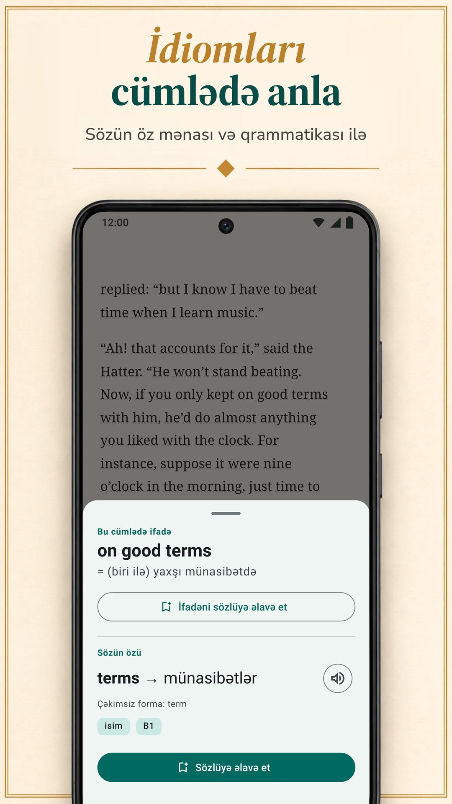

LingQ dili real məzmundan öyrənmək üzərində qurulub: 55-dən çox dildə səsli minlərlə dərs, e-kitablardan, YouTube-dan, Netflix-dən və podkastlardan idxal. Amma oxuyaraq öyrənməyin yeganə yolu o deyil və standart Premium planı buradakı digər tətbiqlərin standart planlarından bahadır. Bu səhifə LingQ-nu altı alternativlə oxuyaraq öyrənəndə vacib olan nöqtələrdə müqayisə edir: mətnlərin haradan gəlir, mənanı necə görürsən, sözlərə sonra nə olur və bunun qiyməti nədir. Biblyx bizim tətbiqimizdir, ona görə bu müqayisəni tərəflərdən birinin yazdığını bilərək oxu. Bizimki də daxil hər alternativ eyni qəliblə təqdim olunur: nəyi yaxşı edir, nəyi yaxşı etmir, qiyməti nədir və kimə uyğundur. Digər tətbiqlər haqqında hər fakt onların öz Google Play, App Store səhifələrindən və ya saytlarından götürülüb və 9 noyabr 2026-da yoxlanılıb.

## Əsas nəticələr

- **LingQ** 55-dən çox dildə səsli minlərlə dərslə öyrədir. Pulsuz planı məhduddur (LingQ-un bloquna görə 20 saxlanmış söz), Premium ayda 14,99 $ və ya ildə 119,99 $-dır.
- **Biblyx** öz EPUB, TXT və mətnli PDF kitablarını oxumaq üçün Android tətbiqidir: sözə toxunursan, onu həmin cümləyə görə izah edir, cümləni söz kartında saxlayır və reklam göstərmir. Premium ayda 4,99 $ və ya ildə 35,99 $-dır (Google Play, ABŞ); bu, LingQ, Linga, Beelinguapp və Readlang-ın standart aylıq və illik planlarından ucuzdur.
- **Öz kitablarını oxumaq üçün** Biblyx, Linga və Smart Book-a bax; LingQ da e-kitab idxal edir.
- **Mətnin yanında tərcümə istəyirsənsə**, Beelinguapp yeni başlayanlara, Smart Book öz kitablarına uyğundur; planlarını göstərən tətbiqlər arasında ən aşağı standart qiymətlər Smart Book-dadır.
- **Readable** yalnız ingilis dili üçündür, **Readlang** isə kompüterdə, brauzerdə oxumaq üçün.

## İnsanlar niyə LingQ alternativi axtarır

LingQ şöhrətinə layiqdir. 55-dən çox dil, mətni və səsi uyğun gələn minlərlə dərs, e-kitablardan, məqalələrdən, YouTube-dan, Netflix-dən və podkastlardan idxal və bildiyin sözlərin sayğacı var. Yenə də üç şey səni başqa tətbiq axtarmağa vadar edə bilər:

- **Qiymət.** Limitsiz söz axtarışı, təkrar və idxal Premium tələb edir: App Store-da ayda 14,99 $ və ya ildə 119,99 $, buradakı digər tətbiqlərin standart planlarından çox.
- **Mürəkkəblik.** Dərslər, idxal, statistika və süni intellekt alətləri güclü, amma qarışıq bir tətbiq yaradır; LingQ-un öz bloqu yazır ki, onu mənimsəmək Duolingo və Babbel-dən çətindir.
- **Öz kitabların.** Bəlkə heç dərs sistemi istəmirsən, sadəcə əlindəki kitablar üçün yaxşı oxuyucu istəyirsən.

## Sürətli müqayisə

| Tətbiq | Kimə uyğundur | Standart Premium qiyməti (ABŞ, 9 noyabr 2026) | Pulsuz versiya | Pulsuz versiyada reklam |
|---|---|---|---|---|
| LingQ (Android, iPhone, veb) | 55-dən çox dildə səsli dərslər, video və podkast idxalı | ayda 14,99 $, ildə 119,99 $ | 20 saxlanmış sözlə məhdud (LingQ-un bloquna görə) | yoxdur |
| **Biblyx** (Android) | öz kitablarını oxumaq, hər söz öz cümləsinə görə izah olunur | ayda 4,99 $, ildə 35,99 $ | oxu, söz kartları, ixrac və sinxronlaşma; süni intellekt tərcümələri gündəlik limitlə | yoxdur |
| Linga (Android, iPhone) | 1000-dən çox real kitablıq kitabxana, oyunlarla | ayda 5,49 $, ildə 54,99 $ | pulsuz yükləmə, PRO ödənişlidir | yoxdur |
| Beelinguapp (Android, iPhone) | yeni başlayanlar: mətnin yanında tərcümə, səsli kitablar | ayda 7,99 $, ildə 49,90 $ | pulsuz yükləmə | var |
| Smart Book (Android, iPhone) | öz kitablarının paralel tərcüməsi | ayda 1,99 $, ildə 19,99 $ | pulsuz yükləmə | var |
| Readable (Android; iPhone yoxlanılmayıb) | sadələşdirilmiş ingilis hekayələri və xəbərləri | tətbiqdaxili satınalmalar 1,99–55,99 $ | pulsuz yükləmə | var |
| Readlang (veb, Chrome əlavəsi) | kompüterdə, brauzerdə oxumaq | ayda 6 $, ildə 48 $ | limitsiz tək söz; gündə 10 ifadə tərcüməsi və 10 kontekst izahı | yoxlanılmayıb (Google Play tətbiqi yoxdur) |

Yalnız standart planlar: altı aylıq, ömürlük və kampaniya qiymətləri, həmçinin LingQ Premium Plus və Readlang Premium Plus kimi yuxarı paketlər daxil deyil. Qiymətlər LingQ, Linga, Beelinguapp və Smart Book üçün App Store-dan, Biblyx və Readable üçün Google Play-dən (Readable orada yalnız qiymət aralığı göstərir), Readlang üçün öz saytından götürülüb. Qiymətlər ölkəyə görə fərqlənir, sənin mağazan öz qiymətini göstərir.

## Hansı tətbiq sənə uyğundur?

| Məqsədin | Tətbiq |
|---|---|
| Əlindəki kitabları hər sözdə köməklə oxumaq | Biblyx; həmçinin Linga və Smart Book |
| Cümləyə uyğun mənanı görmək və həmin cümləni söz kartında saxlamaq | Biblyx |
| Çox dildə səsli dərslərlə öyrənmək | LingQ |
| Oyunlar və seriyalarla böyük real kitab kitabxanası | Linga |
| Sıfırdan, tərcümə mətnin yanında olanda başlamaq | Beelinguapp |
| Öz kitablarının tam paralel tərcüməsi | Smart Book |
| Yalnız ingilis dili, sadələşdirilmiş hekayələr və xəbərlər | Readable |
| Kompüterdə saytları oxumaq | Readlang |
| Sözlərini Anki-yə ixrac etmək | Biblyx və ya Smart Book |
| Pul ödəmədən reklamsız istifadə | Biblyx, LingQ və ya Linga |
| Planlarını göstərən tətbiqlər arasında ən aşağı standart qiymət | Smart Book, sonra Biblyx |

## Altı alternativ, bir-bir

### 1. Biblyx: öz kitablarını oxumaq üçün ən yaxşısı

Biblyx kurs deyil, öz kitabların üçün oxuyucudur. EPUB, TXT və ya mətnli PDF açırsan, ya da məqaləni yapışdırırsan və istənilən sözə toxunursan: süni intellekt cümləni oxuyur və orada uyğun gələn mənanı nitq hissəsi, əsas forma və təxmini CEFR səviyyəsi ilə verir.

- **Cümləyə görə məna:** idiomlar hər iki mənası ilə gəlir; alman, ispan, fransız, italyan və portuqal isimləri artikli ilə gəlir; mürəkkəb sözlər hissələrinə ayrılır.
- **Cümləni saxlayan kartlar:** saxladığın sözlər 1, 3, 7, 14 və 30 gün sonra yenidən gəlir; onları Anki və ya CSV-yə ixrac edə bilərsən.
- **Oflayn:** oxu və kart təkrarı internetsiz işləyir; yeni sözə baxmaq üçün internet lazımdır.
- **İlk rəf:** ilk dəqiqələrin üçün 10 dildə 29 qısa hekayə hazırdır.

Fikir bir sətrə sığır: **Öz kitablarını oxuyaraq dil öyrən**.

**Nəyi yaxşı edir:** seçdiyin kitabları cümləyə uyğun mənalarla və həmin cümləni saxlayan kartlarla oxumaq; pulsuz versiyada belə reklam yoxdur.

**Nəyi yaxşı etmir:** hələlik yalnız Android-dədir (iPhone versiyası planlaşdırılır, tarix yoxdur); dərs və ya səsli kitab yoxdur: mətnləri sən gətirirsən, söz və cümlələri telefonunun səsi oxuyur.

**Qiymət:** pulsuz versiyada oxu, söz kartları, ixrac və sinxronlaşma var, süni intellekt tərcümələri gündəlik limitlədir. Premium gündəlik limiti götürür (ədalətli istifadə qaydası ilə): Google Play-də (ABŞ) ayda 4,99 $, altı ayda 24,99 $ və ya ildə 35,99 $.

**Kimə uyğundur:** oxumaq istədiyi kitablar artıq əlində olanlara; 10 dil, üstəlik 4 dil betada.

**Sına:** [Google Play-də Biblyx](https://play.google.com/store/apps/details?id=com.biblyx.app&referrer=utm_source%3Dbiblyx.com%26utm_medium%3Dwebsite%26utm_campaign%3Dguide_lingq_alternatives_az_inline), ya da əvvəlcə [Biblyx oxuyucusunun necə işlədiyini](/az/tercumeli-kitab-oxuyucu/) oxu.

### 2. Linga: böyük real kitab kitabxanası üçün ən yaxşısı

Linga ispan, fransız, alman, italyan, rus və ingilis dillərində 1000-dən çox kitablıq kitabxanası olan oxuyucudur. Sözə və ya ifadəyə toxunub sinonimlər və qrammatika qeydləri ilə tərcümə və lüğət məlumatı görürsən, sözləri qeydlərlə saxlayıb aralıqlı təkrarlı kartlarla işləyirsən.

**Nəyi yaxşı edir:** böyük real kitab kitabxanası; öz EPUB, PDF, MOBI, FB2 və TXT fayllarını idxal; söz oyunları, gündəlik hədəflər və seriyalar; sözlər və cümlələr üçün ana dilində danışanların səsi, oflayn da.

**Nəyi yaxşı etmir:** altı dil öyrədir və səhifəsinə görə orta və yuxarı səviyyədəkilər üçündür.

**Qiymət:** ayda 5,49 $ və ya ildə 54,99 $; ömürlük giriş üçün birdəfəlik 109,99 $ (App Store, ABŞ).

**Kimə uyğundur:** bu altı dildən birini öyrənən və oyun elementlərini sevən orta səviyyədəkilərə.

### 3. Beelinguapp: tərcüməni həmişə gözünün qarşısında istəyən yeni başlayanlar üçün ən yaxşısı

Beelinguapp mətni və tərcüməsini yan-yana göstərir; ana dilində danışan diktorların oxuduğu səsli kitablar və səslə eyni anda sürüşən karaoke tərzli mətn var. Kitabxanası uşaq hekayələrindən Şerlok Holms kimi klassiklərə və gündəlik xəbərlərə qədər bütün səviyyələri əhatə edir və 20-dən çox dil təklif edir.

**Nəyi yaxşı edir:** asan başlanğıc: ilk gündən hər sətrin tərcüməsini görürsən, oxuyarkən dinləyirsən və hər hekayənin sonunda test həll edirsən.

**Nəyi yaxşı etmir:** səhifəsində öz kitablarını idxal etməkdən söz getmir; Google Play səhifəsində tətbiqdə reklam olduğu qeyd olunub.

**Qiymət:** ayda 7,99 $ və ya ildə 49,90 $ (App Store, ABŞ).

**Kimə uyğundur:** tərcüməni həmişə gözünün qarşısında istəyən yeni başlayanlara.

### 4. Smart Book: öz kitablarının paralel tərcüməsi üçün ən yaxşısı

Smart Book ikidilli oxuyucudur: öz FB2, EPUB və ya TXT kitablarında və subtitr fayllarında orijinal mətni və tərcüməsini yan-yana göstərir. Bir söz üçün xidməti özün seçirsən: Google Translate, DeepL, Reverso, Yandex və ya mənanı və qrammatikanı izah edən ChatGPT, Claude və Gemini kimi süni intellekt çat-botları.

**Nəyi yaxşı edir:** öz kitablarının tam tərcüməsi, tərcümə xidmətinin seçimi, saxlanmış sözlərin Anki və ya ReWord-a ixracı, oflayn oxu və planlarını göstərən tətbiqlər arasında ən aşağı standart qiymətlər.

**Nəyi yaxşı etmir:** Google Play səhifəsində reklam olduğu qeyd olunub; bizcə, ekranda tam tərcümə olanda öz dilində oxumağa keçmək asanlaşır.

**Qiymət:** ayda 1,99 $ və ya ildə 19,99 $ (App Store, ABŞ).

**Kimə uyğundur:** öz kitablarını tam paralel tərcümə ilə oxumaq istəyənlərə.

### 5. Readable: uyğunlaşdırılmış mətn istəyən ingilis dili öyrənənlər üçün ən yaxşısı

Readable yalnız ingilis dili öyrənənlər üçündür. Peşəkar müəllimlər qısa hekayələri və gündəlik xəbərləri sənin səviyyənə görə sadələşdirir, hər sözün səsi və tərcüməsi var, Word Trainer da saxladığın sözləri yadda saxlamağa kömək edir.

**Nəyi yaxşı edir:** artıq səviyyənə uyğunlaşdırılmış mətnlər, hər söz üçün səs.

**Nəyi yaxşı etmir:** yalnız ingilis dilini öyrədir, səhifəsində öz kitablarından söz getmir və Google Play səhifəsində reklam olduğu qeyd olunub.

**Qiymət:** tətbiqdaxili satınalmalar 1,99 $ ilə 55,99 $ arasında (Google Play, ABŞ); planları orada göstərilmir.

**Kimə uyğundur:** öz kitabları əvəzinə uyğunlaşdırılmış mətn istəyən ingilis dili öyrənənlərə.

### 6. Readlang: brauzerdə oxumaq üçün ən yaxşısı

Readlang veb brauzerdə və Chrome əlavəsi kimi işləyir. Mətndə və ya əksər saytlarda sözə və ya ifadəyə klikləyib tərcüməsini görürsən, süni intellekt söz və ifadələri kontekstə görə izah edir, tərcümə etdiyin hər söz də kartlarla məşq üçün saxlanılır və ixrac oluna bilir. Öz mətnlərini və məqalələrini yükləyə, ya da saytındakı məqalələri oxuya bilərsən.

**Nəyi yaxşı edir:** 100-dən çox dil, əksər saytlarda tərcümə və tək söz tərcüməsi limitsiz olan pulsuz plan.

**Nəyi yaxşı etmir:** Google Play-də Readlang tətbiqi yoxdur (saytında onu telefonun ana ekranına əlavə etməyi izah edən təlimata keçid var); pulsuz planda gündə 10 ifadə tərcüməsi və 10 kontekst izahı var.

**Qiymət:** ayda 6 $ və ya ildə 48 $ (öz saytı).

**Kimə uyğundur:** kompüterdə, brauzerdə çox oxuyanlara.

## Funksiyalar yan-yana

| Tətbiq | Öz faylların | Mənanı necə görürsən | Söz məşqi | Tətbiqdə oxu | Öyrənilən dillər |
|---|---|---|---|---|---|
| LingQ (Android, iPhone, veb) | e-kitab, veb məqalə, YouTube, Netflix, podkast | sözə kontekstdə baxmaq; süni intellekt alətləri | aralıqlı təkrar, bilinən söz sayğacı | səsli minlərlə dərs | 55+ |
| **Biblyx** (Android) | EPUB, TXT, mətnli PDF, yapışdırılan mətn | cümləyə uyğun süni intellekt mənası, idiomlar, isimlərin artikli | kitab cümləsini saxlayan kartlar, Anki və CSV ixracı | 29 qısa hekayə | 10, üstəlik 4 betada |
| Linga (Android, iPhone) | EPUB, PDF, MOBI, FB2, TXT | sözə və ya ifadəyə toxun: tərcümə və lüğət məlumatı | aralıqlı təkrarlı kartlar, oyunlar, seriyalar | 1000+ kitab | 6 |
| Beelinguapp (Android, iPhone) | səhifəsində qeyd olunmayıb | yan-yana tərcümə; sözə toxunanda lüğət mənası | hər hekayədən sonra test | ikidilli hekayələr və səsli kitablar | 20+ |
| Smart Book (Android, iPhone) | FB2, EPUB, TXT, .srt subtitr | paralel tərcümə; süni intellekt çat-botları da daxil xidmət seçimi | saxlanmış sözlər, Anki və ya ReWord-a ixrac | ikidilli hekayələr | ingilis, alman, fransız, ispan, italyan və digərləri |
| Readable (Android; iPhone yoxlanılmayıb) | qeyd olunmayıb; tətbiqdə ingiliscə hekayələr və xəbərlər | hər söz üçün səs və tərcümə | Word Trainer | sadələşdirilmiş hekayələr, gündəlik xəbərlər | ingilis |
| Readlang (veb, Chrome əlavəsi) | yüklədiyin mətnlər və məqalələr; əlavə ilə əksər veb səhifələr | sözə və ya ifadəyə klikləyəndə tərcümə; kontekstə görə süni intellekt izahları | söz kartları, ixrac | saytındakı məqalələr | 100+ |

## Yekun

Bizcə, LingQ buradakı ən geniş sistemdir: dərslər, səs və çox dil istəyirsənsə və qiyməti sənə uyğundursa, güclü seçimdir. Öz kitablarını Android-də, hər sözü öz cümləsinə görə izahla, reklamsız və daha aşağı qiymətə oxumaq istəyirsənsə, Biblyx-i sına. İki aləti birlikdə də işlədə bilərsən: dərslər və səs üçün LingQ, telefonundakı kitablar üçün Biblyx kimi oxuyucu. Linga böyük real kitab kitabxanası, Beelinguapp asan başlanğıc, Smart Book münasib qiymətli paralel oxuyucu, Readable uyğunlaşdırılmış ingilis dili, Readlang isə brauzer təklif edir. Ən sadə sınaq: eyni fəsli bir həftə iki tətbiqdə oxu və açmağa davam etdiyini seç.

## Necə yoxladıq

LingQ kimi oxu ilə öyrədən və Google Play-də 1 milyondan çox yükləməsi olan tətbiqləri seçdik (Linga, Beelinguapp, Smart Book, Readable), onlara brauzer aləti Readlang-ı və öz tətbiqimizi əlavə etdik. LingQ, Linga, Beelinguapp, Smart Book və Readable haqqında faktlar onların 9 noyabr 2026-da dərc olunmuş Google Play səhifələrindən (ABŞ mağazası, ingilis dilində) götürülüb: [LingQ](https://play.google.com/store/apps/details?id=com.linguist), [Linga](https://play.google.com/store/apps/details?id=io.linga), [Beelinguapp](https://play.google.com/store/apps/details?id=com.david.android.languageswitch), [Smart Book](https://play.google.com/store/apps/details?id=com.kursx.smartbook) və [Readable](https://play.google.com/store/apps/details?id=co.playlingo.readable). iPhone versiyaları və standart Premium qiymətləri həmin gün [LingQ](https://apps.apple.com/us/app/id379385811), [Linga](https://apps.apple.com/us/app/id1525101819), [Beelinguapp](https://apps.apple.com/us/app/id1225056371) və [Smart Book](https://apps.apple.com/us/app/id1278697399) üçün App Store (ABŞ) səhifələrindən, Readlang-ın faktları və qiymətləri [qiymət səhifəsindən](https://readlang.com/pricing), Biblyx və Readable-ın qiymətləri Google Play-dən (ABŞ) götürülüb. LingQ-un pulsuz plan həddi və öyrənmə çətinliyi haqqında sözü LingQ-un öz bloqundakı [Duolingo alternativləri](https://www.lingq.com/blog/duolingo-alternatives/) (15 iyun 2026-da yenilənib) və [ən yaxşı dil öyrənmə tətbiqləri](https://www.lingq.com/blog/best-language-learning-app/) (14 oktyabr 2026-da yenilənib) yazılarından götürülüb. Readable-ın iPhone versiyasını yoxlamamışıq. Bu səhifəni Biblyx-i hazırlayan Galbinur Guliyev yazıb. Qiymətlər dəyişir və ölkəyə görə fərqlənir; burada köhnəlmiş fakt görsən, support@biblyx.com ünvanına yaz, düzəldək.

## Tez-tez verilən suallar

### Ən ucuz LingQ alternativi hansıdır?

Planlarını göstərən tətbiqlər arasında ən aşağı standart qiymətlər Smart Book-dadır (ayda 1,99 $, ildə 19,99 $), ondan sonra Biblyx gəlir (ayda 4,99 $, ildə 35,99 $); hər ikisi ABŞ qiymətləridir. Pulsuz versiyasında reklam olmayan tətbiqlər arasında ən ucuzu Biblyx-dir; ən bahalısı isə ayda 14,99 $ ilə LingQ-un standart Premium-udur.

### Pulsuz LingQ alternativi varmı?

Buradakı hər tətbiqin pulsuz versiyası və ya pulsuz yükləməsi var. Biblyx-in pulsuz versiyasında oxu, söz kartları, ixrac və sinxronlaşma var, süni intellekt tərcümələri gündəlik limitlədir və reklam yoxdur. Readlang-ın pulsuz planında tək söz tərcüməsi limitsizdir, ifadə tərcüməsi gündə 10-dur. Linga, Beelinguapp, Smart Book və Readable ödənişli əlavələri olan pulsuz yükləmələrdir, son üçü reklam göstərir. LingQ-un öz bloqu pulsuz planının 20 saxlanmış sözlə məhdud olduğunu yazır.

### Android üçün Readlang alternativi varmı?

Readlang-ın Google Play-də tətbiqi yoxdur; saytında onu telefonun ana ekranına əlavə etməyi izah edən təlimata keçid var. Google Play-də Biblyx, Linga və Smart Book öz fayllarını açır və sözlərə toxunub mənasını görməyə imkan verir; LingQ da e-kitab və məqalə idxal edir.

### Öz kitablarımla işləyən LingQ alternativi varmı?

Bəli. Biblyx EPUB, TXT və mətnli PDF faylları ilə yapışdırılan mətni açır; Linga EPUB, PDF, MOBI, FB2 və TXT idxal edir; Smart Book FB2, EPUB və TXT-ni paralel tərcümə ilə açır. LingQ özü də e-kitab idxal edir.

### Bu tətbiqlərdən hansılarında reklam yoxdur?

Google Play səhifələrinə görə Biblyx, LingQ və Linga-da reklam yoxdur; Beelinguapp, Smart Book və Readable-da var. Google Play-dəki altı tətbiqin hamısında tətbiqdaxili satınalma var.

### Yeni başlayanlar üçün ən asanı hansıdır?

Tərcümə mətnin yanında durduğu üçün Beelinguapp; ingilis dili üçün isə hekayələr səviyyənə görə sadələşdirildiyi üçün Readable. Biblyx-də yeni başlayanlar qısa başlanğıc hekayələri ilə başlayır və yalnız lazım olan sözlərə toxunur. Linga özünü orta və yuxarı səviyyə üçün təqdim edir.

### Paralel tərcümə ilə cümləyə görə məna arasında fərq nədir?

Paralel tərcümə bütün mətni orijinalın yanında sənin dilində göstərir. Cümləyə görə məna isə yalnız toxunduğun sözü, içində olduğun cümləyə görə izah edir; beləliklə öyrəndiyin dildə oxumağa davam edirsən.

### Biblyx iPhone-da işləyirmi?

Hələ yox. Biblyx Google Play-də, Android üçündür; iOS versiyası planlaşdırılır, tarix yoxdur.
