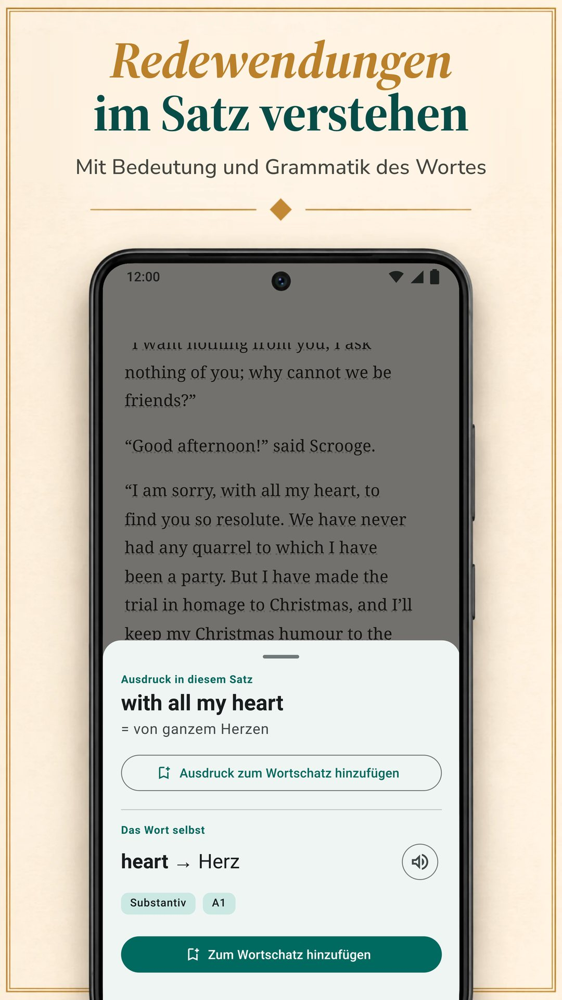

LingQ setzt darauf, eine Sprache mit echten Inhalten zu lernen: tausende Lektionen mit Audio in über 55 Sprachen und Import aus E-Books, YouTube, Netflix und Podcasts. Es ist aber nicht der einzige Weg, durch Lesen zu lernen, und sein Standard-Premium kostet mehr als die Standardtarife der anderen Apps hier. Diese Seite vergleicht LingQ mit sechs Alternativen in dem, was beim Lernen durch Lesen zählt: woher deine Texte kommen, wie du an Bedeutungen kommst, was danach mit deinen Wörtern passiert und was das kostet. Biblyx ist unsere App, lies diesen Vergleich also als einen, den einer der Anbieter geschrieben hat. Jede Alternative, unsere eingeschlossen, bekommt dasselbe Schema: was sie gut kann, was weniger, was sie kostet und für wen sie passt. Jede Angabe zu den anderen Apps stammt von ihren eigenen Google-Play-Seiten, App-Store-Seiten oder Websites, geprüft am 9. November 2026.

## Das Wichtigste in Kürze

- **LingQ** lehrt mit tausenden Lektionen mit Audio in über 55 Sprachen. Der kostenlose Tarif ist begrenzt (laut LingQs Blog auf 20 gespeicherte Wörter), Premium kostet 14,99 $ im Monat oder 119,99 $ im Jahr.
- **Biblyx** ist eine Android-App zum Lesen deiner eigenen EPUB-, TXT- und textbasierten PDF-Bücher: Du tippst auf ein Wort, es wird für genau diesen Satz erklärt, der Satz landet auf der Karteikarte, und Werbung gibt es keine. Premium kostet 4,99 $ im Monat oder 35,99 $ im Jahr (Google Play, USA), weniger als die Standard-Monats- und Jahrestarife von LingQ, Linga, Beelinguapp und Readlang.
- **Für deine eigenen Bücher** kommen Biblyx, Linga und Smart Book infrage; LingQ importiert ebenfalls E-Books.
- **Für eine Übersetzung neben dem Text** passt Beelinguapp zu Anfängern und Smart Book zu deinen eigenen Büchern; Smart Book hat die niedrigsten Standardpreise der Apps, die ihre Tarife angeben.
- **Readable** ist nur für Englisch, **Readlang** für das Lesen im Browser am Computer.

## Warum Leute eine LingQ-Alternative suchen

LingQ hat seinen Ruf verdient. Es deckt über 55 Sprachen ab, hat tausende Lektionen mit passendem Text und Audio, importiert E-Books, Artikel, YouTube, Netflix und Podcasts und zählt die Wörter, die du kennst. Drei Dinge können dich trotzdem nach etwas anderem suchen lassen:

- **Der Preis.** Unbegrenztes Nachschlagen, Wiederholen und Importieren gibt es nur mit Premium: 14,99 $ im Monat oder 119,99 $ im Jahr im App Store, mehr als die Standardtarife der anderen Apps hier.
- **Die Komplexität.** Lektionen, Import, Statistiken und KI-Werkzeuge machen die App mächtig, aber voll; LingQs eigener Blog schreibt, dass man sich in LingQ schwerer einarbeitet als in Duolingo oder Babbel.
- **Deine eigenen Bücher.** Vielleicht willst du gar kein Lektionssystem, sondern nur einen guten Reader für die Bücher, die du schon hast.

## Schnellvergleich

| App | Passt für | Standardpreis Premium (USA, 9. Nov. 2026) | Gratisversion | Werbung in der Gratisversion |
|---|---|---|---|---|
| LingQ (Android, iPhone, Web) | Lektionen mit Audio in über 55 Sprachen, Import von Videos und Podcasts | 14,99 $/Monat, 119,99 $/Jahr | auf 20 gespeicherte Wörter begrenzt (laut LingQs Blog) | nein |
| **Biblyx** (Android) | eigene Bücher lesen, jedes Wort für seinen Satz erklärt | 4,99 $/Monat, 35,99 $/Jahr | Lesen, Karteikarten, Export und Synchronisierung; KI-Übersetzungen mit Tageskontingent | nein |
| Linga (Android, iPhone) | eine Bibliothek mit über 1.000 echten Büchern, mit Spielen | 5,49 $/Monat, 54,99 $/Jahr | kostenloser Download, PRO ist kostenpflichtig | nein |
| Beelinguapp (Android, iPhone) | Anfänger: Übersetzung neben dem Text, Hörbücher | 7,99 $/Monat, 49,90 $/Jahr | kostenloser Download | ja |
| Smart Book (Android, iPhone) | eine Parallelübersetzung deiner eigenen Bücher | 1,99 $/Monat, 19,99 $/Jahr | kostenloser Download | ja |
| Readable (Android; iPhone nicht geprüft) | vereinfachte englische Geschichten und Nachrichten | In-App-Käufe 1,99–55,99 $ | kostenloser Download | ja |
| Readlang (Web, Chrome-Erweiterung) | Lesen im Browser am Computer | 6 $/Monat, 48 $/Jahr | einzelne Wörter unbegrenzt; 10 Phrasen-Übersetzungen und 10 Kontext-Erklärungen am Tag | nicht geprüft (keine App bei Google Play) |

Nur Standardtarife: Halbjahres-, Lifetime- und Aktionspreise sowie höhere Stufen wie LingQ Premium Plus und Readlang Premium Plus sind nicht berücksichtigt. Die Preise stammen für LingQ, Linga, Beelinguapp und Smart Book aus dem App Store, für Biblyx und Readable von Google Play (Readable zeigt dort nur eine Preisspanne) und für Readlang von dessen Website. Sie unterscheiden sich je nach Land; dein Store zeigt dir deinen Preis.

## Welche App passt zu dir?

| Dein Ziel | App |
|---|---|
| Bücher lesen, die du schon hast, mit Hilfe bei jedem Wort | Biblyx; außerdem Linga und Smart Book |
| Die Bedeutung sehen, die zum Satz passt, und diesen Satz auf der Karteikarte behalten | Biblyx |
| Mit Lektionen und Audio in vielen Sprachen lernen | LingQ |
| Eine große Bibliothek echter Bücher, mit Spielen und Serien | Linga |
| Bei null anfangen, mit der Übersetzung neben dem Text | Beelinguapp |
| Eine vollständige Parallelübersetzung deiner eigenen Bücher | Smart Book |
| Nur Englisch, mit vereinfachten Geschichten und Nachrichten | Readable |
| Websites am Computer lesen | Readlang |
| Wörter nach Anki exportieren | Biblyx oder Smart Book |
| Keine Werbung, ohne zu zahlen | Biblyx, LingQ oder Linga |
| Der niedrigste Standardpreis der Apps, die ihre Tarife angeben | Smart Book, dann Biblyx |

## Die sechs Alternativen im Einzelnen

### 1. Biblyx: am besten für deine eigenen Bücher

Biblyx ist kein Kurs, sondern ein Reader für deine eigenen Bücher. Du öffnest eine EPUB-, TXT- oder textbasierte PDF-Datei oder fügst einen Artikel ein und tippst auf ein Wort: Die KI liest den Satz und gibt dir die Bedeutung, die dort passt, samt Wortart, Grundform und geschätztem GER-Niveau.

- **Eine Bedeutung für den Satz:** Redewendungen kommen mit beiden Bedeutungen, deutsche, spanische, französische, italienische und portugiesische Substantive mit Artikel, und zusammengesetzte Wörter werden zerlegt.
- **Karten, die deinen Satz behalten:** Gespeicherte Wörter kommen nach 1, 3, 7, 14 und 30 Tagen wieder, und du kannst sie nach Anki oder als CSV exportieren.
- **Offline:** Lesen und Wiederholen der Karteikarten funktionieren ohne Verbindung; zum Nachschlagen eines neuen Wortes brauchst du eine.
- **Ein erstes Regal:** 29 Kurzgeschichten in 10 Sprachen für die ersten Minuten.

Die Idee passt in eine Zeile: **Sprachen lernen beim Lesen deiner eigenen Bücher**.

**Was sie gut kann:** die Bücher lesen, die du selbst wählst, mit Bedeutungen, die zum Satz passen, und Karten, die ihn behalten; keine Werbung, auch nicht in der Gratisversion.

**Was sie weniger gut kann:** Sie läuft vorerst nur auf Android (eine iPhone-Version ist geplant, ohne Termin), und es gibt keine Lektionen oder Hörbücher: Die Texte bringst du mit, Wörter und Sätze liest die Stimme deines Handys vor.

**Preis:** Die Gratisversion enthält Lesen, Karteikarten, Export und Synchronisierung, dazu ein Tageskontingent an KI-Übersetzungen. Premium hebt das Tageslimit auf (mit Fair Use): 4,99 $ im Monat, 24,99 $ für sechs Monate oder 35,99 $ im Jahr bei Google Play (USA).

**Passt für:** alle, die schon Bücher haben, die sie lesen wollen; 10 Sprachen, dazu 4 in der Beta.

**Ausprobieren:** [Biblyx bei Google Play](https://play.google.com/store/apps/details?id=com.biblyx.app&referrer=utm_source%3Dbiblyx.com%26utm_medium%3Dwebsite%26utm_campaign%3Dguide_lingq_alternatives_de_inline), oder lies zuerst, [wie der Biblyx-Reader funktioniert](/de/ebook-reader-mit-uebersetzung/).

### 2. Linga: am besten für eine große Bibliothek echter Bücher

Linga ist ein Reader mit einer Bibliothek aus über 1.000 Büchern auf Spanisch, Französisch, Deutsch, Italienisch, Russisch und Englisch. Du tippst auf ein Wort oder eine Phrase und bekommst eine Übersetzung und einen Wörterbucheintrag mit Synonymen und Grammatikhinweisen, speicherst Wörter mit Notizen und wiederholst sie mit Karteikarten nach dem Prinzip der verteilten Wiederholung.

**Was sie gut kann:** eine große Bibliothek echter Bücher; Import eigener EPUB-, PDF-, MOBI-, FB2- und TXT-Dateien; Vokabelspiele, Tagesziele und Serien; Aussprache von Muttersprachlern für Wörter und Sätze, auch offline.

**Was sie weniger gut kann:** Sie lehrt sechs Sprachen und richtet sich laut Beschreibung an Lernende mit mittlerem und fortgeschrittenem Niveau.

**Preis:** 5,49 $ im Monat oder 54,99 $ im Jahr, oder einmalig 109,99 $ für lebenslangen Zugang (App Store, USA).

**Passt für:** Lernende mit mittlerem Niveau in einer der sechs Sprachen, die Spielelemente mögen.

### 3. Beelinguapp: am besten für Anfänger, die die Übersetzung immer sehen wollen

Beelinguapp zeigt einen Text und seine Übersetzung nebeneinander, mit Hörbüchern, die Muttersprachler lesen, und Text im Karaoke-Stil, der synchron zum Audio mitläuft. Die Bibliothek für alle Niveaus reicht von Kindergeschichten über Klassiker wie Sherlock Holmes bis zu täglichen Nachrichten, in über 20 Sprachen.

**Was sie gut kann:** ein leichter Einstieg: Vom ersten Tag an siehst du die Übersetzung jeder Zeile, hörst beim Lesen zu und machst am Ende jeder Geschichte ein Quiz.

**Was sie weniger gut kann:** Ein Import eigener Bücher wird in der Beschreibung nicht erwähnt, und die Google-Play-Seite weist darauf hin, dass die App Werbung enthält.

**Preis:** 7,99 $ im Monat oder 49,90 $ im Jahr (App Store, USA).

**Passt für:** Anfänger, die die Übersetzung immer vor Augen haben wollen.

### 4. Smart Book: am besten für eine Parallelübersetzung deiner eigenen Bücher

Smart Book ist ein zweisprachiger Reader: Für deine eigenen FB2-, EPUB- oder TXT-Bücher und Untertiteldateien zeigt er Originaltext und Übersetzung nebeneinander. Für ein einzelnes Wort wählst du den Dienst: Google Translate, DeepL, Reverso, Yandex oder KI-Chatbots wie ChatGPT, Claude und Gemini, die Bedeutung und Grammatik erklären.

**Was sie gut kann:** eine vollständige Übersetzung deiner eigenen Bücher, die Wahl des Übersetzungsdienstes, Export gespeicherter Wörter nach Anki oder ReWord, Offline-Lesen und die niedrigsten Standardpreise der Apps, die ihre Tarife angeben.

**Was sie weniger gut kann:** Die Google-Play-Seite weist auf Werbung hin, und unserer Meinung nach verleitet eine vollständige Übersetzung auf dem Bildschirm leicht dazu, in der eigenen Sprache weiterzulesen.

**Preis:** 1,99 $ im Monat oder 19,99 $ im Jahr (App Store, USA).

**Passt für:** alle, die ihre eigenen Bücher mit vollständiger Parallelübersetzung lesen wollen.

### 5. Readable: am besten für Englischlernende, die angepasste Texte wollen

Readable ist nur für Englischlernende. Erfahrene Lehrkräfte vereinfachen kurze Geschichten und tägliche Nachrichten auf dein Niveau, jedes Wort hat Audio und eine Übersetzung, und ein Word Trainer hilft dir, gespeicherte Wörter zu behalten.

**Was sie gut kann:** Texte, die schon an dein Niveau angepasst sind, mit Audio für jedes Wort.

**Was sie weniger gut kann:** Sie lehrt nur Englisch, eigene Bücher werden in der Beschreibung nicht erwähnt, und die Google-Play-Seite weist auf Werbung hin.

**Preis:** In-App-Käufe von 1,99 $ bis 55,99 $ (Google Play, USA); die Tarife sind dort nicht aufgeführt.

**Passt für:** Englischlernende, die angepasste Texte statt eigener Bücher wollen.

### 6. Readlang: am besten für das Lesen im Browser

Readlang läuft im Webbrowser und als Chrome-Erweiterung. Du klickst in einem Text oder auf den meisten Websites auf ein Wort oder eine Phrase und bekommst die Übersetzung, eine KI erklärt Wörter und Phrasen im Kontext, und jedes übersetzte Wort wird für Karteikarten gespeichert, die du auch exportieren kannst. Du kannst eigene Texte und Artikel hochladen oder Artikel auf der Website lesen.

**Was sie gut kann:** über 100 Sprachen, Übersetzungen auf den meisten Websites und ein kostenloser Tarif mit unbegrenzten Übersetzungen einzelner Wörter.

**Was sie weniger gut kann:** Eine Readlang-App bei Google Play gibt es nicht (die Website verlinkt eine Anleitung, wie man Readlang auf den Startbildschirm des Handys legt), und der kostenlose Tarif erlaubt 10 Phrasen-Übersetzungen und 10 Kontext-Erklärungen am Tag.

**Preis:** 6 $ im Monat oder 48 $ im Jahr (laut Website).

**Passt für:** alle, die viel am Computer im Browser lesen.

## Funktionen im Überblick

| App | Eigene Dateien | Wie du an Bedeutungen kommst | Vokabeltraining | Lesestoff in der App | Sprachen zum Lernen |
|---|---|---|---|---|---|
| LingQ (Android, iPhone, Web) | E-Books, Webartikel, YouTube, Netflix, Podcasts | Wörter im Kontext nachschlagen; KI-Werkzeuge | Wiederholung in Intervallen, Zähler bekannter Wörter | tausende Lektionen mit Audio | 55+ |
| **Biblyx** (Android) | EPUB, TXT, textbasierte PDF, eingefügter Text | KI-Bedeutung passend zum Satz, Redewendungen, Artikel bei Substantiven | Karten mit dem Satz aus dem Buch, Export nach Anki und CSV | 29 Kurzgeschichten | 10, dazu 4 in der Beta |
| Linga (Android, iPhone) | EPUB, PDF, MOBI, FB2, TXT | Wort oder Phrase antippen: Übersetzung und Wörterbucheintrag | Karteikarten mit verteilter Wiederholung, Spiele, Serien | 1.000+ Bücher | 6 |
| Beelinguapp (Android, iPhone) | in der Beschreibung nicht erwähnt | Übersetzung nebeneinander; Wort antippen für die Wörterbuchbedeutung | Quiz nach jeder Geschichte | zweisprachige Geschichten und Hörbücher | 20+ |
| Smart Book (Android, iPhone) | FB2, EPUB, TXT, .srt-Untertitel | Parallelübersetzung; Wahl des Dienstes, auch KI-Chatbots | gespeicherte Wörter, Export nach Anki oder ReWord | zweisprachige Geschichten | Englisch, Deutsch, Französisch, Spanisch, Italienisch und weitere |
| Readable (Android; iPhone nicht geprüft) | nicht erwähnt; englische Geschichten und Nachrichten in der App | Audio und Übersetzung für jedes Wort | Word Trainer | vereinfachte Geschichten, tägliche Nachrichten | Englisch |
| Readlang (Web, Chrome-Erweiterung) | hochgeladene Texte und Artikel; die meisten Webseiten über die Erweiterung | Wort oder Phrase anklicken für eine Übersetzung; KI-Erklärungen im Kontext | Karteikarten, Export | Artikel auf der eigenen Website | 100+ |

## Fazit

Unserer Meinung nach ist LingQ hier das umfassendste System: Wenn du Lektionen, Audio und viele Sprachen willst und der Preis für dich passt, ist es eine starke Wahl. Wenn du deine eigenen Bücher auf Android lesen willst, mit jedem Wort für seinen Satz erklärt, ohne Werbung und günstiger, probier Biblyx aus. Du kannst auch zwei Werkzeuge kombinieren: LingQ für Lektionen und Audio und einen Reader wie Biblyx für die Bücher, die schon auf deinem Handy sind. Linga bietet eine große Bibliothek echter Bücher, Beelinguapp einen leichten Einstieg, Smart Book einen günstigen Parallel-Reader, Readable angepasstes Englisch und Readlang den Browser. Der einfachste Test: Lies eine Woche lang dasselbe Kapitel in zwei Apps und behalte die, die du immer wieder öffnest.

## Wie wir geprüft haben

Wir haben Apps ausgewählt, die wie LingQ über das Lesen lehren und bei Google Play über 1 Million Downloads haben (Linga, Beelinguapp, Smart Book, Readable), dazu das Browser-Werkzeug Readlang und unsere eigene App. Die Angaben zu LingQ, Linga, Beelinguapp, Smart Book und Readable stammen aus ihren Google-Play-Seiten (US-Store, auf Englisch) mit dem Stand vom 9. November 2026: [LingQ](https://play.google.com/store/apps/details?id=com.linguist), [Linga](https://play.google.com/store/apps/details?id=io.linga), [Beelinguapp](https://play.google.com/store/apps/details?id=com.david.android.languageswitch), [Smart Book](https://play.google.com/store/apps/details?id=com.kursx.smartbook) und [Readable](https://play.google.com/store/apps/details?id=co.playlingo.readable). Die iPhone-Versionen und die Standardpreise für Premium stammen vom selben Tag von den App-Store-Seiten (USA) von [LingQ](https://apps.apple.com/us/app/id379385811), [Linga](https://apps.apple.com/us/app/id1525101819), [Beelinguapp](https://apps.apple.com/us/app/id1225056371) und [Smart Book](https://apps.apple.com/us/app/id1278697399), die Angaben und Preise zu Readlang von [dessen Preisseite](https://readlang.com/pricing), die Preise von Biblyx und Readable von Google Play (USA). Die Begrenzung von LingQs Gratistarif und der Hinweis auf die Einarbeitung stammen aus LingQs eigenem Blog: aus den Beiträgen über [Duolingo-Alternativen](https://www.lingq.com/blog/duolingo-alternatives/) (aktualisiert am 15. Juni 2026) und über [die besten Sprachlern-Apps](https://www.lingq.com/blog/best-language-learning-app/) (aktualisiert am 14. Oktober 2026). Die iPhone-Version von Readable haben wir nicht geprüft. Diese Seite hat Galbinur Guliyev geschrieben, der Biblyx entwickelt. Preise ändern sich und unterscheiden sich je nach Land; wenn hier etwas veraltet ist, schreib an support@biblyx.com, dann korrigieren wir es.

## Häufige Fragen

### Welche LingQ-Alternative ist am günstigsten?

Unter den Apps, die ihre Tarife angeben, hat Smart Book die niedrigsten Standardpreise (1,99 $ im Monat, 19,99 $ im Jahr), danach kommt Biblyx (4,99 $ im Monat, 35,99 $ im Jahr), beides US-Preise. Unter den Apps ohne Werbung in der Gratisversion ist Biblyx am günstigsten; am teuersten ist LingQs Standard-Premium mit 14,99 $ im Monat.

### Gibt es eine kostenlose LingQ-Alternative?

Jede App hier hat eine Gratisversion oder einen kostenlosen Download. Die Gratisversion von Biblyx enthält Lesen, Karteikarten, Export und Synchronisierung, ein Tageskontingent an KI-Übersetzungen und keine Werbung. Im kostenlosen Tarif von Readlang sind Übersetzungen einzelner Wörter unbegrenzt, Phrasen-Übersetzungen auf 10 am Tag begrenzt. Linga, Beelinguapp, Smart Book und Readable sind kostenlose Downloads mit kostenpflichtigen Upgrades; die letzten drei zeigen Werbung. LingQs eigener Blog schreibt, dass sein Gratistarif auf 20 gespeicherte Wörter begrenzt ist.

### Gibt es eine Readlang-Alternative für Android?

Readlang hat keine App bei Google Play; die Website verlinkt eine Anleitung, wie man es auf den Startbildschirm des Handys legt. Bei Google Play öffnen Biblyx, Linga und Smart Book deine eigenen Dateien und zeigen dir die Bedeutung eines Wortes per Tipp, und LingQ importiert E-Books und Artikel.

### Gibt es eine LingQ-Alternative für meine eigenen Bücher?

Ja. Biblyx öffnet EPUB, TXT, textbasierte PDFs und eingefügten Text; Linga importiert EPUB, PDF, MOBI, FB2 und TXT; Smart Book öffnet FB2, EPUB und TXT mit Parallelübersetzung. LingQ selbst importiert ebenfalls E-Books.

### Welche dieser Apps haben keine Werbung?

Laut ihren Google-Play-Seiten enthalten Biblyx, LingQ und Linga keine Werbung, Beelinguapp, Smart Book und Readable schon. Alle sechs Apps bei Google Play bieten In-App-Käufe an.

### Welche App ist für Anfänger am einfachsten?

Beelinguapp, weil die Übersetzung neben dem Text steht, und für Englisch Readable, weil die Geschichten auf dein Niveau vereinfacht sind. In Biblyx beginnen Anfänger mit den kurzen Startgeschichten und tippen nur die Wörter an, die sie brauchen. Linga beschreibt sich als App für Lernende mit mittlerem und fortgeschrittenem Niveau.

### Was ist der Unterschied zwischen Parallelübersetzung und einer Bedeutung für den Satz?

Eine Parallelübersetzung zeigt den ganzen Text in deiner Sprache neben dem Original. Eine Bedeutung für den Satz zeigt nur das angetippte Wort, erklärt für den Satz, in dem du gerade bist, und so liest du in der Sprache weiter, die du lernst.

### Gibt es Biblyx für das iPhone?

Noch nicht. Biblyx gibt es für Android bei Google Play; eine iOS-Version ist geplant, ohne Termin.
