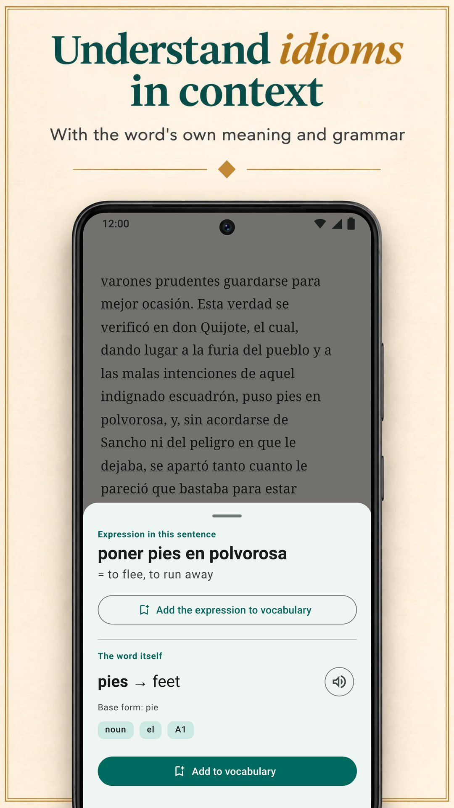

LingQ is built on learning a language from real content: thousands of lessons with audio in more than 55 languages, and imports from ebooks, YouTube, Netflix and podcasts. It isn't the only way to learn by reading, though, and its standard Premium plan costs more than the standard plans of the other apps here. This page compares LingQ with six alternatives on what matters when you learn by reading: where your texts come from, how you get meanings, what happens to your words afterwards, and what it costs. Biblyx is our app, so read this as a comparison written by one of the players. Every alternative, ours included, gets the same template: what it does well, what it does not do well, the price and who it is for. Every fact about the other apps comes from their own Google Play listings, App Store pages or websites, checked on 9 November 2026.

## Key takeaways

- **LingQ** teaches through thousands of lessons with audio in more than 55 languages. Its free plan is limited (to 20 saved words, says LingQ's blog), and Premium costs $14.99 a month or $119.99 a year.
- **Biblyx** is an Android app for reading your own EPUB, TXT and text-based PDF books: tap a word and it explains it for that sentence, keeps the sentence on the flashcard, and shows no ads. Premium costs $4.99 a month or $35.99 a year (Google Play, US), less than the standard monthly and yearly plans of LingQ, Linga, Beelinguapp and Readlang.
- **To read your own books**, look at Biblyx, Linga and Smart Book; LingQ imports ebooks too.
- **For a translation next to the text**, Beelinguapp suits beginners and Smart Book your own books; Smart Book has the lowest standard prices of the apps that list their plans.
- **Readable** is for English only, and **Readlang** is for reading in a browser on a computer.

## Why people look for a LingQ alternative

LingQ deserves its reputation. It covers more than 55 languages, has thousands of lessons with matching text and audio, imports ebooks, articles, YouTube, Netflix and podcasts, and counts the words you know. Three things can still make you look elsewhere:

- **Price.** Unlimited word lookups, review and imports need Premium: $14.99 a month or $119.99 a year on the App Store, more than the standard plans of the other apps here.
- **Complexity.** Lessons, imports, statistics and AI tools make a powerful but busy app; LingQ's own blog says it has a steeper learning curve than Duolingo or Babbel.
- **Your own books.** You may not want a lesson system at all, only a good reader for the books you already have.

## Quick comparison

| App | Best for | Standard premium price (US, checked 9 Nov 2026) | Free version | Ads in the free version |
|---|---|---|---|---|
| LingQ (Android, iPhone, web) | lessons with audio in 55+ languages, imports from videos and podcasts | $14.99/month, $119.99/year | limited to 20 saved words, says LingQ's blog | no |
| **Biblyx** (Android) | reading your own books, with each word explained for its sentence | $4.99/month, $35.99/year | reading, flashcards, export and sync; AI translations with a daily allowance | no |
| Linga (Android, iPhone) | a library of 1,000+ real books, with games | $5.49/month, $54.99/year | free download, PRO is paid | no |
| Beelinguapp (Android, iPhone) | beginners: the translation next to the text, audiobooks | $7.99/month, $49.90/year | free download | yes |
| Smart Book (Android, iPhone) | a parallel translation of your own books | $1.99/month, $19.99/year | free download | yes |
| Readable (Android; iPhone not checked) | simplified English stories and news | in-app purchases $1.99–$55.99 | free download | yes |
| Readlang (web, Chrome extension) | reading in the browser on a computer | $6/month, $48/year | unlimited single words; 10 phrase translations and 10 context explanations a day | not checked (no Google Play app) |

Standard plans only: six-month, lifetime and promotional prices, and higher tiers such as LingQ Premium Plus and Readlang Premium Plus, are left out. Prices come from the App Store for LingQ, Linga, Beelinguapp and Smart Book, from Google Play for Biblyx and Readable (Readable shows only a price range there) and from Readlang's website. They differ by country, and your store shows your own price.

## Which app is right for you?

| Your goal | App |
|---|---|
| Read the books you already have, with help on each word | Biblyx; also Linga and Smart Book |
| See the meaning that fits the sentence, and keep that sentence on your flashcards | Biblyx |
| Learn with lessons and audio in many languages | LingQ |
| A big library of real books, with games and streaks | Linga |
| Start from zero with the translation next to the text | Beelinguapp |
| A full parallel translation of your own books | Smart Book |
| English only, with simplified stories and news | Readable |
| Read websites on a computer | Readlang |
| Export your words to Anki | Biblyx or Smart Book |
| No ads without paying | Biblyx, LingQ or Linga |
| The lowest standard price of the apps that list their plans | Smart Book, then Biblyx |

## The six alternatives, one by one

### 1. Biblyx: best for reading your own books

Biblyx is a reader for your own books, not a course. You open an EPUB, TXT or text-based PDF, or paste an article, and tap any word: the AI reads the sentence and gives the meaning that fits there, with the part of speech, the base form and an estimated CEFR level.

- **A meaning for the sentence:** idioms come with both meanings, German, Spanish, French, Italian and Portuguese nouns come with their article, and compound words are split into parts.
- **Cards that keep your sentence:** saved words come back after 1, 3, 7, 14 and 30 days, and you can export them to Anki or CSV.
- **Offline:** reading and flashcard review work without a connection; looking up a new word needs one.
- **A first shelf:** 29 short stories in 10 languages for your first minutes.

The idea fits in one line: **Learn languages by reading your own books**.

**What it does well:** reading the books you choose, with meanings that fit the sentence and cards that keep it; no ads, even in the free version.

**What it does not do well:** it is on Android only for now (an iPhone version is planned, with no date), and it has no lessons or audiobooks: you bring the texts, and your phone's voice reads words and sentences aloud.

**Price:** the free version keeps reading, flashcards, export and sync, with a daily allowance of AI translations. Premium removes the daily limit (fair use applies): $4.99 a month, $24.99 for six months or $35.99 a year on Google Play (US).

**Best for:** learners who already have books they want to read, in 10 languages plus 4 in beta.

**Try it:** [Biblyx on Google Play](https://play.google.com/store/apps/details?id=com.biblyx.app&referrer=utm_source%3Dbiblyx.com%26utm_medium%3Dwebsite%26utm_campaign%3Dguide_lingq_alternatives_en_inline), or first read [how the Biblyx reader works](/epub-reader-with-translation/).

### 2. Linga: best for a big library of real books

Linga is a reader with a library of more than 1,000 books in Spanish, French, German, Italian, Russian and English. You tap a word or a phrase for a translation and a dictionary entry with synonyms and grammar notes, save words with notes and review them with spaced-repetition flashcards.

**What it does well:** a large library of real books, imports of your own EPUB, PDF, MOBI, FB2 and TXT files, vocabulary games, daily goals and streaks, and native audio for words and sentences, also offline.

**What it does not do well:** it teaches six languages, and its listing says it is meant for intermediate and advanced learners.

**Price:** $5.49 a month or $54.99 a year, or $109.99 once for lifetime access (App Store, US).

**Best for:** intermediate learners of its six languages who like a game layer.

### 3. Beelinguapp: best for beginners who want the translation in view

Beelinguapp shows a text and its translation side by side, with audiobooks read by native narrators and karaoke-style text that scrolls in sync with the audio. Its library ranges from children's stories and classics such as Sherlock Holmes to daily news, for all levels, in more than 20 languages.

**What it does well:** an easy start: you see the translation of every line from the first day, listen while you read and take a quiz at the end of each story.

**What it does not do well:** its listing doesn't mention importing your own books, and the Google Play page notes that the app contains ads.

**Price:** $7.99 a month or $49.90 a year (App Store, US).

**Best for:** beginners who want the translation always in view.

### 4. Smart Book: best for a parallel translation of your own books

Smart Book is a bilingual reader: it shows the original text and its translation side by side, for your own FB2, EPUB or TXT books and subtitle files. For a single word you choose the service: Google Translate, DeepL, Reverso, Yandex, or AI chatbots such as ChatGPT, Claude and Gemini that explain meaning and grammar.

**What it does well:** a full translation of your own books, a choice of translation services, export of saved words to Anki or ReWord, offline reading, and the lowest standard prices of the apps that list their plans.

**What it does not do well:** the Google Play page notes ads, and in our view a full translation on screen makes it easy to slip into reading your own language.

**Price:** $1.99 a month or $19.99 a year (App Store, US).

**Best for:** readers who want their own books with a full parallel translation.

### 5. Readable: best for English learners who want adapted texts

Readable is for learners of English only. Expert teachers simplify short stories and daily news to your level, every word has audio and a translation, and a Word Trainer helps you memorise the words you save.

**What it does well:** texts already adapted to your level, with audio for every word.

**What it does not do well:** it teaches English only, its listing doesn't mention your own books, and the Google Play page notes ads.

**Price:** in-app purchases from $1.99 to $55.99 (Google Play, US); its plans aren't listed there.

**Best for:** learners of English who want adapted texts rather than books of their own.

### 6. Readlang: best for reading in the browser

Readlang works in the web browser and as a Chrome extension. You click a word or a phrase in a text, or on most websites, to translate it, AI explains words and phrases in context, and every word you translate is saved for flashcard practice, which you can also export. You can upload your own texts and articles or read the articles on its site.

**What it does well:** more than 100 languages, translations on most websites, and a free plan with unlimited single-word translations.

**What it does not do well:** there is no Readlang app on Google Play (its site links a guide to adding it to a phone's home screen), and the free plan allows 10 phrase translations and 10 context explanations a day.

**Price:** $6 a month or $48 a year (its website).

**Best for:** learners who read a lot in the browser, on a computer.

## Features side by side

| App | Your own files | How you get meanings | Vocabulary practice | Built-in reading | Languages to learn |
|---|---|---|---|---|---|
| LingQ (Android, iPhone, web) | ebooks, web articles, YouTube, Netflix, podcasts | look up words in context; AI tools | spaced-repetition review, known-word count | thousands of lessons with audio | 55+ |
| **Biblyx** (Android) | EPUB, TXT, text-based PDF, pasted text | AI meaning fitted to the sentence, idioms, noun articles | cards with the book sentence, Anki and CSV export | 29 short stories | 10, plus 4 in beta |
| Linga (Android, iPhone) | EPUB, PDF, MOBI, FB2, TXT | tap a word or phrase: translation and dictionary entry | flashcards with spaced repetition, games, streaks | 1,000+ books | 6 |
| Beelinguapp (Android, iPhone) | not mentioned in its listing | translation side by side; tap a word for a dictionary meaning | quizzes after each story | bilingual stories and audiobooks | 20+ |
| Smart Book (Android, iPhone) | FB2, EPUB, TXT, .srt subtitles | parallel translation; a choice of services, including AI chatbots | saved words, export to Anki or ReWord | bilingual stories | English, German, French, Spanish, Italian and more |
| Readable (Android; iPhone not checked) | not mentioned; English stories and news in the app | audio and translation for every word | Word Trainer | simplified stories, daily news | English |
| Readlang (web, Chrome extension) | texts and articles you upload; most web pages through the extension | click a word or phrase to translate it; AI explanations in context | flashcards, export | articles on its site | 100+ |

## The bottom line

In our view, LingQ is the most complete system here: if you want lessons, audio and many languages and the price suits you, it is a strong choice. If you want to read your own books on Android, with each word explained for its sentence, no ads and a lower price, try Biblyx. You can also combine two tools: LingQ for lessons and audio, and a reader such as Biblyx for the books already on your phone. Linga brings a big library of real books, Beelinguapp an easy start, Smart Book a low-priced parallel reader, Readable adapted English and Readlang the browser. The simplest test: read the same chapter in two apps for a week, and keep the one you keep opening.

## How we checked

We chose apps that, like LingQ, teach through reading and have more than 1 million downloads on Google Play (Linga, Beelinguapp, Smart Book, Readable), plus the browser tool Readlang and our own app. Facts about LingQ, Linga, Beelinguapp, Smart Book and Readable come from their Google Play listings (US store, in English) as published on 9 November 2026: [LingQ](https://play.google.com/store/apps/details?id=com.linguist), [Linga](https://play.google.com/store/apps/details?id=io.linga), [Beelinguapp](https://play.google.com/store/apps/details?id=com.david.android.languageswitch), [Smart Book](https://play.google.com/store/apps/details?id=com.kursx.smartbook) and [Readable](https://play.google.com/store/apps/details?id=co.playlingo.readable). The iPhone versions and standard premium prices come from the App Store pages (US) of [LingQ](https://apps.apple.com/us/app/id379385811), [Linga](https://apps.apple.com/us/app/id1525101819), [Beelinguapp](https://apps.apple.com/us/app/id1225056371) and [Smart Book](https://apps.apple.com/us/app/id1278697399) the same day, Readlang's facts and prices from [its pricing page](https://readlang.com/pricing), and Biblyx's and Readable's prices from Google Play (US). LingQ's free-plan limit and its learning-curve remark come from LingQ's own blog posts on [Duolingo alternatives](https://www.lingq.com/blog/duolingo-alternatives/) (updated 15 June 2026) and [the best language learning apps](https://www.lingq.com/blog/best-language-learning-app/) (updated 14 October 2026). We didn't check Readable's iPhone version. This page was written by Galbinur Guliyev, who builds Biblyx. Prices change and differ by country; if something here is out of date, write to support@biblyx.com and we will correct it.

## Frequently asked questions

### What is the cheapest LingQ alternative?

Of the apps that list their plans, Smart Book has the lowest standard prices ($1.99 a month, $19.99 a year), then Biblyx ($4.99 a month, $35.99 a year), both US prices. Among the apps whose free version has no ads, Biblyx costs the least; LingQ's standard Premium, at $14.99 a month, costs the most.

### Is there a free LingQ alternative?

Every app here has a free version or a free download. Biblyx's free version keeps reading, flashcards, export and sync, with a daily allowance of AI translations and no ads. Readlang's free plan has unlimited single-word translations and 10 phrase translations a day. Linga, Beelinguapp, Smart Book and Readable are free downloads with paid upgrades, and the last three show ads. LingQ's own blog says its free plan is limited to 20 saved words.

### Is there a Readlang alternative for Android?

Readlang has no app on Google Play; its site links a guide to adding it to a phone's home screen. On Google Play, Biblyx, Linga and Smart Book open your own files and let you tap words for their meaning, and LingQ imports ebooks and articles.

### Is there a LingQ alternative that works with my own books?

Yes. Biblyx opens EPUB, TXT and text-based PDF files and pasted text; Linga imports EPUB, PDF, MOBI, FB2 and TXT; Smart Book loads FB2, EPUB and TXT with a parallel translation. LingQ itself also imports ebooks.

### Which of these apps has no ads?

According to their Google Play pages, Biblyx, LingQ and Linga don't contain ads; Beelinguapp, Smart Book and Readable do. All six apps on Google Play offer in-app purchases.

### Which app is the easiest for beginners?

Beelinguapp, because the translation stays next to the text, and Readable for English, because its stories are simplified to your level. In Biblyx, beginners start with the short starter stories and tap only the words they need. Linga describes itself as for intermediate and advanced learners.

### What is the difference between a parallel translation and a meaning for the sentence?

A parallel translation shows the whole text in your language next to the original. A meaning for the sentence shows only the word you tapped, explained for the sentence you are in, so you keep reading in the language you are learning.

### Does Biblyx work on iPhone?

Not yet. Biblyx is on Android through Google Play; an iOS version is planned, with no date.
