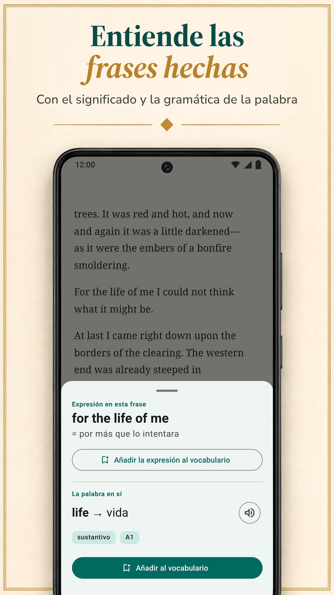

LingQ se basa en aprender un idioma con contenido real: miles de lecciones con audio en más de 55 idiomas e importación de libros electrónicos, YouTube, Netflix y pódcasts. Pero no es la única forma de aprender leyendo, y su Premium estándar cuesta más que los planes estándar de las demás apps de esta página. Aquí comparamos LingQ con seis alternativas en lo que importa cuando aprendes leyendo: de dónde salen tus textos, cómo obtienes los significados, qué pasa después con tus palabras y cuánto cuesta. Biblyx es nuestra app, así que lee esta comparación sabiendo que la ha escrito una de las partes. Cada alternativa, la nuestra incluida, sigue el mismo esquema: qué hace bien, qué no hace tan bien, cuánto cuesta y para quién es. Todos los datos sobre las demás apps salen de sus propias páginas de Google Play, de la App Store o de sus webs, comprobados el 9 de noviembre de 2026.

## Lo esencial

- **LingQ** enseña con miles de lecciones con audio en más de 55 idiomas. Su plan gratuito es limitado (a 20 palabras guardadas, según el blog de LingQ), y Premium cuesta 14,99 $ al mes o 119,99 $ al año.
- **Biblyx** es una app para Android con la que lees tus propios libros en EPUB, TXT y PDF con texto: tocas una palabra y te la explica para esa frase, guarda la frase en la tarjeta y no muestra anuncios. Premium cuesta 4,99 $ al mes o 35,99 $ al año (Google Play, EE. UU.), menos que los planes estándar mensuales y anuales de LingQ, Linga, Beelinguapp y Readlang.
- **Para leer tus propios libros**, mira Biblyx, Linga y Smart Book; LingQ también importa libros electrónicos.
- **Si quieres la traducción junto al texto**, Beelinguapp encaja con principiantes y Smart Book con tus propios libros; Smart Book tiene los precios estándar más bajos de las apps que publican sus planes.
- **Readable** es solo para inglés, y **Readlang**, para leer en el navegador del ordenador.

## Por qué se busca una alternativa a LingQ

LingQ se ha ganado su fama. Cubre más de 55 idiomas, tiene miles de lecciones con texto y audio, importa libros electrónicos, artículos, YouTube, Netflix y pódcasts, y cuenta las palabras que conoces. Aun así, hay tres cosas que pueden hacerte buscar otra opción:

- **El precio.** Las búsquedas, los repasos y las importaciones ilimitados necesitan Premium: 14,99 $ al mes o 119,99 $ al año en la App Store, más que los planes estándar de las demás apps de aquí.
- **La complejidad.** Lecciones, importaciones, estadísticas y herramientas de IA hacen de LingQ una app potente pero cargada; el propio blog de LingQ dice que su curva de aprendizaje es más pronunciada que la de Duolingo o Babbel.
- **Tus propios libros.** Quizá no quieras ningún sistema de lecciones, solo un buen lector para los libros que ya tienes.

## Comparación rápida

| App | Ideal para | Precio estándar de Premium (EE. UU., 9 nov. 2026) | Versión gratuita | Anuncios en la versión gratuita |
|---|---|---|---|---|
| LingQ (Android, iPhone, web) | lecciones con audio en más de 55 idiomas, importación de vídeos y pódcasts | 14,99 $/mes, 119,99 $/año | limitada a 20 palabras guardadas, según el blog de LingQ | no |
| **Biblyx** (Android) | leer tus propios libros, con cada palabra explicada para su frase | 4,99 $/mes, 35,99 $/año | lectura, tarjetas, exportación y sincronización; traducciones de IA con un cupo diario | no |
| Linga (Android, iPhone) | una biblioteca de más de 1000 libros reales, con juegos | 5,49 $/mes, 54,99 $/año | descarga gratuita, PRO es de pago | no |
| Beelinguapp (Android, iPhone) | principiantes: la traducción junto al texto, audiolibros | 7,99 $/mes, 49,90 $/año | descarga gratuita | sí |
| Smart Book (Android, iPhone) | una traducción paralela de tus propios libros | 1,99 $/mes, 19,99 $/año | descarga gratuita | sí |
| Readable (Android; iPhone sin comprobar) | relatos y noticias en inglés simplificados | compras dentro de la app de 1,99 a 55,99 $ | descarga gratuita | sí |
| Readlang (web, extensión de Chrome) | leer en el navegador del ordenador | 6 $/mes, 48 $/año | palabras sueltas ilimitadas; 10 traducciones de frases y 10 explicaciones de contexto al día | sin comprobar (no hay app en Google Play) |

Solo planes estándar: no se incluyen los precios semestrales, de por vida ni promocionales, ni niveles superiores como LingQ Premium Plus y Readlang Premium Plus. Los precios de LingQ, Linga, Beelinguapp y Smart Book salen de la App Store; los de Biblyx y Readable, de Google Play (Readable solo muestra allí un rango de precios), y los de Readlang, de su web. Cambian según el país, y tu tienda te muestra tu propio precio.

## ¿Qué app te conviene?

| Tu objetivo | App |
|---|---|
| Leer los libros que ya tienes, con ayuda en cada palabra | Biblyx; también Linga y Smart Book |
| Ver el significado que encaja en la frase y conservar esa frase en tus tarjetas | Biblyx |
| Aprender con lecciones y audio en muchos idiomas | LingQ |
| Una gran biblioteca de libros reales, con juegos y rachas | Linga |
| Empezar de cero con la traducción junto al texto | Beelinguapp |
| Una traducción paralela completa de tus propios libros | Smart Book |
| Solo inglés, con relatos y noticias simplificados | Readable |
| Leer webs en el ordenador | Readlang |
| Exportar tus palabras a Anki | Biblyx o Smart Book |
| Sin anuncios y sin pagar | Biblyx, LingQ o Linga |
| El precio estándar más bajo de las apps que publican sus planes | Smart Book, y después Biblyx |

## Las seis alternativas, una a una

### 1. Biblyx: la mejor para leer tus propios libros

Biblyx no es un curso, sino un lector para tus propios libros. Abres un EPUB, un TXT o un PDF con texto, o pegas un artículo, y tocas cualquier palabra: la IA lee la frase y da el significado que encaja ahí, con su categoría gramatical, su forma base y un nivel MCER estimado.

- **Un significado para la frase:** los modismos muestran los dos significados, los sustantivos en alemán, español, francés, italiano y portugués aparecen con su artículo y las palabras compuestas se separan en partes.
- **Tarjetas que conservan tu frase:** las palabras guardadas vuelven al cabo de 1, 3, 7, 14 y 30 días, y puedes exportarlas a Anki o CSV.
- **Sin conexión:** leer y repasar las tarjetas funcionan sin internet; para consultar una palabra nueva hace falta conexión.
- **Una primera estantería:** 29 relatos cortos en 10 idiomas para los primeros minutos.

La idea cabe en una línea: **Aprende idiomas leyendo tus propios libros**.

**Qué hace bien:** leer los libros que tú eliges, con significados que encajan en la frase y tarjetas que la conservan; sin anuncios, ni siquiera en la versión gratuita.

**Qué no hace tan bien:** por ahora solo está en Android (hay prevista una versión para iPhone, sin fecha), y no tiene lecciones ni audiolibros: los textos los pones tú, y la voz de tu móvil lee las palabras y las frases en voz alta.

**Precio:** la versión gratuita incluye lectura, tarjetas, exportación y sincronización, con un cupo diario de traducciones de IA. Premium quita el límite diario (con uso razonable): 4,99 $ al mes, 24,99 $ por seis meses o 35,99 $ al año en Google Play (EE. UU.).

**Ideal para:** quien ya tiene libros que quiere leer; 10 idiomas, más 4 en beta.

**Pruébala:** [Biblyx en Google Play](https://play.google.com/store/apps/details?id=com.biblyx.app&referrer=utm_source%3Dbiblyx.com%26utm_medium%3Dwebsite%26utm_campaign%3Dguide_lingq_alternatives_es_inline), o lee antes [cómo funciona el lector de Biblyx](/es/app-para-leer-libros-en-ingles/).

### 2. Linga: la mejor para una gran biblioteca de libros reales

Linga es un lector con una biblioteca de más de 1000 libros en español, francés, alemán, italiano, ruso e inglés. Tocas una palabra o una frase y ves una traducción y una entrada de diccionario con sinónimos y notas de gramática, guardas palabras con notas y las repasas con tarjetas de repetición espaciada.

**Qué hace bien:** una gran biblioteca de libros reales; importación de tus propios EPUB, PDF, MOBI, FB2 y TXT; juegos de vocabulario, metas diarias y rachas; audio de hablantes nativos para palabras y frases, también sin conexión.

**Qué no hace tan bien:** enseña seis idiomas, y según su ficha está pensada para nivel intermedio y avanzado.

**Precio:** 5,49 $ al mes o 54,99 $ al año, o un pago único de 109,99 $ por acceso de por vida (App Store, EE. UU.).

**Ideal para:** estudiantes de nivel intermedio de sus seis idiomas a quienes les gustan los juegos.

### 3. Beelinguapp: la mejor para principiantes que quieren la traducción a la vista

Beelinguapp muestra un texto y su traducción uno al lado del otro, con audiolibros leídos por narradores nativos y texto tipo karaoke que avanza sincronizado con el audio. Su biblioteca va desde cuentos infantiles y clásicos como Sherlock Holmes hasta noticias diarias, para todos los niveles, en más de 20 idiomas.

**Qué hace bien:** un comienzo fácil: desde el primer día ves la traducción de cada línea, escuchas mientras lees y haces una prueba al final de cada historia.

**Qué no hace tan bien:** su ficha no menciona importar tus propios libros, y la página de Google Play indica que la app contiene anuncios.

**Precio:** 7,99 $ al mes o 49,90 $ al año (App Store, EE. UU.).

**Ideal para:** principiantes que quieren la traducción siempre a la vista.

### 4. Smart Book: la mejor para una traducción paralela de tus propios libros

Smart Book es un lector bilingüe: con tus propios libros en FB2, EPUB o TXT y con archivos de subtítulos muestra el texto original y su traducción en paralelo. Para una palabra eliges el servicio: Google Translate, DeepL, Reverso, Yandex o chatbots de IA como ChatGPT, Claude y Gemini que explican significado y gramática.

**Qué hace bien:** una traducción completa de tus propios libros, la elección del servicio de traducción, la exportación de las palabras guardadas a Anki o ReWord, la lectura sin conexión y los precios estándar más bajos de las apps que publican sus planes.

**Qué no hace tan bien:** la página de Google Play indica anuncios y, en nuestra opinión, con la traducción completa en pantalla es fácil acabar leyendo en tu propio idioma.

**Precio:** 1,99 $ al mes o 19,99 $ al año (App Store, EE. UU.).

**Ideal para:** quien quiere leer sus propios libros con una traducción paralela completa.

### 5. Readable: la mejor para quien aprende inglés con textos adaptados

Readable es solo para quien aprende inglés. Profesores expertos simplifican relatos cortos y noticias diarias a tu nivel, cada palabra tiene audio y traducción, y un Word Trainer te ayuda a memorizar las palabras que guardas.

**Qué hace bien:** textos ya adaptados a tu nivel, con audio para cada palabra.

**Qué no hace tan bien:** solo enseña inglés, su ficha no menciona tus propios libros y la página de Google Play indica anuncios.

**Precio:** compras dentro de la app de 1,99 $ a 55,99 $ (Google Play, EE. UU.); allí no se detallan sus planes.

**Ideal para:** quien aprende inglés y prefiere textos adaptados en lugar de libros propios.

### 6. Readlang: la mejor para leer en el navegador

Readlang funciona en el navegador y como extensión de Chrome. Haces clic en una palabra o una frase de un texto o de la mayoría de las webs para traducirla, la IA explica palabras y frases en su contexto, y cada palabra que traduces se guarda para practicarla con tarjetas, que también puedes exportar. Puedes subir tus propios textos y artículos o leer los artículos de su web.

**Qué hace bien:** más de 100 idiomas, traducciones en la mayoría de las webs y un plan gratuito con traducciones ilimitadas de palabras sueltas.

**Qué no hace tan bien:** no hay app de Readlang en Google Play (su web enlaza una guía para añadirla a la pantalla de inicio del móvil), y el plan gratuito permite 10 traducciones de frases y 10 explicaciones de contexto al día.

**Precio:** 6 $ al mes o 48 $ al año (su web).

**Ideal para:** quien lee mucho en el navegador, en el ordenador.

## Funciones lado a lado

| App | Tus propios archivos | Cómo obtienes los significados | Práctica de vocabulario | Lectura incluida | Idiomas para aprender |
|---|---|---|---|---|---|
| LingQ (Android, iPhone, web) | libros electrónicos, artículos web, YouTube, Netflix, pódcasts | buscar palabras en contexto; herramientas de IA | repaso espaciado, contador de palabras conocidas | miles de lecciones con audio | 55+ |
| **Biblyx** (Android) | EPUB, TXT, PDF con texto, texto pegado | significado de IA ajustado a la frase, modismos, artículos de los sustantivos | tarjetas con la frase del libro, exportación a Anki y CSV | 29 relatos cortos | 10, más 4 en beta |
| Linga (Android, iPhone) | EPUB, PDF, MOBI, FB2, TXT | tocar una palabra o frase: traducción y entrada de diccionario | tarjetas con repetición espaciada, juegos, rachas | más de 1000 libros | 6 |
| Beelinguapp (Android, iPhone) | no lo menciona su ficha | traducción en paralelo; tocar una palabra da su significado de diccionario | pruebas tras cada historia | historias bilingües y audiolibros | 20+ |
| Smart Book (Android, iPhone) | FB2, EPUB, TXT, subtítulos .srt | traducción paralela; elección de servicio, incluidos chatbots de IA | palabras guardadas, exportación a Anki o ReWord | historias bilingües | inglés, alemán, francés, español, italiano y más |
| Readable (Android; iPhone sin comprobar) | no se menciona; relatos y noticias en inglés dentro de la app | audio y traducción para cada palabra | Word Trainer | relatos simplificados, noticias diarias | inglés |
| Readlang (web, extensión de Chrome) | textos y artículos que subes; la mayoría de las páginas web con la extensión | clic en una palabra o frase para traducirla; explicaciones de IA en contexto | tarjetas, exportación | artículos en su web | 100+ |

## En resumen

En nuestra opinión, LingQ es el sistema más completo de esta lista: si quieres lecciones, audio y muchos idiomas y el precio te encaja, es una opción sólida. Si quieres leer tus propios libros en Android, con cada palabra explicada para su frase, sin anuncios y por menos dinero, prueba Biblyx. También puedes combinar dos herramientas: LingQ para lecciones y audio, y un lector como Biblyx para los libros que ya tienes en el móvil. Linga aporta una gran biblioteca de libros reales; Beelinguapp, un comienzo fácil; Smart Book, un lector paralelo barato; Readable, inglés adaptado, y Readlang, el navegador. La prueba más sencilla: lee el mismo capítulo en dos apps durante una semana y quédate con la que sigues abriendo.

## Cómo lo comprobamos

Elegimos apps que, como LingQ, enseñan a través de la lectura y tienen más de un millón de descargas en Google Play (Linga, Beelinguapp, Smart Book, Readable), además de la herramienta de navegador Readlang y nuestra propia app. Los datos sobre LingQ, Linga, Beelinguapp, Smart Book y Readable salen de sus páginas de Google Play (tienda de EE. UU., en inglés) tal como estaban publicadas el 9 de noviembre de 2026: [LingQ](https://play.google.com/store/apps/details?id=com.linguist), [Linga](https://play.google.com/store/apps/details?id=io.linga), [Beelinguapp](https://play.google.com/store/apps/details?id=com.david.android.languageswitch), [Smart Book](https://play.google.com/store/apps/details?id=com.kursx.smartbook) y [Readable](https://play.google.com/store/apps/details?id=co.playlingo.readable). Las versiones para iPhone y los precios estándar de Premium salen ese mismo día de las páginas de la App Store (EE. UU.) de [LingQ](https://apps.apple.com/us/app/id379385811), [Linga](https://apps.apple.com/us/app/id1525101819), [Beelinguapp](https://apps.apple.com/us/app/id1225056371) y [Smart Book](https://apps.apple.com/us/app/id1278697399); los datos y precios de Readlang, de [su página de precios](https://readlang.com/pricing), y los precios de Biblyx y Readable, de Google Play (EE. UU.). El límite del plan gratuito de LingQ y su comentario sobre la curva de aprendizaje salen del propio blog de LingQ: los artículos sobre [alternativas a Duolingo](https://www.lingq.com/blog/duolingo-alternatives/) (actualizado el 15 de junio de 2026) y sobre [las mejores apps para aprender idiomas](https://www.lingq.com/blog/best-language-learning-app/) (actualizado el 14 de octubre de 2026). No comprobamos la versión para iPhone de Readable. Esta página la ha escrito Galbinur Guliyev, que desarrolla Biblyx. Los precios cambian y varían según el país; si algo de aquí está desactualizado, escribe a support@biblyx.com y lo corregimos.

## Preguntas frecuentes

### ¿Cuál es la alternativa a LingQ más barata?

De las apps que publican sus planes, Smart Book tiene los precios estándar más bajos (1,99 $ al mes, 19,99 $ al año), y después va Biblyx (4,99 $ al mes, 35,99 $ al año); los dos son precios de EE. UU. Entre las apps cuya versión gratuita no tiene anuncios, Biblyx es la que menos cuesta; el Premium estándar de LingQ, a 14,99 $ al mes, es el que más.

### ¿Hay una alternativa gratuita a LingQ?

Todas las apps de aquí tienen una versión gratuita o una descarga gratuita. La versión gratuita de Biblyx incluye lectura, tarjetas, exportación y sincronización, con un cupo diario de traducciones de IA y sin anuncios. El plan gratuito de Readlang tiene traducciones ilimitadas de palabras sueltas y 10 traducciones de frases al día. Linga, Beelinguapp, Smart Book y Readable son descargas gratuitas con mejoras de pago, y las tres últimas muestran anuncios. El propio blog de LingQ dice que su plan gratuito está limitado a 20 palabras guardadas.

### ¿Hay una alternativa a Readlang para Android?

Readlang no tiene app en Google Play; su web enlaza una guía para añadirla a la pantalla de inicio del móvil. En Google Play, Biblyx, Linga y Smart Book abren tus propios archivos y te dejan tocar palabras para ver su significado, y LingQ importa libros electrónicos y artículos.

### ¿Hay una alternativa a LingQ que funcione con mis propios libros?

Sí. Biblyx abre EPUB, TXT, PDF con texto y texto pegado; Linga importa EPUB, PDF, MOBI, FB2 y TXT; Smart Book abre FB2, EPUB y TXT con traducción paralela. El propio LingQ también importa libros electrónicos.

### ¿Cuáles de estas apps no tienen anuncios?

Según sus páginas de Google Play, Biblyx, LingQ y Linga no tienen anuncios; Beelinguapp, Smart Book y Readable sí. Las seis apps de Google Play ofrecen compras dentro de la app.

### ¿Qué app es la más fácil para principiantes?

Beelinguapp, porque la traducción está junto al texto, y Readable para inglés, porque sus relatos están simplificados a tu nivel. En Biblyx, los principiantes empiezan con los relatos cortos de inicio y tocan solo las palabras que necesitan. Linga se presenta como una app para nivel intermedio y avanzado.

### ¿Qué diferencia hay entre una traducción paralela y un significado para la frase?

Una traducción paralela muestra todo el texto en tu idioma junto al original. Un significado para la frase muestra solo la palabra que tocaste, explicada para la frase en la que estás, así que sigues leyendo en el idioma que aprendes.

### ¿Biblyx funciona en iPhone?

Todavía no. Biblyx está en Android a través de Google Play; la versión para iOS está prevista, sin fecha.
