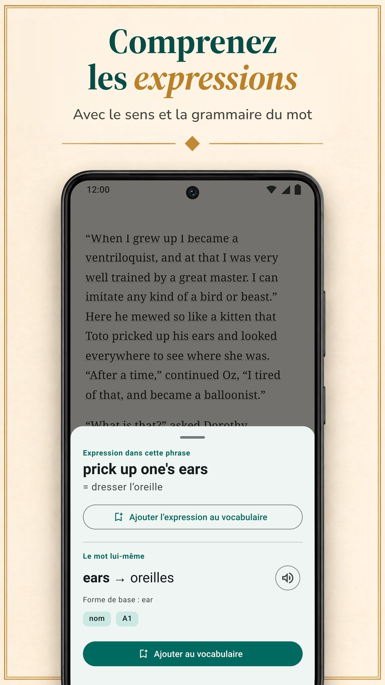

LingQ repose sur l'apprentissage d'une langue à partir de vrais contenus : des milliers de leçons avec audio dans plus de 55 langues, et l'import de livres numériques, de YouTube, de Netflix et de podcasts. Ce n'est pourtant pas la seule façon d'apprendre en lisant, et son offre Premium standard coûte plus cher que les offres standard des autres applications de cette page. Nous comparons ici LingQ à six alternatives sur ce qui compte quand on apprend en lisant : d'où viennent vos textes, comment vous obtenez le sens des mots, ce que deviennent vos mots ensuite et ce que tout cela coûte. Biblyx est notre application : lisez donc cette comparaison en sachant qu'elle est écrite par l'un des acteurs. Chaque alternative, la nôtre comprise, suit le même modèle : ce qu'elle fait bien, ce qu'elle fait moins bien, son prix et à qui elle convient. Toutes les informations sur les autres applications viennent de leurs propres pages Google Play, App Store ou de leurs sites, vérifiées le 9 novembre 2026.

## L'essentiel

- **LingQ** enseigne avec des milliers de leçons avec audio dans plus de 55 langues. Son offre gratuite est limitée (à 20 mots enregistrés, selon le blog de LingQ), et Premium coûte 14,99 $ par mois ou 119,99 $ par an.
- **Biblyx** est une application Android pour lire vos propres livres en EPUB, TXT et PDF avec texte : vous touchez un mot, elle l'explique pour cette phrase, garde la phrase sur la flashcard et n'affiche aucune publicité. Premium coûte 4,99 $ par mois ou 35,99 $ par an (Google Play, États-Unis), moins que les offres standard mensuelles et annuelles de LingQ, Linga, Beelinguapp et Readlang.
- **Pour lire vos propres livres**, regardez Biblyx, Linga et Smart Book ; LingQ importe aussi des livres numériques.
- **Pour une traduction à côté du texte**, Beelinguapp convient aux débutants et Smart Book à vos propres livres ; Smart Book a les prix standard les plus bas des applications qui publient leurs offres.
- **Readable** ne concerne que l'anglais, et **Readlang** sert à lire dans le navigateur, sur ordinateur.

## Pourquoi chercher une alternative à LingQ

LingQ mérite sa réputation. Elle couvre plus de 55 langues, propose des milliers de leçons avec texte et audio, importe livres numériques, articles, YouTube, Netflix et podcasts, et compte les mots que vous connaissez. Trois choses peuvent pourtant vous pousser à regarder ailleurs :

- **Le prix.** Les recherches de mots, les révisions et les importations illimitées demandent Premium : 14,99 $ par mois ou 119,99 $ par an sur l'App Store, plus que les offres standard des autres applications de cette page.
- **La complexité.** Leçons, imports, statistiques et outils d'IA en font une application puissante mais chargée ; le blog de LingQ lui-même dit qu'elle demande plus de temps de prise en main que Duolingo ou Babbel.
- **Vos propres livres.** Vous ne voulez peut-être aucun système de leçons, seulement une bonne liseuse pour les livres que vous avez déjà.

## Comparaison rapide

| Application | Idéale pour | Prix standard de Premium (États-Unis, 9 nov. 2026) | Version gratuite | Publicité dans la version gratuite |
|---|---|---|---|---|
| LingQ (Android, iPhone, web) | leçons avec audio dans plus de 55 langues, import de vidéos et de podcasts | 14,99 $/mois, 119,99 $/an | limitée à 20 mots enregistrés, selon le blog de LingQ | non |
| **Biblyx** (Android) | lire vos propres livres, chaque mot expliqué pour sa phrase | 4,99 $/mois, 35,99 $/an | lecture, flashcards, export et synchronisation ; traductions par l'IA avec un quota quotidien | non |
| Linga (Android, iPhone) | une bibliothèque de plus de 1 000 vrais livres, avec des jeux | 5,49 $/mois, 54,99 $/an | téléchargement gratuit, PRO payant | non |
| Beelinguapp (Android, iPhone) | débutants : la traduction à côté du texte, livres audio | 7,99 $/mois, 49,90 $/an | téléchargement gratuit | oui |
| Smart Book (Android, iPhone) | une traduction en parallèle de vos propres livres | 1,99 $/mois, 19,99 $/an | téléchargement gratuit | oui |
| Readable (Android ; iPhone non vérifié) | histoires et actualités en anglais simplifiées | achats intégrés de 1,99 à 55,99 $ | téléchargement gratuit | oui |
| Readlang (web, extension Chrome) | lire dans le navigateur, sur ordinateur | 6 $/mois, 48 $/an | mots seuls illimités ; 10 traductions d'expressions et 10 explications du contexte par jour | non vérifié (pas d'application sur Google Play) |

Offres standard uniquement : les prix semestriels, à vie et promotionnels, ainsi que les niveaux supérieurs comme LingQ Premium Plus et Readlang Premium Plus, ne sont pas inclus. Les prix de LingQ, Linga, Beelinguapp et Smart Book viennent de l'App Store, ceux de Biblyx et Readable de Google Play (Readable n'y affiche qu'une fourchette de prix) et celui de Readlang de son site. Ils varient selon les pays, et votre boutique affiche votre propre prix.

## Quelle application vous convient ?

| Votre objectif | Application |
|---|---|
| Lire les livres que vous avez déjà, avec de l'aide sur chaque mot | Biblyx ; aussi Linga et Smart Book |
| Voir le sens qui convient à la phrase et garder cette phrase sur vos flashcards | Biblyx |
| Apprendre avec des leçons et de l'audio dans beaucoup de langues | LingQ |
| Une grande bibliothèque de vrais livres, avec jeux et séries | Linga |
| Partir de zéro avec la traduction à côté du texte | Beelinguapp |
| Une traduction complète en parallèle de vos propres livres | Smart Book |
| Seulement l'anglais, avec des histoires et des actualités simplifiées | Readable |
| Lire des sites web sur ordinateur | Readlang |
| Exporter vos mots vers Anki | Biblyx ou Smart Book |
| Pas de publicité sans payer | Biblyx, LingQ ou Linga |
| Le prix standard le plus bas des applications qui publient leurs offres | Smart Book, puis Biblyx |

## Les six alternatives une par une

### 1. Biblyx : la meilleure pour lire vos propres livres

Biblyx n'est pas un cours, mais une liseuse pour vos propres livres. Vous ouvrez un EPUB, un TXT ou un PDF avec du texte, ou vous collez un article, et vous touchez un mot : l'IA lit la phrase et donne le sens qui convient là, avec la nature du mot, sa forme de base et un niveau CECRL estimé.

- **Un sens pour la phrase :** les expressions arrivent avec leurs deux sens, les noms allemands, espagnols, français, italiens et portugais avec leur article, et les mots composés sont découpés en parties.
- **Des cartes qui gardent votre phrase :** les mots enregistrés reviennent après 1, 3, 7, 14 et 30 jours, et vous pouvez les exporter vers Anki ou en CSV.
- **Hors ligne :** la lecture et la révision des flashcards fonctionnent sans connexion ; chercher un nouveau mot en demande une.
- **Une première étagère :** 29 nouvelles en 10 langues pour vos premières minutes.

L'idée tient en une ligne : **Apprenez les langues en lisant vos propres livres**.

**Ce qu'elle fait bien :** lire les livres que vous choisissez, avec des sens adaptés à la phrase et des cartes qui la gardent ; aucune publicité, même dans la version gratuite.

**Ce qu'elle fait moins bien :** elle n'existe pour l'instant que sur Android (une version iPhone est prévue, sans date), et elle n'a ni leçons ni livres audio : c'est vous qui apportez les textes, et la voix de votre téléphone lit les mots et les phrases.

**Prix :** la version gratuite comprend la lecture, les flashcards, l'export et la synchronisation, avec un quota quotidien de traductions par l'IA. Premium lève la limite quotidienne (usage raisonnable) : 4,99 $ par mois, 24,99 $ pour six mois ou 35,99 $ par an sur Google Play (États-Unis).

**Idéale pour :** ceux qui ont déjà des livres à lire ; 10 langues, plus 4 en bêta.

**L'essayer :** [Biblyx sur Google Play](https://play.google.com/store/apps/details?id=com.biblyx.app&referrer=utm_source%3Dbiblyx.com%26utm_medium%3Dwebsite%26utm_campaign%3Dguide_lingq_alternatives_fr_inline), ou lisez d'abord [comment fonctionne la liseuse Biblyx](/fr/application-pour-lire-en-anglais/).

### 2. Linga : la meilleure pour une grande bibliothèque de vrais livres

Linga est une liseuse avec une bibliothèque de plus de 1 000 livres en espagnol, français, allemand, italien, russe et anglais. Vous touchez un mot ou une expression pour obtenir une traduction et un article de dictionnaire avec synonymes et notes de grammaire, vous enregistrez des mots avec des notes et vous les révisez avec des flashcards à répétition espacée.

**Ce qu'elle fait bien :** une grande bibliothèque de vrais livres ; l'import de vos propres EPUB, PDF, MOBI, FB2 et TXT ; des jeux de vocabulaire, des objectifs quotidiens et des séries ; la prononciation par des locuteurs natifs pour les mots et les phrases, même hors ligne.

**Ce qu'elle fait moins bien :** elle enseigne six langues et, d'après sa fiche, vise les niveaux intermédiaire et avancé.

**Prix :** 5,49 $ par mois ou 54,99 $ par an, ou 109,99 $ une fois pour un accès à vie (App Store, États-Unis).

**Idéale pour :** les apprenants de niveau intermédiaire dans l'une de ses six langues qui aiment le jeu.

### 3. Beelinguapp : la meilleure pour les débutants qui veulent la traduction sous les yeux

Beelinguapp affiche un texte et sa traduction côte à côte, avec des livres audio lus par des narrateurs natifs et un texte façon karaoké qui défile en synchronisation avec l'audio. Sa bibliothèque va des histoires pour enfants et des classiques comme Sherlock Holmes jusqu'aux actualités quotidiennes, pour tous les niveaux, dans plus de 20 langues.

**Ce qu'elle fait bien :** un démarrage facile : dès le premier jour, vous voyez la traduction de chaque ligne, vous écoutez en lisant et vous faites un quiz à la fin de chaque histoire.

**Ce qu'elle fait moins bien :** sa fiche ne mentionne pas l'import de vos propres livres, et la page Google Play indique que l'application contient de la publicité.

**Prix :** 7,99 $ par mois ou 49,90 $ par an (App Store, États-Unis).

**Idéale pour :** les débutants qui veulent toujours voir la traduction.

### 4. Smart Book : la meilleure pour une traduction en parallèle de vos propres livres

Smart Book est une liseuse bilingue : pour vos propres livres FB2, EPUB ou TXT et vos fichiers de sous-titres, elle affiche le texte original et sa traduction en parallèle. Pour un mot, vous choisissez le service : Google Traduction, DeepL, Reverso, Yandex, ou des chatbots d'IA comme ChatGPT, Claude et Gemini qui expliquent le sens et la grammaire.

**Ce qu'elle fait bien :** une traduction complète de vos propres livres, le choix du service de traduction, l'export des mots enregistrés vers Anki ou ReWord, la lecture hors ligne et les prix standard les plus bas des applications qui publient leurs offres.

**Ce qu'elle fait moins bien :** la page Google Play signale la présence de publicité et, à notre avis, avec la traduction complète à l'écran, on glisse facilement vers la lecture dans sa propre langue.

**Prix :** 1,99 $ par mois ou 19,99 $ par an (App Store, États-Unis).

**Idéale pour :** ceux qui veulent lire leurs propres livres avec une traduction complète en parallèle.

### 5. Readable : la meilleure pour apprendre l'anglais avec des textes adaptés

Readable s'adresse uniquement à ceux qui apprennent l'anglais. Des enseignants expérimentés simplifient de courtes histoires et les actualités du jour à votre niveau, chaque mot a son audio et sa traduction, et un Word Trainer vous aide à retenir les mots enregistrés.

**Ce qu'elle fait bien :** des textes déjà adaptés à votre niveau, avec l'audio de chaque mot.

**Ce qu'elle fait moins bien :** elle n'enseigne que l'anglais, sa fiche ne mentionne pas vos propres livres, et la page Google Play signale la présence de publicité.

**Prix :** achats intégrés de 1,99 $ à 55,99 $ (Google Play, États-Unis) ; ses offres n'y sont pas détaillées.

**Idéale pour :** ceux qui apprennent l'anglais et préfèrent des textes adaptés plutôt que leurs propres livres.

### 6. Readlang : la meilleure pour lire dans le navigateur

Readlang fonctionne dans le navigateur et sous forme d'extension Chrome. Vous cliquez sur un mot ou une expression d'un texte ou de la plupart des sites pour le traduire, l'IA explique les mots et les expressions en contexte, et chaque mot traduit est enregistré pour être révisé en flashcards, que vous pouvez aussi exporter. Vous pouvez importer vos propres textes et articles ou lire les articles de son site.

**Ce qu'elle fait bien :** plus de 100 langues, des traductions sur la plupart des sites et une offre gratuite avec des traductions de mots seuls illimitées.

**Ce qu'elle fait moins bien :** il n'existe pas d'application Readlang sur Google Play (son site renvoie vers un guide pour l'ajouter à l'écran d'accueil du téléphone), et l'offre gratuite permet 10 traductions d'expressions et 10 explications du contexte par jour.

**Prix :** 6 $ par mois ou 48 $ par an (son site).

**Idéale pour :** ceux qui lisent beaucoup dans le navigateur, sur ordinateur.

## Les fonctions côte à côte

| Application | Vos propres fichiers | Comment vous obtenez le sens | Travail du vocabulaire | Lecture intégrée | Langues à apprendre |
|---|---|---|---|---|---|
| LingQ (Android, iPhone, web) | livres numériques, articles web, YouTube, Netflix, podcasts | recherche de mots en contexte ; outils d'IA | révision espacée, compteur de mots connus | des milliers de leçons avec audio | 55+ |
| **Biblyx** (Android) | EPUB, TXT, PDF avec texte, texte collé | sens donné par l'IA selon la phrase, expressions, article des noms | cartes avec la phrase du livre, export vers Anki et CSV | 29 nouvelles | 10, plus 4 en bêta |
| Linga (Android, iPhone) | EPUB, PDF, MOBI, FB2, TXT | toucher un mot ou une expression : traduction et article de dictionnaire | flashcards à répétition espacée, jeux, séries | plus de 1 000 livres | 6 |
| Beelinguapp (Android, iPhone) | non mentionné dans sa fiche | traduction côte à côte ; toucher un mot pour son sens de dictionnaire | quiz après chaque histoire | histoires bilingues et livres audio | 20+ |
| Smart Book (Android, iPhone) | FB2, EPUB, TXT, sous-titres .srt | traduction en parallèle ; choix du service, chatbots d'IA compris | mots enregistrés, export vers Anki ou ReWord | histoires bilingues | anglais, allemand, français, espagnol, italien et d'autres |
| Readable (Android ; iPhone non vérifié) | non mentionné ; histoires et actualités en anglais dans l'application | audio et traduction pour chaque mot | Word Trainer | histoires simplifiées, actualités du jour | anglais |
| Readlang (web, extension Chrome) | textes et articles importés ; la plupart des pages web via l'extension | cliquer sur un mot ou une expression pour le traduire ; explications par l'IA en contexte | flashcards, export | articles sur son site | 100+ |

## En résumé

À notre avis, LingQ est le système le plus complet de cette liste : si vous voulez des leçons, de l'audio et beaucoup de langues et que le prix vous convient, c'est un bon choix. Si vous voulez lire vos propres livres sur Android, avec chaque mot expliqué pour sa phrase, sans publicité et pour moins cher, essayez Biblyx. Vous pouvez aussi combiner deux outils : LingQ pour les leçons et l'audio, et une liseuse comme Biblyx pour les livres déjà sur votre téléphone. Linga apporte une grande bibliothèque de vrais livres, Beelinguapp un démarrage facile, Smart Book une liseuse parallèle bon marché, Readable de l'anglais adapté et Readlang le navigateur. Le test le plus simple : lisez le même chapitre dans deux applications pendant une semaine, et gardez celle que vous continuez à ouvrir.

## Comment nous avons vérifié

Nous avons choisi des applications qui, comme LingQ, enseignent par la lecture et comptent plus d'un million de téléchargements sur Google Play (Linga, Beelinguapp, Smart Book, Readable), plus l'outil de navigateur Readlang et notre propre application. Les informations sur LingQ, Linga, Beelinguapp, Smart Book et Readable viennent de leurs pages Google Play (boutique américaine, en anglais) telles que publiées le 9 novembre 2026 : [LingQ](https://play.google.com/store/apps/details?id=com.linguist), [Linga](https://play.google.com/store/apps/details?id=io.linga), [Beelinguapp](https://play.google.com/store/apps/details?id=com.david.android.languageswitch), [Smart Book](https://play.google.com/store/apps/details?id=com.kursx.smartbook) et [Readable](https://play.google.com/store/apps/details?id=co.playlingo.readable). Les versions iPhone et les prix standard de Premium viennent, le même jour, des pages App Store (États-Unis) de [LingQ](https://apps.apple.com/us/app/id379385811), [Linga](https://apps.apple.com/us/app/id1525101819), [Beelinguapp](https://apps.apple.com/us/app/id1225056371) et [Smart Book](https://apps.apple.com/us/app/id1278697399), les informations et prix de Readlang de [sa page de tarifs](https://readlang.com/pricing), et les prix de Biblyx et Readable de Google Play (États-Unis). La limite de l'offre gratuite de LingQ et sa remarque sur la prise en main viennent du blog de LingQ lui-même : les articles sur les [alternatives à Duolingo](https://www.lingq.com/blog/duolingo-alternatives/) (mis à jour le 15 juin 2026) et sur [les meilleures applications pour apprendre une langue](https://www.lingq.com/blog/best-language-learning-app/) (mis à jour le 14 octobre 2026). Nous n'avons pas vérifié la version iPhone de Readable. Cette page a été écrite par Galbinur Guliyev, qui développe Biblyx. Les prix changent et varient selon les pays ; si une information est dépassée, écrivez à support@biblyx.com et nous la corrigerons.

## Questions fréquentes

### Quelle est l'alternative à LingQ la moins chère ?

Parmi les applications qui publient leurs offres, Smart Book a les prix standard les plus bas (1,99 $ par mois, 19,99 $ par an), puis vient Biblyx (4,99 $ par mois, 35,99 $ par an), deux prix américains. Parmi les applications dont la version gratuite est sans publicité, Biblyx est la moins chère ; l'offre Premium standard de LingQ, à 14,99 $ par mois, est la plus chère.

### Existe-t-il une alternative gratuite à LingQ ?

Chaque application de cette page a une version gratuite ou un téléchargement gratuit. La version gratuite de Biblyx comprend la lecture, les flashcards, l'export et la synchronisation, avec un quota quotidien de traductions par l'IA et sans publicité. L'offre gratuite de Readlang comprend des traductions de mots seuls illimitées et 10 traductions d'expressions par jour. Linga, Beelinguapp, Smart Book et Readable se téléchargent gratuitement, avec des options payantes, et les trois dernières affichent de la publicité. Le blog de LingQ lui-même dit que son offre gratuite est limitée à 20 mots enregistrés.

### Existe-t-il une alternative à Readlang sur Android ?

Readlang n'a pas d'application sur Google Play ; son site renvoie vers un guide pour l'ajouter à l'écran d'accueil du téléphone. Sur Google Play, Biblyx, Linga et Smart Book ouvrent vos propres fichiers et vous laissent toucher les mots pour voir leur sens, et LingQ importe livres numériques et articles.

### Existe-t-il une alternative à LingQ qui fonctionne avec mes propres livres ?

Oui. Biblyx ouvre EPUB, TXT, PDF avec texte et texte collé ; Linga importe EPUB, PDF, MOBI, FB2 et TXT ; Smart Book ouvre FB2, EPUB et TXT avec une traduction en parallèle. LingQ elle-même importe aussi des livres numériques.

### Lesquelles de ces applications n'ont pas de publicité ?

D'après leurs pages Google Play, Biblyx, LingQ et Linga ne contiennent pas de publicité ; Beelinguapp, Smart Book et Readable en contiennent. Les six applications présentes sur Google Play proposent des achats intégrés.

### Quelle application est la plus simple pour débuter ?

Beelinguapp, parce que la traduction est à côté du texte, et Readable pour l'anglais, parce que ses histoires sont simplifiées à votre niveau. Dans Biblyx, les débutants commencent par les nouvelles de départ et ne touchent que les mots dont ils ont besoin. Linga se présente comme une application pour les niveaux intermédiaire et avancé.

### Quelle est la différence entre une traduction en parallèle et un sens pour la phrase ?

Une traduction en parallèle montre tout le texte dans votre langue à côté de l'original. Un sens pour la phrase ne montre que le mot touché, expliqué pour la phrase où vous êtes : vous continuez donc à lire dans la langue que vous apprenez.

### Biblyx fonctionne-t-elle sur iPhone ?

Pas encore. Biblyx est sur Android via Google Play ; une version iOS est prévue, sans date.
