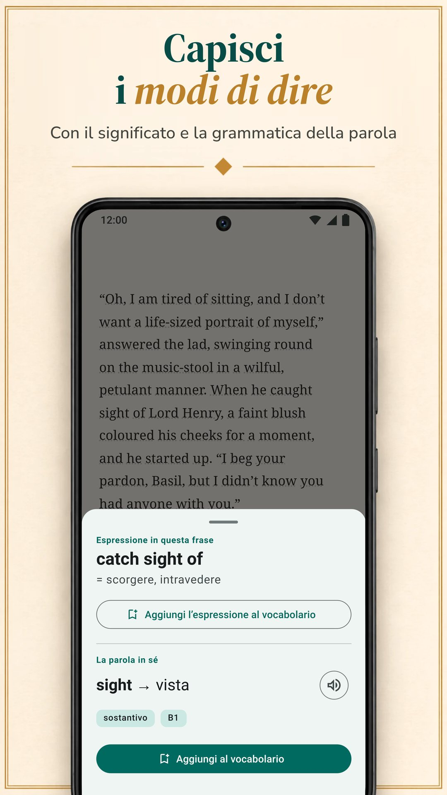

LingQ si basa sull'imparare una lingua da contenuti reali: migliaia di lezioni con audio in più di 55 lingue e l'importazione da ebook, YouTube, Netflix e podcast. Non è però l'unico modo di imparare leggendo, e il suo Premium standard costa più dei piani standard delle altre app di questa pagina. Qui confrontiamo LingQ con sei alternative su ciò che conta quando impari leggendo: da dove arrivano i tuoi testi, come ottieni i significati, cosa succede poi alle parole e quanto costa. Biblyx è la nostra app, quindi leggi questo confronto sapendo che l'ha scritto una delle parti in causa. Ogni alternativa, la nostra compresa, segue lo stesso schema: cosa fa bene, cosa fa meno bene, quanto costa e per chi è. Tutti i dati sulle altre app vengono dalle loro pagine di Google Play, dell'App Store o dai loro siti, controllati il 9 novembre 2026.

## In breve

- **LingQ** insegna con migliaia di lezioni con audio in più di 55 lingue. Il piano gratuito è limitato (a 20 parole salvate, dice il blog di LingQ) e Premium costa 14,99 $ al mese o 119,99 $ all'anno.
- **Biblyx** è un'app per Android con cui leggi i tuoi libri in EPUB, TXT e PDF con testo: tocchi una parola e te la spiega per quella frase, conserva la frase nella flashcard e non mostra pubblicità. Premium costa 4,99 $ al mese o 35,99 $ all'anno (Google Play, Stati Uniti), meno dei piani standard mensili e annuali di LingQ, Linga, Beelinguapp e Readlang.
- **Per leggere i tuoi libri** guarda Biblyx, Linga e Smart Book; anche LingQ importa ebook.
- **Per avere la traduzione accanto al testo**, Beelinguapp va bene per i principianti e Smart Book per i tuoi libri; Smart Book ha i prezzi standard più bassi tra le app che pubblicano i loro piani.
- **Readable** è solo per l'inglese, e **Readlang** serve a leggere nel browser, al computer.

## Perché si cerca un'alternativa a LingQ

LingQ si merita la sua fama. Copre più di 55 lingue, ha migliaia di lezioni con testo e audio, importa ebook, articoli, YouTube, Netflix e podcast e conta le parole che conosci. Tre cose, però, possono farti guardare altrove:

- **Il prezzo.** Ricerche, ripassi e importazioni illimitati richiedono Premium: 14,99 $ al mese o 119,99 $ all'anno sull'App Store, più dei piani standard delle altre app di questa pagina.
- **La complessità.** Lezioni, importazioni, statistiche e strumenti di IA ne fanno un'app potente ma affollata; lo stesso blog di LingQ dice che ha una curva di apprendimento più ripida di Duolingo o Babbel.
- **I tuoi libri.** Forse non vuoi nessun sistema di lezioni, ma solo un buon lettore per i libri che hai già.

## Confronto rapido

| App | Ideale per | Prezzo standard di Premium (Stati Uniti, 9 nov. 2026) | Versione gratuita | Pubblicità nella versione gratuita |
|---|---|---|---|---|
| LingQ (Android, iPhone, web) | lezioni con audio in più di 55 lingue, importazione di video e podcast | 14,99 $/mese, 119,99 $/anno | limitata a 20 parole salvate, secondo il blog di LingQ | no |
| **Biblyx** (Android) | leggere i tuoi libri, con ogni parola spiegata per la sua frase | 4,99 $/mese, 35,99 $/anno | lettura, flashcard, esportazione e sincronizzazione; traduzioni dell'IA con una quota giornaliera | no |
| Linga (Android, iPhone) | una biblioteca di oltre 1.000 libri veri, con giochi | 5,49 $/mese, 54,99 $/anno | download gratuito, PRO a pagamento | no |
| Beelinguapp (Android, iPhone) | principianti: la traduzione accanto al testo, audiolibri | 7,99 $/mese, 49,90 $/anno | download gratuito | sì |
| Smart Book (Android, iPhone) | una traduzione a fronte dei tuoi libri | 1,99 $/mese, 19,99 $/anno | download gratuito | sì |
| Readable (Android; iOS in arrivo, secondo il sito) | racconti e notizie in inglese semplificati | acquisti in-app da 1,99 a 55,99 $ | download gratuito | sì |
| Readlang (web, estensione per Chrome) | leggere nel browser, al computer | 6 $/mese, 48 $/anno | singole parole illimitate; 10 traduzioni di espressioni e 10 spiegazioni del contesto al giorno | non controllato (nessuna app su Google Play) |

Solo piani standard: sono esclusi i prezzi semestrali, a vita e promozionali, e i livelli superiori come LingQ Premium Plus e Readlang Premium Plus. I prezzi di LingQ, Linga, Beelinguapp e Smart Book vengono dall'App Store, quelli di Biblyx e Readable da Google Play (Readable lì mostra solo una fascia di prezzo) e quello di Readlang dal suo sito. Cambiano da paese a paese, e il tuo store ti mostra il tuo prezzo.

## Quale app fa per te?

| Il tuo obiettivo | App |
|---|---|
| Leggere i libri che hai già, con aiuto su ogni parola | Biblyx; anche Linga e Smart Book |
| Vedere il significato giusto per la frase e conservare quella frase nelle flashcard | Biblyx |
| Imparare con lezioni e audio in molte lingue | LingQ |
| Una grande biblioteca di libri veri, con giochi e serie | Linga |
| Partire da zero con la traduzione accanto al testo | Beelinguapp |
| Una traduzione a fronte completa dei tuoi libri | Smart Book |
| Solo inglese, con racconti e notizie semplificati | Readable |
| Leggere siti web al computer | Readlang |
| Esportare le tue parole in Anki | Biblyx o Smart Book |
| Niente pubblicità senza pagare | Biblyx, LingQ o Linga |
| Il prezzo standard più basso tra le app che pubblicano i loro piani | Smart Book, poi Biblyx |

## Le sei alternative, una per una

### 1. Biblyx: la migliore per leggere i tuoi libri

Biblyx non è un corso, ma un lettore per i tuoi libri. Apri un EPUB, un TXT o un PDF con testo, oppure incolli un articolo, e tocchi una parola: l'IA legge la frase e dà il significato giusto in quel punto, con parte del discorso, forma base e un livello QCER stimato.

- **Un significato per la frase:** i modi di dire arrivano con entrambi i significati, i sostantivi tedeschi, spagnoli, francesi, italiani e portoghesi con il loro articolo, e le parole composte vengono divise nelle loro parti.
- **Flashcard che conservano la tua frase:** le parole salvate tornano dopo 1, 3, 7, 14 e 30 giorni, e puoi esportarle in Anki o CSV.
- **Offline:** lettura e ripasso delle flashcard funzionano senza connessione; per cercare una parola nuova serve la connessione.
- **Un primo scaffale:** 29 racconti brevi in 10 lingue per i primi minuti.

L'idea sta in una riga: **Impara le lingue leggendo i tuoi libri**.

**Cosa fa bene:** leggere i libri che scegli tu, con significati giusti per la frase e flashcard che la conservano; niente pubblicità, nemmeno nella versione gratuita.

**Cosa fa meno bene:** per ora è solo su Android (una versione per iPhone è in programma, senza data), e non ha lezioni né audiolibri: i testi li porti tu, e parole e frasi le legge la voce del tuo telefono.

**Prezzo:** la versione gratuita comprende lettura, flashcard, esportazione e sincronizzazione, con una quota giornaliera di traduzioni dell'IA. Premium toglie il limite giornaliero (con uso ragionevole): 4,99 $ al mese, 24,99 $ per sei mesi o 35,99 $ all'anno su Google Play (Stati Uniti).

**Ideale per:** chi ha già dei libri che vuole leggere; 10 lingue, più 4 in beta.

**Provala:** [Biblyx su Google Play](https://play.google.com/store/apps/details?id=com.biblyx.app&referrer=utm_source%3Dbiblyx.com%26utm_medium%3Dwebsite%26utm_campaign%3Dguide_lingq_alternatives_it_inline), oppure leggi prima [come funziona il lettore di Biblyx](/it/app-per-leggere-libri-in-inglese/).

### 2. Linga: la migliore per una grande biblioteca di libri veri

Linga è un lettore con una biblioteca di oltre 1.000 libri in spagnolo, francese, tedesco, italiano, russo e inglese. Tocchi una parola o un'espressione e ottieni una traduzione e una voce di dizionario con sinonimi e note di grammatica, salvi le parole con note e le ripassi con flashcard a ripetizione spaziata.

**Cosa fa bene:** una grande biblioteca di libri veri; l'importazione dei tuoi EPUB, PDF, MOBI, FB2 e TXT; giochi di vocabolario, obiettivi giornalieri e serie; la pronuncia di madrelingua per parole e frasi, anche offline.

**Cosa fa meno bene:** insegna sei lingue e, secondo la sua scheda, è pensata per livelli intermedi e avanzati.

**Prezzo:** 5,49 $ al mese o 54,99 $ all'anno, oppure 109,99 $ una tantum per l'accesso a vita (App Store, Stati Uniti).

**Ideale per:** chi studia una delle sue sei lingue a livello intermedio e ama i giochi.

### 3. Beelinguapp: la migliore per i principianti che vogliono la traduzione sotto gli occhi

Beelinguapp mostra un testo e la sua traduzione affiancati, con audiolibri letti da narratori madrelingua e un testo scorrevole in stile karaoke, sincronizzato con l'audio. La biblioteca va dalle storie per bambini ai classici come Sherlock Holmes fino alle notizie del giorno, per tutti i livelli, in più di 20 lingue.

**Cosa fa bene:** un inizio facile: dal primo giorno vedi la traduzione di ogni riga, ascolti mentre leggi e fai un quiz alla fine di ogni storia.

**Cosa fa meno bene:** la scheda non parla di importare i tuoi libri, e la pagina di Google Play segnala che l'app contiene pubblicità.

**Prezzo:** 7,99 $ al mese o 49,90 $ all'anno (App Store, Stati Uniti).

**Ideale per:** i principianti che vogliono la traduzione sempre sotto gli occhi.

### 4. Smart Book: la migliore per una traduzione a fronte dei tuoi libri

Smart Book è un lettore bilingue: per i tuoi libri FB2, EPUB o TXT e per i file di sottotitoli mostra il testo originale e la traduzione a fronte. Per una parola scegli tu il servizio: Google Traduttore, DeepL, Reverso, Yandex oppure chatbot di IA come ChatGPT, Claude e Gemini che spiegano significato e grammatica.

**Cosa fa bene:** una traduzione completa dei tuoi libri, la scelta del servizio di traduzione, l'esportazione delle parole salvate in Anki o ReWord, la lettura offline e i prezzi standard più bassi tra le app che pubblicano i loro piani.

**Cosa fa meno bene:** la pagina di Google Play segnala la pubblicità e, secondo noi, con la traduzione completa sullo schermo è facile finire a leggere nella propria lingua.

**Prezzo:** 1,99 $ al mese o 19,99 $ all'anno (App Store, Stati Uniti).

**Ideale per:** chi vuole leggere i propri libri con una traduzione a fronte completa.

### 5. Readable: la migliore per chi studia inglese con testi adattati

Readable è solo per chi studia inglese. Insegnanti esperti semplificano racconti brevi e notizie del giorno al tuo livello, ogni parola ha audio e traduzione, e un Word Trainer ti aiuta a memorizzare le parole salvate.

**Cosa fa bene:** testi già adattati al tuo livello, con l'audio di ogni parola.

**Cosa fa meno bene:** insegna solo l'inglese, la scheda non parla dei tuoi libri e la pagina di Google Play segnala la pubblicità.

**Prezzo:** acquisti in-app da 1,99 $ a 55,99 $ (Google Play, Stati Uniti); lì i piani non sono indicati.

**Ideale per:** chi studia inglese e preferisce testi adattati invece di libri propri.

### 6. Readlang: la migliore per leggere nel browser

Readlang funziona nel browser e come estensione per Chrome. Clicchi su una parola o un'espressione in un testo o nella maggior parte dei siti per tradurla, l'IA spiega parole ed espressioni nel contesto, e ogni parola tradotta viene salvata per il ripasso con le flashcard, che puoi anche esportare. Puoi caricare i tuoi testi e articoli oppure leggere gli articoli sul suo sito.

**Cosa fa bene:** più di 100 lingue, traduzioni nella maggior parte dei siti e un piano gratuito con traduzioni illimitate di singole parole.

**Cosa fa meno bene:** su Google Play non c'è un'app di Readlang (il sito rimanda a una guida per aggiungerla alla schermata iniziale del telefono), e il piano gratuito consente 10 traduzioni di espressioni e 10 spiegazioni del contesto al giorno.

**Prezzo:** 6 $ al mese o 48 $ all'anno (dal suo sito).

**Ideale per:** chi legge molto nel browser, al computer.

## Le funzioni a confronto

| App | I tuoi file | Come ottieni i significati | Esercizio sul lessico | Lettura inclusa | Lingue da studiare |
|---|---|---|---|---|---|
| LingQ (Android, iPhone, web) | ebook, articoli web, YouTube, Netflix, podcast | ricerca delle parole nel contesto; strumenti di IA | ripetizione spaziata, contatore di parole conosciute | migliaia di lezioni con audio | 55+ |
| **Biblyx** (Android) | EPUB, TXT, PDF con testo, testo incollato | significato dell'IA adatto alla frase, modi di dire, articoli dei sostantivi | flashcard con la frase del libro, esportazione in Anki e CSV | 29 racconti brevi | 10, più 4 in beta |
| Linga (Android, iPhone) | EPUB, PDF, MOBI, FB2, TXT | tocchi una parola o un'espressione: traduzione e voce di dizionario | flashcard a ripetizione spaziata, giochi, serie | oltre 1.000 libri | 6 |
| Beelinguapp (Android, iPhone) | non indicato nella scheda | traduzione affiancata; tocchi una parola per il significato da dizionario | quiz dopo ogni storia | storie bilingui e audiolibri | 20+ |
| Smart Book (Android, iPhone) | FB2, EPUB, TXT, sottotitoli .srt | traduzione a fronte; scelta del servizio, chatbot di IA compresi | parole salvate, esportazione in Anki o ReWord | storie bilingui | inglese, tedesco, francese, spagnolo, italiano e altre |
| Readable (Android; iOS in arrivo, secondo il sito) | non indicato; racconti e notizie in inglese nell'app | audio e traduzione per ogni parola | Word Trainer | racconti semplificati, notizie del giorno | inglese |
| Readlang (web, estensione per Chrome) | testi e articoli caricati; la maggior parte delle pagine web con l'estensione | clic su una parola o un'espressione per tradurla; spiegazioni dell'IA nel contesto | flashcard, esportazione | articoli sul suo sito | 100+ |

## In sintesi

Secondo noi LingQ è il sistema più completo di questa lista: se vuoi lezioni, audio e tante lingue e il prezzo ti va bene, è un'ottima scelta. Se vuoi leggere i tuoi libri su Android, con ogni parola spiegata per la sua frase, senza pubblicità e spendendo meno, prova Biblyx. Puoi anche usare due strumenti insieme: LingQ per lezioni e audio, e un lettore come Biblyx per i libri che hai già sul telefono. Linga offre una grande biblioteca di libri veri, Beelinguapp un inizio facile, Smart Book un lettore a fronte economico, Readable l'inglese adattato e Readlang il browser. Il test più semplice: leggi lo stesso capitolo in due app per una settimana e tieni quella che continui ad aprire.

## Come abbiamo controllato

Abbiamo scelto app che, come LingQ, insegnano attraverso la lettura e hanno più di un milione di download su Google Play (Linga, Beelinguapp, Smart Book, Readable), più lo strumento per browser Readlang e la nostra app. I dati su LingQ, Linga, Beelinguapp, Smart Book e Readable vengono dalle loro pagine di Google Play (store statunitense, in inglese) così come erano pubblicate il 9 novembre 2026: [LingQ](https://play.google.com/store/apps/details?id=com.linguist), [Linga](https://play.google.com/store/apps/details?id=io.linga), [Beelinguapp](https://play.google.com/store/apps/details?id=com.david.android.languageswitch), [Smart Book](https://play.google.com/store/apps/details?id=com.kursx.smartbook) e [Readable](https://play.google.com/store/apps/details?id=co.playlingo.readable). Le versioni per iPhone e i prezzi standard di Premium vengono, lo stesso giorno, dalle pagine dell'App Store (Stati Uniti) di [LingQ](https://apps.apple.com/us/app/id379385811), [Linga](https://apps.apple.com/us/app/id1525101819), [Beelinguapp](https://apps.apple.com/us/app/id1225056371) e [Smart Book](https://apps.apple.com/us/app/id1278697399), i dati e i prezzi di Readlang dalla [sua pagina dei prezzi](https://readlang.com/pricing), e i prezzi di Biblyx e Readable da Google Play (Stati Uniti). Il limite del piano gratuito di LingQ e la sua osservazione sulla curva di apprendimento vengono dal blog di LingQ stesso: gli articoli sulle [alternative a Duolingo](https://www.lingq.com/blog/duolingo-alternatives/) (aggiornato il 15 giugno 2026) e sulle [migliori app per imparare le lingue](https://www.lingq.com/blog/best-language-learning-app/) (aggiornato il 14 ottobre 2026). Il sito di Readable dice che la versione per iOS arriverà presto. Questa pagina l'ha scritta Galbinur Guliyev, che sviluppa Biblyx. I prezzi cambiano e variano da paese a paese; se qui qualcosa non è aggiornato, scrivi a support@biblyx.com e lo correggiamo.

## Domande frequenti

### Qual è l'alternativa a LingQ più economica?

Tra le app che pubblicano i loro piani, Smart Book ha i prezzi standard più bassi (1,99 $ al mese, 19,99 $ all'anno), poi viene Biblyx (4,99 $ al mese, 35,99 $ all'anno), entrambi prezzi statunitensi. Tra le app la cui versione gratuita non ha pubblicità, Biblyx è quella che costa meno; il Premium standard di LingQ, a 14,99 $ al mese, è quello che costa di più.

### Esiste un'alternativa gratuita a LingQ?

Ogni app di questa pagina ha una versione gratuita o un download gratuito. La versione gratuita di Biblyx comprende lettura, flashcard, esportazione e sincronizzazione, con una quota giornaliera di traduzioni dell'IA e senza pubblicità. Il piano gratuito di Readlang ha traduzioni illimitate di singole parole e 10 traduzioni di espressioni al giorno. Linga, Beelinguapp, Smart Book e Readable si scaricano gratis, con aggiornamenti a pagamento, e le ultime tre mostrano pubblicità. Lo stesso blog di LingQ dice che il suo piano gratuito è limitato a 20 parole salvate.

### Esiste un'alternativa a Readlang per Android?

Readlang non ha un'app su Google Play; il suo sito rimanda a una guida per aggiungerla alla schermata iniziale del telefono. Su Google Play, Biblyx, Linga e Smart Book aprono i tuoi file e ti fanno toccare le parole per vederne il significato, e LingQ importa ebook e articoli.

### Esiste un'alternativa a LingQ che funziona con i miei libri?

Sì. Biblyx apre EPUB, TXT, PDF con testo e testo incollato; Linga importa EPUB, PDF, MOBI, FB2 e TXT; Smart Book apre FB2, EPUB e TXT con traduzione a fronte. Anche LingQ importa ebook.

### Quali di queste app non hanno pubblicità?

Secondo le loro pagine di Google Play, Biblyx, LingQ e Linga non hanno pubblicità; Beelinguapp, Smart Book e Readable sì. Tutte e sei le app su Google Play offrono acquisti in-app.

### Qual è l'app più facile per chi comincia?

Beelinguapp, perché la traduzione è accanto al testo, e Readable per l'inglese, perché i racconti sono semplificati al tuo livello. In Biblyx chi comincia parte dai racconti brevi iniziali e tocca solo le parole che gli servono. Linga si presenta come app per livelli intermedi e avanzati.

### Che differenza c'è tra traduzione a fronte e significato per la frase?

La traduzione a fronte mostra tutto il testo nella tua lingua accanto all'originale. Il significato per la frase mostra solo la parola che hai toccato, spiegata per la frase in cui ti trovi, così continui a leggere nella lingua che studi.

### Biblyx funziona su iPhone?

Non ancora. Biblyx è su Android tramite Google Play; la versione iOS è in programma, senza data.
