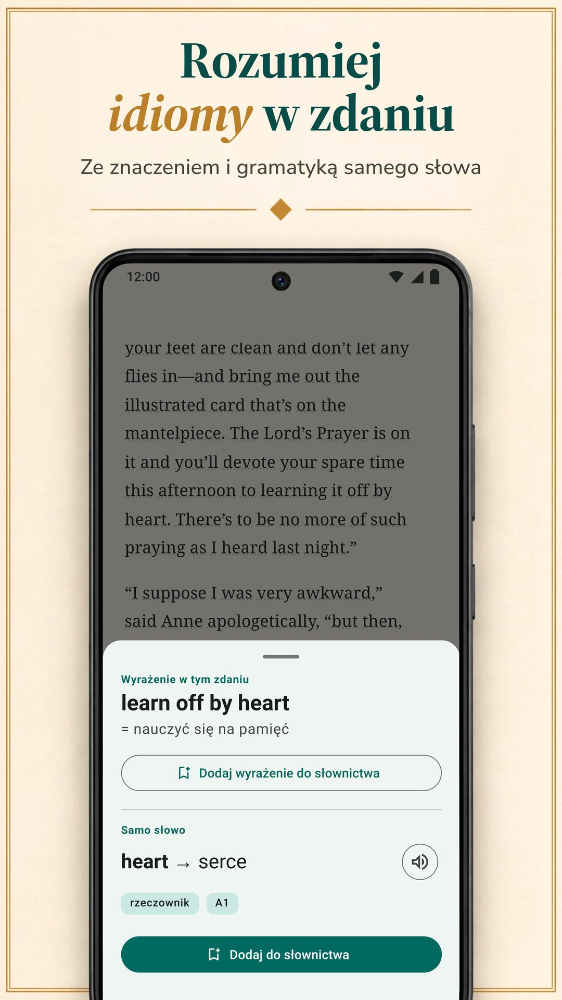

LingQ opiera się na nauce języka z prawdziwych treści: tysiące lekcji z nagraniami w ponad 55 językach i import z e-booków, YouTube, Netflixa i podcastów. Nie jest to jednak jedyny sposób nauki przez czytanie, a jego standardowy Premium kosztuje więcej niż standardowe plany pozostałych aplikacji na tej stronie. Porównujemy tu LingQ z sześcioma alternatywami pod kątem tego, co ważne przy nauce przez czytanie: skąd biorą się twoje teksty, jak poznajesz znaczenia, co dzieje się potem ze słowami i ile to kosztuje. Biblyx to nasza aplikacja, więc czytaj to porównanie ze świadomością, że napisała je jedna ze stron. Każda alternatywa, łącznie z naszą, jest opisana według tego samego schematu: co robi dobrze, co gorzej, ile kosztuje i dla kogo jest. Wszystkie informacje o pozostałych aplikacjach pochodzą z ich własnych stron w Google Play, App Store lub z ich witryn i zostały sprawdzone 9 listopada 2026 roku.

## Najważniejsze

- **LingQ** uczy przez tysiące lekcji z nagraniami w ponad 55 językach. Plan bezpłatny jest ograniczony (według bloga LingQ do 20 zapisanych słów), a Premium kosztuje 14,99 USD miesięcznie lub 119,99 USD rocznie.
- **Biblyx** to aplikacja na Androida do czytania własnych książek w EPUB, TXT i PDF z tekstem: dotykasz słowa, a ona wyjaśnia je dla tego zdania, zapisuje zdanie na fiszce i nie wyświetla reklam. Premium kosztuje 4,99 USD miesięcznie lub 35,99 USD rocznie (Google Play, USA), mniej niż standardowe plany miesięczne i roczne LingQ, Linga, Beelinguapp i Readlang.
- **Do czytania własnych książek** sprawdź Biblyx, Linga i Smart Book; LingQ też importuje e-booki.
- **Jeśli chcesz tłumaczenia obok tekstu**, Beelinguapp pasuje początkującym, a Smart Book własnym książkom; Smart Book ma najniższe standardowe ceny spośród aplikacji, które podają swoje plany.
- **Readable** jest tylko do angielskiego, a **Readlang** do czytania w przeglądarce na komputerze.

## Dlaczego ludzie szukają alternatywy dla LingQ

LingQ zasłużył na swoją renomę. Obejmuje ponad 55 języków, ma tysiące lekcji z tekstem i nagraniem, importuje e-booki, artykuły, YouTube, Netflixa i podcasty oraz liczy słowa, które znasz. Mimo to trzy rzeczy mogą skłonić cię do szukania czegoś innego:

- **Cena.** Nieograniczone sprawdzanie słów, powtórki i import wymagają Premium: 14,99 USD miesięcznie lub 119,99 USD rocznie w App Store, więcej niż standardowe plany pozostałych aplikacji tutaj.
- **Złożoność.** Lekcje, import, statystyki i narzędzia AI tworzą aplikację potężną, ale przeładowaną; sam blog LingQ pisze, że trudniej się jej nauczyć niż Duolingo czy Babbel.
- **Własne książki.** Może w ogóle nie chcesz systemu lekcji, tylko dobrego czytnika do książek, które już masz.

## Szybkie porównanie

| Aplikacja | Dla kogo | Standardowa cena Premium (USA, 9 lis 2026) | Wersja bezpłatna | Reklamy w wersji bezpłatnej |
|---|---|---|---|---|
| LingQ (Android, iPhone, przeglądarka) | lekcje z nagraniami w ponad 55 językach, import filmów i podcastów | 14,99 USD/mies., 119,99 USD/rok | ograniczona do 20 zapisanych słów (według bloga LingQ) | nie |
| **Biblyx** (Android) | czytanie własnych książek, każde słowo wyjaśnione dla swojego zdania | 4,99 USD/mies., 35,99 USD/rok | czytanie, fiszki, eksport i synchronizacja; tłumaczenia AI z dziennym limitem | nie |
| Linga (Android, iPhone) | biblioteka ponad 1000 prawdziwych książek, z grami | 5,49 USD/mies., 54,99 USD/rok | bezpłatne pobranie, PRO płatne | nie |
| Beelinguapp (Android, iPhone) | początkujący: tłumaczenie obok tekstu, audiobooki | 7,99 USD/mies., 49,90 USD/rok | bezpłatne pobranie | tak |
| Smart Book (Android, iPhone) | tłumaczenie równoległe własnych książek | 1,99 USD/mies., 19,99 USD/rok | bezpłatne pobranie | tak |
| Readable (Android; iPhone niesprawdzony) | uproszczone angielskie opowiadania i wiadomości | zakupy w aplikacji 1,99–55,99 USD | bezpłatne pobranie | tak |
| Readlang (przeglądarka, rozszerzenie do Chrome) | czytanie w przeglądarce na komputerze | 6 USD/mies., 48 USD/rok | pojedyncze słowa bez limitu; 10 tłumaczeń wyrażeń i 10 objaśnień kontekstu dziennie | niesprawdzone (brak aplikacji w Google Play) |

Tylko plany standardowe: ceny półroczne, dożywotnie i promocyjne oraz wyższe plany, takie jak LingQ Premium Plus i Readlang Premium Plus, nie są uwzględnione. Ceny LingQ, Linga, Beelinguapp i Smart Book pochodzą z App Store, Biblyx i Readable z Google Play (Readable pokazuje tam tylko przedział cen), a Readlang z jego strony. Różnią się w zależności od kraju, a twój sklep pokazuje twoją cenę.

## Która aplikacja jest dla ciebie?

| Twój cel | Aplikacja |
|---|---|
| Czytać książki, które już masz, z pomocą przy każdym słowie | Biblyx; także Linga i Smart Book |
| Widzieć znaczenie pasujące do zdania i zachować to zdanie na fiszce | Biblyx |
| Uczyć się z lekcji z nagraniami w wielu językach | LingQ |
| Duża biblioteka prawdziwych książek, z grami i seriami dni nauki | Linga |
| Zacząć od zera, z tłumaczeniem obok tekstu | Beelinguapp |
| Pełne tłumaczenie równoległe własnych książek | Smart Book |
| Tylko angielski, uproszczone opowiadania i wiadomości | Readable |
| Czytać strony internetowe na komputerze | Readlang |
| Eksportować słowa do Anki | Biblyx lub Smart Book |
| Bez reklam i bez płacenia | Biblyx, LingQ lub Linga |
| Najniższa standardowa cena wśród aplikacji, które podają swoje plany | Smart Book, potem Biblyx |

## Sześć alternatyw po kolei

### 1. Biblyx: najlepsza do czytania własnych książek

Biblyx to nie kurs, lecz czytnik twoich własnych książek. Otwierasz plik EPUB, TXT lub PDF z tekstem albo wklejasz artykuł i dotykasz dowolnego słowa: AI czyta zdanie i podaje znaczenie, które tu pasuje, z częścią mowy, formą podstawową i szacowanym poziomem CEFR.

- **Znaczenie dla zdania:** idiomy pokazują oba znaczenia, niemieckie, hiszpańskie, francuskie, włoskie i portugalskie rzeczowniki mają rodzajnik, a wyrazy złożone są dzielone na części.
- **Fiszki, które zachowują twoje zdanie:** zapisane słowa wracają po 1, 3, 7, 14 i 30 dniach, a ty możesz je wyeksportować do Anki lub CSV.
- **Offline:** czytanie i powtórki fiszek działają bez internetu; do sprawdzenia nowego słowa potrzebne jest połączenie.
- **Pierwsza półka:** na pierwsze minuty czeka 29 krótkich opowiadań w 10 językach.

Cały pomysł mieści się w jednym zdaniu: **Ucz się języków, czytając własne książki**.

**Co robi dobrze:** czytanie wybranych przez ciebie książek ze znaczeniami pasującymi do zdania i fiszkami, które to zdanie zachowują; żadnych reklam, nawet w wersji bezpłatnej.

**Co robi gorzej:** na razie działa tylko na Androidzie (wersja na iPhone'a jest w planach, bez daty), nie ma też lekcji ani audiobooków: teksty przynosisz ty, a słowa i zdania czyta głos twojego telefonu.

**Cena:** wersja bezpłatna obejmuje czytanie, fiszki, eksport i synchronizację, z dziennym limitem tłumaczeń AI. Premium znosi dzienny limit (obowiązują zasady rozsądnego użytkowania): 4,99 USD miesięcznie, 24,99 USD za pół roku lub 35,99 USD rocznie w Google Play (USA).

**Dla kogo:** dla osób, które mają już książki do przeczytania; 10 języków i 4 w wersji beta.

**Wypróbuj:** [Biblyx w Google Play](https://play.google.com/store/apps/details?id=com.biblyx.app&referrer=utm_source%3Dbiblyx.com%26utm_medium%3Dwebsite%26utm_campaign%3Dguide_lingq_alternatives_pl_inline) albo najpierw przeczytaj, [jak działa czytnik Biblyx](/pl/czytnik-z-tlumaczeniem/).

### 2. Linga: najlepsza do dużej biblioteki prawdziwych książek

Linga to czytnik z biblioteką ponad 1000 książek po hiszpańsku, francusku, niemiecku, włosku, rosyjsku i angielsku. Dotykasz słowa lub wyrażenia i dostajesz tłumaczenie oraz hasło słownikowe z synonimami i uwagami gramatycznymi, zapisujesz słowa z notatkami i powtarzasz je na fiszkach w odstępach.

**Co robi dobrze:** duża biblioteka prawdziwych książek; import własnych plików EPUB, PDF, MOBI, FB2 i TXT; gry słownikowe, codzienne cele i serie dni nauki; nagrania wymowy native speakerów dla słów i zdań, także offline.

**Co robi gorzej:** uczy sześciu języków i według opisu jest przeznaczona dla średnio zaawansowanych i zaawansowanych.

**Cena:** 5,49 USD miesięcznie lub 54,99 USD rocznie albo jednorazowo 109,99 USD za dożywotni dostęp (App Store, USA).

**Dla kogo:** dla średnio zaawansowanych uczących się jednego z jej sześciu języków, którzy lubią elementy gry.

### 3. Beelinguapp: najlepsza dla początkujących, którzy chcą mieć tłumaczenie na widoku

Beelinguapp pokazuje tekst i jego tłumaczenie obok siebie, z audiobookami czytanymi przez rodzimych lektorów i tekstem w stylu karaoke, który przewija się synchronicznie z nagraniem. Biblioteka obejmuje wszystkie poziomy, od bajek dla dzieci i klasyki, jak Sherlock Holmes, po codzienne wiadomości, w ponad 20 językach.

**Co robi dobrze:** łatwy start: od pierwszego dnia widzisz tłumaczenie każdej linijki, słuchasz podczas czytania i rozwiązujesz quiz po każdej historii.

**Co robi gorzej:** opis nie wspomina o imporcie własnych książek, a strona w Google Play informuje, że aplikacja zawiera reklamy.

**Cena:** 7,99 USD miesięcznie lub 49,90 USD rocznie (App Store, USA).

**Dla kogo:** dla początkujących, którzy chcą mieć tłumaczenie zawsze na widoku.

### 4. Smart Book: najlepsza do tłumaczenia równoległego własnych książek

Smart Book to czytnik dwujęzyczny: dla twoich książek FB2, EPUB lub TXT i plików z napisami pokazuje oryginał i tłumaczenie równolegle. Dla pojedynczego słowa sam wybierasz usługę: Tłumacz Google, DeepL, Reverso, Yandex albo czatboty AI, takie jak ChatGPT, Claude i Gemini, które wyjaśniają znaczenie i gramatykę.

**Co robi dobrze:** pełne tłumaczenie własnych książek, wybór usługi tłumaczenia, eksport zapisanych słów do Anki lub ReWord, czytanie offline i najniższe standardowe ceny spośród aplikacji, które podają swoje plany.

**Co robi gorzej:** strona w Google Play informuje o reklamach, a naszym zdaniem przy pełnym tłumaczeniu na ekranie łatwo przejść na czytanie we własnym języku.

**Cena:** 1,99 USD miesięcznie lub 19,99 USD rocznie (App Store, USA).

**Dla kogo:** dla osób, które chcą czytać własne książki z pełnym tłumaczeniem równoległym.

### 5. Readable: najlepsza dla uczących się angielskiego z dopasowanych tekstów

Readable jest tylko dla uczących się angielskiego. Doświadczeni nauczyciele upraszczają krótkie opowiadania i codzienne wiadomości do twojego poziomu, każde słowo ma nagranie i tłumaczenie, a Word Trainer pomaga zapamiętać zapisane słowa.

**Co robi dobrze:** teksty już dopasowane do twojego poziomu, z nagraniem każdego słowa.

**Co robi gorzej:** uczy tylko angielskiego, opis nie wspomina o własnych książkach, a strona w Google Play informuje o reklamach.

**Cena:** zakupy w aplikacji od 1,99 USD do 55,99 USD (Google Play, USA); planów tam nie podano.

**Dla kogo:** dla uczących się angielskiego, którzy wolą dopasowane teksty niż własne książki.

### 6. Readlang: najlepsza do czytania w przeglądarce

Readlang działa w przeglądarce i jako rozszerzenie do Chrome. Klikasz słowo lub wyrażenie w tekście albo na większości stron i dostajesz tłumaczenie, AI objaśnia słowa i wyrażenia w kontekście, a każde przetłumaczone słowo zapisuje się do powtórek na fiszkach, które można też wyeksportować. Możesz wgrać własne teksty i artykuły albo czytać artykuły na stronie serwisu.

**Co robi dobrze:** ponad 100 języków, tłumaczenia na większości stron i bezpłatny plan z nieograniczonymi tłumaczeniami pojedynczych słów.

**Co robi gorzej:** w Google Play nie ma aplikacji Readlang (strona odsyła do instrukcji, jak dodać ją do ekranu głównego telefonu), a plan bezpłatny daje 10 tłumaczeń wyrażeń i 10 objaśnień kontekstu dziennie.

**Cena:** 6 USD miesięcznie lub 48 USD rocznie (według jego strony).

**Dla kogo:** dla osób, które dużo czytają w przeglądarce na komputerze.

## Funkcje obok siebie

| Aplikacja | Własne pliki | Jak poznajesz znaczenia | Praca ze słówkami | Teksty w aplikacji | Języki do nauki |
|---|---|---|---|---|---|
| LingQ (Android, iPhone, przeglądarka) | e-booki, artykuły, YouTube, Netflix, podcasty | sprawdzanie słów w kontekście; narzędzia AI | powtórki w odstępach, licznik znanych słów | tysiące lekcji z nagraniami | 55+ |
| **Biblyx** (Android) | EPUB, TXT, PDF z tekstem, wklejony tekst | znaczenie od AI dopasowane do zdania, idiomy, rodzajniki rzeczowników | fiszki ze zdaniem z książki, eksport do Anki i CSV | 29 krótkich opowiadań | 10, plus 4 w wersji beta |
| Linga (Android, iPhone) | EPUB, PDF, MOBI, FB2, TXT | dotknięcie słowa lub wyrażenia: tłumaczenie i hasło słownikowe | fiszki z powtórkami w odstępach, gry, serie | ponad 1000 książek | 6 |
| Beelinguapp (Android, iPhone) | nie wspomina o tym opis | tłumaczenie obok tekstu; dotknięcie słowa pokazuje znaczenie słownikowe | quizy po każdej historii | dwujęzyczne historie i audiobooki | 20+ |
| Smart Book (Android, iPhone) | FB2, EPUB, TXT, napisy .srt | tłumaczenie równoległe; wybór usługi, w tym czatboty AI | zapisane słowa, eksport do Anki lub ReWord | dwujęzyczne historie | angielski, niemiecki, francuski, hiszpański, włoski i inne |
| Readable (Android; iPhone niesprawdzony) | brak wzmianki; angielskie opowiadania i wiadomości w aplikacji | nagranie i tłumaczenie każdego słowa | Word Trainer | uproszczone opowiadania, codzienne wiadomości | angielski |
| Readlang (przeglądarka, rozszerzenie do Chrome) | wgrane teksty i artykuły; większość stron przez rozszerzenie | kliknięcie słowa lub wyrażenia: tłumaczenie; objaśnienia AI w kontekście | fiszki, eksport | artykuły na stronie serwisu | 100+ |

## Podsumowanie

Naszym zdaniem LingQ to najpełniejszy system na tej liście: jeśli chcesz lekcji, nagrań i wielu języków, a cena ci odpowiada, to mocny wybór. Jeśli chcesz czytać własne książki na Androidzie, z każdym słowem wyjaśnionym dla jego zdania, bez reklam i taniej, wypróbuj Biblyx. Możesz też łączyć dwa narzędzia: LingQ do lekcji i nagrań, a czytnik taki jak Biblyx do książek, które już masz w telefonie. Linga daje dużą bibliotekę prawdziwych książek, Beelinguapp łatwy start, Smart Book niedrogi czytnik równoległy, Readable dopasowany angielski, a Readlang przeglądarkę. Najprostszy test: przez tydzień czytaj ten sam rozdział w dwóch aplikacjach i zostaw tę, którą wciąż otwierasz.

## Jak sprawdzaliśmy

Wybraliśmy aplikacje, które, tak jak LingQ, uczą przez czytanie i mają ponad milion pobrań w Google Play (Linga, Beelinguapp, Smart Book, Readable), a do tego narzędzie przeglądarkowe Readlang i naszą aplikację. Informacje o LingQ, Linga, Beelinguapp, Smart Book i Readable pochodzą z ich stron w Google Play (sklep amerykański, po angielsku) w wersji opublikowanej 9 listopada 2026 roku: [LingQ](https://play.google.com/store/apps/details?id=com.linguist), [Linga](https://play.google.com/store/apps/details?id=io.linga), [Beelinguapp](https://play.google.com/store/apps/details?id=com.david.android.languageswitch), [Smart Book](https://play.google.com/store/apps/details?id=com.kursx.smartbook) i [Readable](https://play.google.com/store/apps/details?id=co.playlingo.readable). Wersje na iPhone'a i standardowe ceny Premium pochodzą z tego samego dnia ze stron App Store (USA) aplikacji [LingQ](https://apps.apple.com/us/app/id379385811), [Linga](https://apps.apple.com/us/app/id1525101819), [Beelinguapp](https://apps.apple.com/us/app/id1225056371) i [Smart Book](https://apps.apple.com/us/app/id1278697399), informacje i ceny Readlang z [jego cennika](https://readlang.com/pricing), a ceny Biblyx i Readable z Google Play (USA). Limit planu bezpłatnego LingQ i uwaga o tym, że trudniej się go nauczyć, pochodzą z bloga samego LingQ: z artykułów o [alternatywach dla Duolingo](https://www.lingq.com/blog/duolingo-alternatives/) (aktualizacja 15 czerwca 2026) i o [najlepszych aplikacjach do nauki języków](https://www.lingq.com/blog/best-language-learning-app/) (aktualizacja 14 października 2026). Nie sprawdzaliśmy wersji Readable na iPhone'a. Tę stronę napisał Galbinur Guliyev, który tworzy Biblyx. Ceny się zmieniają i różnią w zależności od kraju; jeśli coś tu jest nieaktualne, napisz na support@biblyx.com, a poprawimy.

## Częste pytania

### Która alternatywa dla LingQ jest najtańsza?

Spośród aplikacji, które podają swoje plany, najniższe standardowe ceny ma Smart Book (1,99 USD miesięcznie, 19,99 USD rocznie), a po nim Biblyx (4,99 USD miesięcznie, 35,99 USD rocznie); obie to ceny w USA. Wśród aplikacji, których wersja bezpłatna nie ma reklam, najmniej kosztuje Biblyx, a najwięcej standardowy Premium LingQ za 14,99 USD miesięcznie.

### Czy jest bezpłatna alternatywa dla LingQ?

Każda aplikacja tutaj ma wersję bezpłatną albo bezpłatne pobranie. Bezpłatna wersja Biblyx obejmuje czytanie, fiszki, eksport i synchronizację, z dziennym limitem tłumaczeń AI i bez reklam. Bezpłatny plan Readlang daje nieograniczone tłumaczenia pojedynczych słów i 10 tłumaczeń wyrażeń dziennie. Linga, Beelinguapp, Smart Book i Readable można pobrać bezpłatnie, z płatnymi planami; trzy ostatnie wyświetlają reklamy. Sam blog LingQ pisze, że jego plan bezpłatny jest ograniczony do 20 zapisanych słów.

### Czy jest alternatywa dla Readlang na Androida?

Readlang nie ma aplikacji w Google Play; jego strona odsyła do instrukcji, jak dodać go do ekranu głównego telefonu. W Google Play Biblyx, Linga i Smart Book otwierają twoje własne pliki i pokazują znaczenie słowa po dotknięciu, a LingQ importuje e-booki i artykuły.

### Czy jest alternatywa dla LingQ, która działa z moimi książkami?

Tak. Biblyx otwiera EPUB, TXT, PDF z tekstem i wklejony tekst; Linga importuje EPUB, PDF, MOBI, FB2 i TXT; Smart Book otwiera FB2, EPUB i TXT z tłumaczeniem równoległym. Sam LingQ też importuje e-booki.

### Które z tych aplikacji nie mają reklam?

Według ich stron w Google Play reklam nie ma w Biblyx, LingQ i Linga; w Beelinguapp, Smart Book i Readable są. Wszystkie sześć aplikacji z Google Play oferuje zakupy w aplikacji.

### Która aplikacja jest najłatwiejsza dla początkujących?

Beelinguapp, bo tłumaczenie stoi obok tekstu, i Readable do angielskiego, bo opowiadania są uproszczone do twojego poziomu. W Biblyx początkujący zaczynają od krótkich opowiadań startowych i dotykają tylko tych słów, których potrzebują. Linga przedstawia się jako aplikacja dla średnio zaawansowanych i zaawansowanych.

### Czym różni się tłumaczenie równoległe od znaczenia dopasowanego do zdania?

Tłumaczenie równoległe pokazuje cały tekst w twoim języku obok oryginału. Znaczenie dopasowane do zdania pokazuje tylko dotknięte słowo, wyjaśnione w kontekście czytanego zdania, więc dalej czytasz w języku, którego się uczysz.

### Czy Biblyx działa na iPhonie?

Jeszcze nie. Biblyx jest na Androida w Google Play; wersja na iOS jest w planach, bez daty.
