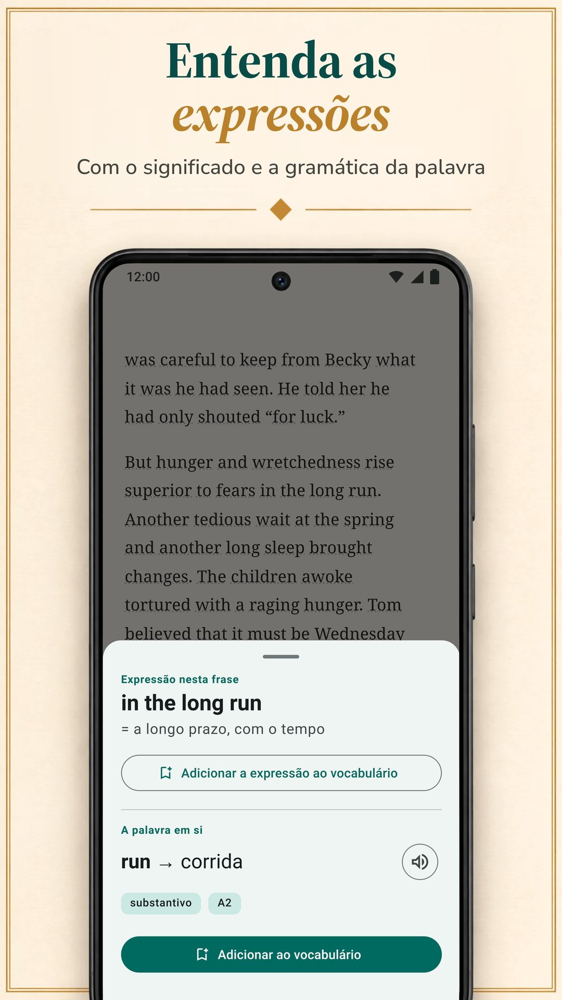

O LingQ se baseia em aprender um idioma com conteúdo real: milhares de lições com áudio em mais de 55 idiomas e importação de e-books, YouTube, Netflix e podcasts. Mas ele não é o único jeito de aprender lendo, e o Premium padrão dele custa mais que os planos padrão dos outros apps desta página. Aqui comparamos o LingQ com seis alternativas no que importa quando você aprende lendo: de onde vêm seus textos, como você vê os significados, o que acontece depois com as palavras e quanto tudo isso custa. O Biblyx é o nosso app, então leia esta comparação sabendo que ela foi escrita por uma das partes. Cada alternativa, a nossa inclusive, segue o mesmo modelo: o que faz bem, o que não faz tão bem, quanto custa e para quem é. Todos os dados sobre os outros apps vêm das páginas deles no Google Play, na App Store ou dos sites deles, conferidos em 9 de novembro de 2026.

## O essencial

- **O LingQ** ensina com milhares de lições com áudio em mais de 55 idiomas. O plano gratuito é limitado (a 20 palavras salvas, segundo o blog do LingQ), e o Premium custa US$ 14,99 por mês ou US$ 119,99 por ano.
- **O Biblyx** é um app para Android para ler seus próprios livros em EPUB, TXT e PDF com texto: você toca em uma palavra, ele a explica para aquela frase, guarda a frase no flashcard e não mostra anúncios. O Premium custa US$ 4,99 por mês ou US$ 35,99 por ano (Google Play, EUA), menos que os planos padrão mensais e anuais de LingQ, Linga, Beelinguapp e Readlang.
- **Para ler seus próprios livros**, veja Biblyx, Linga e Smart Book; o LingQ também importa e-books.
- **Se você quer a tradução ao lado do texto**, o Beelinguapp combina com iniciantes e o Smart Book com seus próprios livros; o Smart Book tem os menores preços padrão entre os apps que publicam seus planos.
- **O Readable** é só para inglês, e **o Readlang** é para ler no navegador, no computador.

## Por que as pessoas procuram uma alternativa ao LingQ

O LingQ merece a fama que tem. Ele cobre mais de 55 idiomas, tem milhares de lições com texto e áudio, importa e-books, artigos, YouTube, Netflix e podcasts e conta as palavras que você conhece. Mesmo assim, três coisas podem fazer você procurar outra opção:

- **O preço.** Consultas, revisões e importações ilimitadas exigem o Premium: US$ 14,99 por mês ou US$ 119,99 por ano na App Store, mais que os planos padrão dos outros apps daqui.
- **A complexidade.** Lições, importações, estatísticas e ferramentas de IA fazem dele um app poderoso, mas carregado; o próprio blog do LingQ diz que ele é mais difícil de aprender a usar que o Duolingo ou o Babbel.
- **Seus próprios livros.** Talvez você não queira nenhum sistema de lições, só um bom leitor para os livros que você já tem.

## Comparação rápida

| App | Ideal para | Preço padrão do Premium (EUA, 9 nov. 2026) | Versão gratuita | Anúncios na versão gratuita |
|---|---|---|---|---|
| LingQ (Android, iPhone, web) | lições com áudio em mais de 55 idiomas, importação de vídeos e podcasts | US$ 14,99/mês, US$ 119,99/ano | limitada a 20 palavras salvas, segundo o blog do LingQ | não |
| **Biblyx** (Android) | ler seus próprios livros, com cada palavra explicada para a frase dela | US$ 4,99/mês, US$ 35,99/ano | leitura, flashcards, exportação e sincronização; traduções por IA com uma cota diária | não |
| Linga (Android, iPhone) | uma biblioteca de mais de 1.000 livros reais, com jogos | US$ 5,49/mês, US$ 54,99/ano | download gratuito, PRO é pago | não |
| Beelinguapp (Android, iPhone) | iniciantes: a tradução ao lado do texto, audiolivros | US$ 7,99/mês, US$ 49,90/ano | download gratuito | sim |
| Smart Book (Android, iPhone) | uma tradução paralela dos seus próprios livros | US$ 1,99/mês, US$ 19,99/ano | download gratuito | sim |
| Readable (Android; iPhone não conferido) | histórias e notícias em inglês simplificadas | compras no app de US$ 1,99 a US$ 55,99 | download gratuito | sim |
| Readlang (web, extensão do Chrome) | ler no navegador, no computador | US$ 6/mês, US$ 48/ano | palavras soltas ilimitadas; 10 traduções de frases e 10 explicações de contexto por dia | não conferido (não há app no Google Play) |

Só planos padrão: preços semestrais, vitalícios e promocionais, e níveis superiores como LingQ Premium Plus e Readlang Premium Plus, ficaram de fora. Os preços de LingQ, Linga, Beelinguapp e Smart Book vêm da App Store, os de Biblyx e Readable do Google Play (o Readable mostra lá só uma faixa de preço) e o do Readlang do site dele. Eles variam de país para país, e a sua loja mostra o seu preço.

## Qual app combina com você?

| Seu objetivo | App |
|---|---|
| Ler os livros que você já tem, com ajuda em cada palavra | Biblyx; também Linga e Smart Book |
| Ver o significado que cabe na frase e guardar essa frase nos flashcards | Biblyx |
| Aprender com lições e áudio em muitos idiomas | LingQ |
| Uma grande biblioteca de livros reais, com jogos e sequências | Linga |
| Começar do zero com a tradução ao lado do texto | Beelinguapp |
| Uma tradução paralela completa dos seus próprios livros | Smart Book |
| Só inglês, com histórias e notícias simplificadas | Readable |
| Ler sites no computador | Readlang |
| Exportar suas palavras para o Anki | Biblyx ou Smart Book |
| Sem anúncios e sem pagar | Biblyx, LingQ ou Linga |
| O menor preço padrão entre os apps que publicam seus planos | Smart Book, depois Biblyx |

## As seis alternativas, uma a uma

### 1. Biblyx: o melhor para ler seus próprios livros

O Biblyx não é um curso, e sim um leitor para os seus próprios livros. Você abre um EPUB, um TXT ou um PDF com texto, ou cola um artigo, e toca em qualquer palavra: a IA lê a frase e dá o significado que cabe ali, com a classe gramatical, a forma básica e um nível CEFR estimado.

- **Um significado para a frase:** expressões idiomáticas vêm com os dois significados, substantivos em alemão, espanhol, francês, italiano e português vêm com o artigo, e palavras compostas são separadas em partes.
- **Flashcards que guardam a sua frase:** as palavras salvas voltam depois de 1, 3, 7, 14 e 30 dias, e você pode exportá-las para o Anki ou em CSV.
- **Offline:** a leitura e a revisão dos flashcards funcionam sem internet; para consultar uma palavra nova, é preciso conexão.
- **Uma primeira estante:** 29 contos curtos em 10 idiomas para os primeiros minutos.

A ideia cabe em uma linha: **Aprenda idiomas lendo seus próprios livros**.

**O que faz bem:** ler os livros que você escolhe, com significados que cabem na frase e flashcards que a guardam; sem anúncios, nem na versão gratuita.

**O que não faz tão bem:** por enquanto, só existe para Android (uma versão para iPhone está planejada, sem data), e não tem lições nem audiolivros: os textos são seus, e a voz do seu celular lê as palavras e as frases.

**Preço:** a versão gratuita inclui leitura, flashcards, exportação e sincronização, com uma cota diária de traduções por IA. O Premium tira o limite diário (com uso justo): US$ 4,99 por mês, US$ 24,99 por seis meses ou US$ 35,99 por ano no Google Play (EUA).

**Ideal para:** quem já tem livros que quer ler; 10 idiomas, mais 4 em beta.

**Experimente:** [o Biblyx no Google Play](https://play.google.com/store/apps/details?id=com.biblyx.app&referrer=utm_source%3Dbiblyx.com%26utm_medium%3Dwebsite%26utm_campaign%3Dguide_lingq_alternatives_pt_inline), ou leia antes [como funciona o leitor do Biblyx](/pt/app-para-ler-livros-com-traducao/).

### 2. Linga: o melhor para uma grande biblioteca de livros reais

O Linga é um leitor com uma biblioteca de mais de 1.000 livros em espanhol, francês, alemão, italiano, russo e inglês. Você toca uma palavra ou expressão e recebe uma tradução e um verbete de dicionário com sinônimos e notas de gramática, salva palavras com notas e as revisa com flashcards de repetição espaçada.

**O que faz bem:** uma grande biblioteca de livros reais; importação dos seus próprios EPUB, PDF, MOBI, FB2 e TXT; jogos de vocabulário, metas diárias e sequências; áudio de falantes nativos para palavras e frases, também offline.

**O que não faz tão bem:** ensina seis idiomas e, segundo a página dele, é pensado para níveis intermediário e avançado.

**Preço:** US$ 5,49 por mês ou US$ 54,99 por ano, ou US$ 109,99 uma única vez pelo acesso vitalício (App Store, EUA).

**Ideal para:** quem estuda um dos seis idiomas dele em nível intermediário e gosta de jogos.

### 3. Beelinguapp: o melhor para iniciantes que querem a tradução à vista

O Beelinguapp mostra um texto e sua tradução lado a lado, com audiolivros lidos por narradores nativos e um texto estilo karaokê que rola em sincronia com o áudio. A biblioteca vai de histórias infantis e clássicos como Sherlock Holmes até notícias do dia, para todos os níveis, em mais de 20 idiomas.

**O que faz bem:** um começo fácil: desde o primeiro dia você vê a tradução de cada linha, ouve enquanto lê e faz um quiz no fim de cada história.

**O que não faz tão bem:** a página do app não fala de importar seus próprios livros, e a página do Google Play indica que o app contém anúncios.

**Preço:** US$ 7,99 por mês ou US$ 49,90 por ano (App Store, EUA).

**Ideal para:** iniciantes que querem a tradução sempre à vista.

### 4. Smart Book: o melhor para uma tradução paralela dos seus próprios livros

O Smart Book é um leitor bilíngue: para os seus livros em FB2, EPUB ou TXT e para arquivos de legenda, mostra o texto original e a tradução em paralelo. Para cada palavra, você escolhe o serviço: Google Tradutor, DeepL, Reverso, Yandex ou chatbots de IA como ChatGPT, Claude e Gemini, que explicam significado e gramática.

**O que faz bem:** uma tradução completa dos seus próprios livros, a escolha do serviço de tradução, a exportação das palavras salvas para o Anki ou o ReWord, a leitura offline e os menores preços padrão entre os apps que publicam seus planos.

**O que não faz tão bem:** a página do Google Play indica anúncios e, na nossa opinião, com a tradução completa na tela é fácil acabar lendo no seu próprio idioma.

**Preço:** US$ 1,99 por mês ou US$ 19,99 por ano (App Store, EUA).

**Ideal para:** quem quer ler os próprios livros com uma tradução paralela completa.

### 5. Readable: o melhor para quem estuda inglês com textos adaptados

O Readable é só para quem estuda inglês. Professores experientes simplificam contos curtos e notícias do dia para o seu nível, cada palavra tem áudio e tradução, e um Word Trainer ajuda a memorizar as palavras salvas.

**O que faz bem:** textos já adaptados ao seu nível, com áudio para cada palavra.

**O que não faz tão bem:** só ensina inglês, a página do app não fala dos seus próprios livros, e a página do Google Play indica anúncios.

**Preço:** compras no app de US$ 1,99 a US$ 55,99 (Google Play, EUA); os planos não aparecem lá.

**Ideal para:** quem estuda inglês e prefere textos adaptados a livros próprios.

### 6. Readlang: o melhor para ler no navegador

O Readlang funciona no navegador e como extensão do Chrome. Você clica numa palavra ou frase de um texto ou da maioria dos sites para traduzi-la, a IA explica palavras e frases no contexto, e cada palavra traduzida é salva para praticar com flashcards, que também podem ser exportados. Você pode enviar seus próprios textos e artigos ou ler os artigos do site.

**O que faz bem:** mais de 100 idiomas, traduções na maioria dos sites e um plano gratuito com traduções ilimitadas de palavras soltas.

**O que não faz tão bem:** não há app do Readlang no Google Play (o site traz um guia para adicioná-lo à tela inicial do celular), e o plano gratuito permite 10 traduções de frases e 10 explicações de contexto por dia.

**Preço:** US$ 6 por mês ou US$ 48 por ano (site do Readlang).

**Ideal para:** quem lê muito no navegador, no computador.

## Recursos lado a lado

| App | Seus próprios arquivos | Como você vê os significados | Prática de vocabulário | Leitura incluída | Idiomas para aprender |
|---|---|---|---|---|---|
| LingQ (Android, iPhone, web) | e-books, artigos da web, YouTube, Netflix, podcasts | consulta de palavras no contexto; ferramentas de IA | revisão espaçada, contador de palavras conhecidas | milhares de lições com áudio | 55+ |
| **Biblyx** (Android) | EPUB, TXT, PDF com texto, texto colado | significado de IA ajustado à frase, expressões, artigos dos substantivos | cards com a frase do livro, exportação para Anki e CSV | 29 contos curtos | 10, mais 4 em beta |
| Linga (Android, iPhone) | EPUB, PDF, MOBI, FB2, TXT | tocar uma palavra ou expressão: tradução e verbete de dicionário | flashcards com repetição espaçada, jogos, sequências | mais de 1.000 livros | 6 |
| Beelinguapp (Android, iPhone) | não mencionado na página | tradução lado a lado; tocar uma palavra mostra o significado de dicionário | quizzes depois de cada história | histórias bilíngues e audiolivros | 20+ |
| Smart Book (Android, iPhone) | FB2, EPUB, TXT, legendas .srt | tradução paralela; escolha do serviço, inclusive chatbots de IA | palavras salvas, exportação para Anki ou ReWord | histórias bilíngues | inglês, alemão, francês, espanhol, italiano e outros |
| Readable (Android; iPhone não conferido) | não mencionado; histórias e notícias em inglês no app | áudio e tradução para cada palavra | Word Trainer | histórias simplificadas, notícias do dia | inglês |
| Readlang (web, extensão do Chrome) | textos e artigos que você envia; a maioria das páginas da web pela extensão | clique numa palavra ou frase para traduzir; explicações de IA no contexto | flashcards, exportação | artigos no site dele | 100+ |

## Resumindo

Na nossa opinião, o LingQ é o sistema mais completo desta lista: se você quer lições, áudio e muitos idiomas e o preço cabe no seu bolso, é uma ótima escolha. Se você quer ler seus próprios livros no Android, com cada palavra explicada para a frase dela, sem anúncios e pagando menos, experimente o Biblyx. Você também pode combinar duas ferramentas: o LingQ para lições e áudio, e um leitor como o Biblyx para os livros que já estão no seu celular. O Linga traz uma grande biblioteca de livros reais, o Beelinguapp um começo fácil, o Smart Book um leitor paralelo barato, o Readable inglês adaptado e o Readlang o navegador. O teste mais simples: leia o mesmo capítulo em dois apps durante uma semana e fique com o que você continua abrindo.

## Como conferimos

Escolhemos apps que, como o LingQ, ensinam pela leitura e têm mais de 1 milhão de downloads no Google Play (Linga, Beelinguapp, Smart Book, Readable), além da ferramenta de navegador Readlang e do nosso próprio app. Os dados sobre LingQ, Linga, Beelinguapp, Smart Book e Readable vêm das páginas deles no Google Play (loja dos EUA, em inglês) como estavam publicadas em 9 de novembro de 2026: [LingQ](https://play.google.com/store/apps/details?id=com.linguist), [Linga](https://play.google.com/store/apps/details?id=io.linga), [Beelinguapp](https://play.google.com/store/apps/details?id=com.david.android.languageswitch), [Smart Book](https://play.google.com/store/apps/details?id=com.kursx.smartbook) e [Readable](https://play.google.com/store/apps/details?id=co.playlingo.readable). As versões para iPhone e os preços padrão do Premium vêm, no mesmo dia, das páginas da App Store (EUA) de [LingQ](https://apps.apple.com/us/app/id379385811), [Linga](https://apps.apple.com/us/app/id1525101819), [Beelinguapp](https://apps.apple.com/us/app/id1225056371) e [Smart Book](https://apps.apple.com/us/app/id1278697399), os dados e preços do Readlang da [página de preços dele](https://readlang.com/pricing), e os preços de Biblyx e Readable do Google Play (EUA). O limite do plano gratuito do LingQ e o comentário sobre ele ser mais difícil de aprender a usar vêm do próprio blog do LingQ: os artigos sobre [alternativas ao Duolingo](https://www.lingq.com/blog/duolingo-alternatives/) (atualizado em 15 de junho de 2026) e sobre [os melhores apps para aprender idiomas](https://www.lingq.com/blog/best-language-learning-app/) (atualizado em 14 de outubro de 2026). Não conferimos a versão para iPhone do Readable. Esta página foi escrita por Galbinur Guliyev, que desenvolve o Biblyx. Os preços mudam e variam de país para país; se algo aqui estiver desatualizado, escreva para support@biblyx.com e corrigimos.

## Perguntas frequentes

### Qual é a alternativa ao LingQ mais barata?

Entre os apps que publicam seus planos, o Smart Book tem os menores preços padrão (US$ 1,99 por mês, US$ 19,99 por ano), e depois vem o Biblyx (US$ 4,99 por mês, US$ 35,99 por ano); os dois são preços dos EUA. Entre os apps cuja versão gratuita não tem anúncios, o Biblyx é o que custa menos; o Premium padrão do LingQ, a US$ 14,99 por mês, é o que custa mais.

### Existe uma alternativa gratuita ao LingQ?

Todos os apps daqui têm uma versão gratuita ou um download gratuito. A versão gratuita do Biblyx inclui leitura, flashcards, exportação e sincronização, com uma cota diária de traduções por IA e sem anúncios. O plano gratuito do Readlang tem traduções ilimitadas de palavras soltas e 10 traduções de frases por dia. Linga, Beelinguapp, Smart Book e Readable são downloads gratuitos com recursos pagos, e os três últimos mostram anúncios. O próprio blog do LingQ diz que o plano gratuito dele é limitado a 20 palavras salvas.

### Existe uma alternativa ao Readlang para Android?

O Readlang não tem app no Google Play; o site dele traz um guia para adicioná-lo à tela inicial do celular. No Google Play, Biblyx, Linga e Smart Book abrem seus próprios arquivos e deixam você tocar nas palavras para ver o significado, e o LingQ importa e-books e artigos.

### Existe uma alternativa ao LingQ que funcione com meus próprios livros?

Sim. O Biblyx abre EPUB, TXT, PDF com texto e texto colado; o Linga importa EPUB, PDF, MOBI, FB2 e TXT; o Smart Book abre FB2, EPUB e TXT com tradução paralela. O próprio LingQ também importa e-books.

### Quais desses apps não têm anúncios?

Segundo as páginas deles no Google Play, Biblyx, LingQ e Linga não têm anúncios; Beelinguapp, Smart Book e Readable têm. Os seis apps do Google Play oferecem compras no app.

### Qual é o app mais fácil para iniciantes?

O Beelinguapp, porque a tradução fica ao lado do texto, e o Readable para inglês, porque as histórias são simplificadas para o seu nível. No Biblyx, iniciantes começam pelos contos curtos iniciais e tocam só nas palavras de que precisam. O Linga se apresenta como app para níveis intermediário e avançado.

### Qual a diferença entre tradução paralela e significado para a frase?

A tradução paralela mostra o texto inteiro no seu idioma ao lado do original. O significado para a frase mostra só a palavra que você tocou, explicada para a frase em que você está, e assim você continua lendo no idioma que está aprendendo.

### O Biblyx funciona no iPhone?

Ainda não. O Biblyx está no Android pelo Google Play; a versão para iOS está planejada, sem data.
