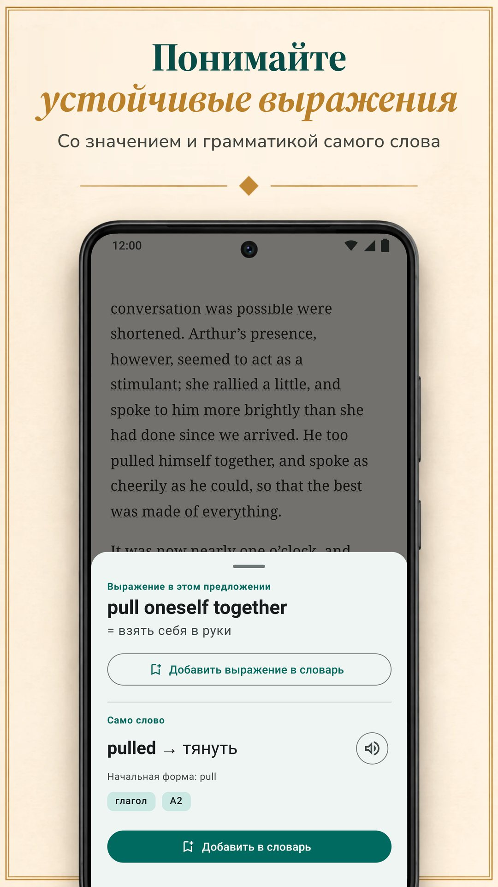

LingQ построен на изучении языка по настоящим материалам: тысячи уроков с аудио больше чем на 55 языках и импорт из электронных книг, YouTube, Netflix и подкастов. Но это не единственный способ учиться через чтение, а его стандартный Premium стоит дороже стандартных тарифов остальных приложений на этой странице. Здесь мы сравниваем LingQ с шестью альтернативами по тому, что важно, когда учите язык чтением: откуда берутся тексты, как вы получаете значения, что потом происходит со словами и сколько всё это стоит. Biblyx — наше приложение, поэтому читайте это сравнение, помня, что его написал один из участников рынка. Каждая альтернатива, включая нашу, описана по одной схеме: что она делает хорошо, что не очень, сколько стоит и кому подходит. Каждый факт о других приложениях взят с их собственных страниц в Google Play, App Store или с их сайтов и проверен 9 ноября 2026 года.

## Главное

- **LingQ** учит через тысячи уроков с аудио больше чем на 55 языках. Бесплатный тариф ограничен (по словам блога LingQ, 20 сохранёнными словами), а Premium стоит 14,99 $ в месяц или 119,99 $ в год.
- **Biblyx** — приложение для Android, в котором можно читать свои книги в EPUB, TXT и PDF с текстовым слоем: вы нажимаете на слово, и оно объясняется для этого предложения, предложение сохраняется на карточке, рекламы нет. Premium стоит 4,99 $ в месяц или 35,99 $ в год (Google Play, США) — меньше стандартных месячных и годовых тарифов LingQ, Linga, Beelinguapp и Readlang.
- **Чтобы читать свои книги**, посмотрите Biblyx, Linga и Smart Book; LingQ тоже импортирует электронные книги.
- **Если нужен перевод рядом с текстом**, Beelinguapp подходит начинающим, а Smart Book — для своих книг; у Smart Book самые низкие стандартные цены среди приложений, которые публикуют свои тарифы.
- **Readable** — только для английского, а **Readlang** — для чтения в браузере на компьютере.

## Почему ищут аналог LingQ

LingQ заслуживает своей репутации. В нём больше 55 языков, тысячи уроков с текстом и аудио, импорт электронных книг, статей, YouTube, Netflix и подкастов и счётчик слов, которые вы знаете. И всё же есть три причины посмотреть в другую сторону:

- **Цена.** Безлимитный поиск слов, повторения и импорт требуют Premium: 14,99 $ в месяц или 119,99 $ в год в App Store, больше стандартных тарифов остальных приложений здесь.
- **Сложность.** Уроки, импорт, статистика и инструменты ИИ делают приложение мощным, но перегруженным; собственный блог LingQ пишет, что освоить его сложнее, чем Duolingo или Babbel.
- **Свои книги.** Возможно, вам вообще не нужна система уроков, а нужна просто хорошая читалка для книг, которые у вас уже есть.

## Быстрое сравнение

| Приложение | Кому подходит | Стандартная цена Premium (США, 9 ноября 2026) | Бесплатная версия | Реклама в бесплатной версии |
|---|---|---|---|---|
| LingQ (Android, iPhone, веб) | уроки с аудио больше чем на 55 языках, импорт видео и подкастов | 14,99 $ в месяц, 119,99 $ в год | ограничена 20 сохранёнными словами (по блогу LingQ) | нет |
| **Biblyx** (Android) | чтение своих книг, каждое слово объясняется для своего предложения | 4,99 $ в месяц, 35,99 $ в год | чтение, карточки, экспорт и синхронизация; переводы ИИ с дневным лимитом | нет |
| Linga (Android, iPhone) | библиотека из более чем 1000 настоящих книг, с играми | 5,49 $ в месяц, 54,99 $ в год | бесплатная загрузка, PRO платный | нет |
| Beelinguapp (Android, iPhone) | начинающие: перевод рядом с текстом, аудиокниги | 7,99 $ в месяц, 49,90 $ в год | бесплатная загрузка | есть |
| Smart Book (Android, iPhone) | параллельный перевод своих книг | 1,99 $ в месяц, 19,99 $ в год | бесплатная загрузка | есть |
| Readable (Android; iPhone не проверяли) | упрощённые рассказы и новости на английском | покупки в приложении 1,99–55,99 $ | бесплатная загрузка | есть |
| Readlang (веб, расширение для Chrome) | чтение в браузере на компьютере | 6 $ в месяц, 48 $ в год | отдельные слова без лимита; 10 переводов фраз и 10 объяснений контекста в день | не проверяли (приложения в Google Play нет) |

Только стандартные тарифы: полугодовые, пожизненные и акционные цены, а также старшие тарифы вроде LingQ Premium Plus и Readlang Premium Plus не учитываются. Цены LingQ, Linga, Beelinguapp и Smart Book взяты из App Store, Biblyx и Readable — из Google Play (Readable показывает там только диапазон), Readlang — с его сайта. Цены зависят от страны; ваш магазин покажет вашу цену.

## Какое приложение подойдёт вам?

| Ваша цель | Приложение |
|---|---|
| Читать книги, которые у вас уже есть, с помощью на каждом слове | Biblyx; также Linga и Smart Book |
| Видеть значение, подходящее к предложению, и сохранять это предложение на карточке | Biblyx |
| Учиться по урокам с аудио на многих языках | LingQ |
| Большая библиотека настоящих книг, с играми и сериями дней | Linga |
| Начать с нуля, когда перевод рядом с текстом | Beelinguapp |
| Полный параллельный перевод своих книг | Smart Book |
| Только английский, упрощённые рассказы и новости | Readable |
| Читать сайты на компьютере | Readlang |
| Экспортировать слова в Anki | Biblyx или Smart Book |
| Без рекламы и без оплаты | Biblyx, LingQ или Linga |
| Самая низкая стандартная цена среди приложений, которые публикуют тарифы | Smart Book, затем Biblyx |

## Шесть альтернатив по порядку

### 1. Biblyx: лучше всего для чтения своих книг

Biblyx — не курс, а читалка для ваших собственных книг. Вы открываете EPUB, TXT или PDF с текстовым слоем либо вставляете статью и нажимаете на любое слово: ИИ читает предложение и даёт значение, подходящее именно здесь, с частью речи, начальной формой и примерным уровнем CEFR.

- **Значение под предложение:** для идиом показываются оба значения, для немецких, испанских, французских, итальянских и португальских существительных — артикль, а составные слова разбираются на части.
- **Карточки с вашим предложением:** сохранённые слова возвращаются через 1, 3, 7, 14 и 30 дней; их можно экспортировать в Anki или CSV.
- **Офлайн:** чтение и повторение карточек работают без интернета; чтобы узнать значение нового слова, нужно подключение.
- **Первая полка:** для первых минут уже есть 29 коротких рассказов на 10 языках.

Вся идея в одной строке: **Учите языки, читая свои книги**.

**Что получается хорошо:** читать выбранные вами книги со значениями, подходящими к предложению, и с карточками, которые это предложение сохраняют; рекламы нет даже в бесплатной версии.

**Что получается хуже:** пока только Android (версия для iPhone планируется, даты нет); нет уроков и аудиокниг: тексты приносите вы, а слова и предложения читает голос вашего телефона.

**Цена:** в бесплатной версии есть чтение, карточки, экспорт и синхронизация, а переводы ИИ — с дневным лимитом. Premium снимает дневной лимит (действуют правила разумного использования): 4,99 $ в месяц, 24,99 $ за полгода или 35,99 $ в год в Google Play (США).

**Кому подходит:** тем, у кого уже есть книги, которые хочется прочитать; 10 языков и ещё 4 в бета-версии.

**Попробовать:** [Biblyx в Google Play](https://play.google.com/store/apps/details?id=com.biblyx.app&referrer=utm_source%3Dbiblyx.com%26utm_medium%3Dwebsite%26utm_campaign%3Dguide_lingq_alternatives_ru_inline) или сначала прочитайте, [как работает читалка Biblyx](/ru/chitalka-s-perevodom/).

### 2. Linga: лучше всего для большой библиотеки настоящих книг

Linga — читалка с библиотекой из более чем 1000 книг на испанском, французском, немецком, итальянском, русском и английском. Вы нажимаете на слово или фразу и получаете перевод и словарную статью с синонимами и грамматическими пометками, сохраняете слова с заметками и повторяете их на карточках с интервальными повторениями.

**Что получается хорошо:** большая библиотека настоящих книг; импорт своих EPUB, PDF, MOBI, FB2 и TXT; словарные игры, дневные цели и серии дней; озвучка слов и предложений носителями, в том числе офлайн.

**Что получается хуже:** в ней шесть языков, и по её описанию она рассчитана на средний и продвинутый уровень.

**Цена:** 5,49 $ в месяц или 54,99 $ в год, либо разово 109,99 $ за пожизненный доступ (App Store, США).

**Кому подходит:** изучающим один из этих шести языков на среднем уровне, кто любит игровые элементы.

### 3. Beelinguapp: лучше всего для начинающих, которым нужен перевод перед глазами

Beelinguapp показывает текст и перевод рядом; есть аудиокниги, которые читают носители, и текст в стиле караоке, который прокручивается синхронно с аудио. Библиотека рассчитана на все уровни, от детских историй и классики вроде Шерлока Холмса до ежедневных новостей, а языков больше 20.

**Что получается хорошо:** лёгкий старт: с первого дня вы видите перевод каждой строки, слушаете во время чтения и проходите тест после каждой истории.

**Что получается хуже:** в описании не говорится об импорте своих книг, а страница в Google Play отмечает, что в приложении есть реклама.

**Цена:** 7,99 $ в месяц или 49,90 $ в год (App Store, США).

**Кому подходит:** начинающим, которым нужен перевод всегда перед глазами.

### 4. Smart Book: лучше всего для параллельного перевода своих книг

Smart Book — двуязычная читалка: для ваших книг в FB2, EPUB или TXT и файлов субтитров она показывает оригинал и перевод рядом. Для отдельного слова вы сами выбираете сервис: Google Translate, DeepL, Reverso, Яндекс или чат-боты ИИ вроде ChatGPT, Claude и Gemini, которые объясняют значение и грамматику.

**Что получается хорошо:** полный перевод своих книг, выбор сервиса перевода, экспорт сохранённых слов в Anki или ReWord, чтение офлайн и самые низкие стандартные цены среди приложений, которые публикуют тарифы.

**Что получается хуже:** страница в Google Play отмечает рекламу; на наш взгляд, когда на экране полный перевод, легко перейти на чтение на родном языке.

**Цена:** 1,99 $ в месяц или 19,99 $ в год (App Store, США).

**Кому подходит:** тем, кто хочет читать свои книги с полным параллельным переводом.

### 5. Readable: лучше всего для изучающих английский по адаптированным текстам

Readable — только для изучающих английский. Опытные преподаватели упрощают короткие рассказы и ежедневные новости под ваш уровень, у каждого слова есть аудио и перевод, а Word Trainer помогает запомнить сохранённые слова.

**Что получается хорошо:** тексты, уже адаптированные под ваш уровень, и аудио для каждого слова.

**Что получается хуже:** только английский, в описании не говорится о своих книгах, а страница в Google Play отмечает рекламу.

**Цена:** покупки в приложении от 1,99 $ до 55,99 $ (Google Play, США); тарифы там не указаны.

**Кому подходит:** изучающим английский, которым нужны адаптированные тексты, а не свои книги.

### 6. Readlang: лучше всего для чтения в браузере

Readlang работает в браузере и как расширение для Chrome. Вы щёлкаете по слову или фразе в тексте или на большинстве сайтов и получаете перевод, ИИ объясняет слова и фразы в контексте, а каждое переведённое слово сохраняется для повторения на карточках, которые можно и экспортировать. Можно загружать свои тексты и статьи или читать статьи на сайте сервиса.

**Что получается хорошо:** больше 100 языков, перевод на большинстве сайтов и бесплатный тариф с безлимитным переводом отдельных слов.

**Что получается хуже:** приложения Readlang в Google Play нет (на сайте есть ссылка на инструкцию, как добавить его на главный экран телефона), а в бесплатном тарифе — 10 переводов фраз и 10 объяснений контекста в день.

**Цена:** 6 $ в месяц или 48 $ в год (сайт Readlang).

**Кому подходит:** тем, кто много читает в браузере на компьютере.

## Возможности рядом

| Приложение | Свои файлы | Как вы получаете значения | Работа со словами | Встроенное чтение | Изучаемые языки |
|---|---|---|---|---|---|
| LingQ (Android, iPhone, веб) | электронные книги, статьи, YouTube, Netflix, подкасты | поиск слов в контексте; инструменты ИИ | интервальные повторения, счётчик известных слов | тысячи уроков с аудио | 55+ |
| **Biblyx** (Android) | EPUB, TXT, PDF с текстовым слоем, вставленный текст | значение от ИИ под предложение, идиомы, артикли существительных | карточки с предложением из книги, экспорт в Anki и CSV | 29 коротких рассказов | 10 и ещё 4 в бета-версии |
| Linga (Android, iPhone) | EPUB, PDF, MOBI, FB2, TXT | нажатие на слово или фразу: перевод и словарная статья | карточки с интервальными повторениями, игры, серии дней | 1000+ книг | 6 |
| Beelinguapp (Android, iPhone) | в описании не упоминается | перевод рядом; нажатие на слово даёт словарное значение | тест после каждой истории | двуязычные истории и аудиокниги | 20+ |
| Smart Book (Android, iPhone) | FB2, EPUB, TXT, субтитры .srt | параллельный перевод; выбор сервиса, включая чат-боты ИИ | сохранённые слова, экспорт в Anki или ReWord | двуязычные истории | английский, немецкий, французский, испанский, итальянский и другие |
| Readable (Android; iPhone не проверяли) | не упоминается; английские рассказы и новости в приложении | аудио и перевод для каждого слова | Word Trainer | упрощённые рассказы, ежедневные новости | английский |
| Readlang (веб, расширение для Chrome) | загруженные тексты и статьи; большинство веб-страниц через расширение | щелчок по слову или фразе — перевод; объяснения ИИ в контексте | карточки, экспорт | статьи на сайте | 100+ |

## Итог

На наш взгляд, LingQ — самая полная система здесь: если вам нужны уроки, аудио и много языков, а цена вас устраивает, это сильный выбор. Если хотите читать свои книги на Android, с объяснением каждого слова для его предложения, без рекламы и дешевле, попробуйте Biblyx. Можно и совмещать два инструмента: LingQ для уроков и аудио, а читалку вроде Biblyx — для книг, которые уже есть в телефоне. Linga даёт большую библиотеку настоящих книг, Beelinguapp — лёгкий старт, Smart Book — недорогую параллельную читалку, Readable — адаптированный английский, а Readlang — браузер. Самая простая проверка: неделю читайте одну и ту же главу в двух приложениях и оставьте то, которое продолжаете открывать.

## Как мы проверяли

Мы выбрали приложения, которые, как LingQ, учат через чтение и у которых больше 1 миллиона загрузок в Google Play (Linga, Beelinguapp, Smart Book, Readable), и добавили к ним браузерный инструмент Readlang и наше приложение. Факты о LingQ, Linga, Beelinguapp, Smart Book и Readable взяты из их страниц в Google Play (магазин США, на английском) в том виде, в каком они были опубликованы 9 ноября 2026 года: [LingQ](https://play.google.com/store/apps/details?id=com.linguist), [Linga](https://play.google.com/store/apps/details?id=io.linga), [Beelinguapp](https://play.google.com/store/apps/details?id=com.david.android.languageswitch), [Smart Book](https://play.google.com/store/apps/details?id=com.kursx.smartbook) и [Readable](https://play.google.com/store/apps/details?id=co.playlingo.readable). Версии для iPhone и стандартные цены Premium мы в тот же день взяли со страниц App Store (США) [LingQ](https://apps.apple.com/us/app/id379385811), [Linga](https://apps.apple.com/us/app/id1525101819), [Beelinguapp](https://apps.apple.com/us/app/id1225056371) и [Smart Book](https://apps.apple.com/us/app/id1278697399), факты и цены Readlang — с [его страницы тарифов](https://readlang.com/pricing), а цены Biblyx и Readable — из Google Play (США). Ограничение бесплатного тарифа LingQ и слова о том, что его сложнее освоить, взяты из собственного блога LingQ: статей о [замене Duolingo](https://www.lingq.com/blog/duolingo-alternatives/) (обновлена 15 июня 2026 года) и о [лучших приложениях для изучения языков](https://www.lingq.com/blog/best-language-learning-app/) (обновлена 14 октября 2026 года). Версию Readable для iPhone мы не проверяли. Эту страницу написал Galbinur Guliyev, создатель Biblyx. Цены меняются и зависят от страны; если что-то здесь устарело, напишите на support@biblyx.com, и мы исправим.

## Частые вопросы

### Какой аналог LingQ самый дешёвый?

Среди приложений, которые публикуют свои тарифы, самые низкие стандартные цены у Smart Book (1,99 $ в месяц, 19,99 $ в год), затем идёт Biblyx (4,99 $ в месяц, 35,99 $ в год); обе цены для США. Среди приложений без рекламы в бесплатной версии дешевле всех Biblyx, а дороже всех — стандартный Premium LingQ за 14,99 $ в месяц.

### Есть ли бесплатный аналог LingQ?

У каждого приложения здесь есть бесплатная версия или бесплатная загрузка. В бесплатной версии Biblyx есть чтение, карточки, экспорт и синхронизация, переводы ИИ с дневным лимитом и нет рекламы. В бесплатном тарифе Readlang перевод отдельных слов не ограничен, а переводов фраз — 10 в день. Linga, Beelinguapp, Smart Book и Readable можно скачать бесплатно, с платными улучшениями; последние три показывают рекламу. Собственный блог LingQ пишет, что его бесплатный тариф ограничен 20 сохранёнными словами.

### Есть ли аналог Readlang для Android?

У Readlang нет приложения в Google Play; на его сайте есть ссылка на инструкцию, как добавить сервис на главный экран телефона. В Google Play Biblyx, Linga и Smart Book открывают ваши собственные файлы и показывают значение слова по нажатию, а LingQ импортирует электронные книги и статьи.

### Есть ли аналог LingQ, который работает с моими книгами?

Да. Biblyx открывает EPUB, TXT, PDF с текстовым слоем и вставленный текст; Linga импортирует EPUB, PDF, MOBI, FB2 и TXT; Smart Book открывает FB2, EPUB и TXT с параллельным переводом. Сам LingQ тоже импортирует электронные книги.

### В каких из этих приложений нет рекламы?

По их страницам в Google Play, рекламы нет в Biblyx, LingQ и Linga; в Beelinguapp, Smart Book и Readable она есть. Покупки в приложении есть во всех шести приложениях из Google Play.

### Какое приложение проще всего для начинающих?

Beelinguapp, потому что перевод стоит рядом с текстом, и Readable для английского, потому что его рассказы упрощены под ваш уровень. В Biblyx новички начинают с коротких стартовых рассказов и нажимают только на нужные им слова. Linga описывает себя как приложение для среднего и продвинутого уровня.

### Чем параллельный перевод отличается от значения под предложение?

Параллельный перевод показывает весь текст на вашем языке рядом с оригиналом. Значение под предложение показывает только слово, на которое вы нажали, объяснённое для этого предложения, поэтому вы продолжаете читать на языке, который учите.

### Работает ли Biblyx на iPhone?

Пока нет. Biblyx доступен для Android в Google Play; версия для iOS планируется, даты нет.
