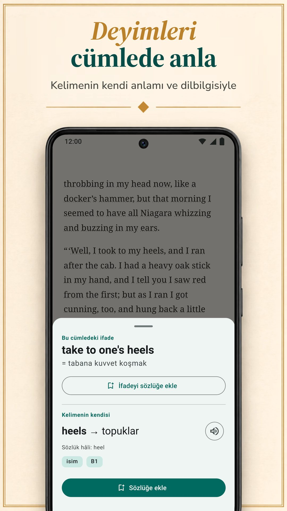

LingQ, dili gerçek içerikten öğrenme fikri üzerine kurulu: 55'ten fazla dilde sesli binlerce ders, e-kitaplardan, YouTube'dan, Netflix'ten ve podcast'lerden içe aktarma. Ama okuyarak öğrenmenin tek yolu o değil ve standart Premium planı buradaki diğer uygulamaların standart planlarından pahalı. Bu sayfa LingQ'yu altı alternatifle, okuyarak öğrenirken önemli olan noktalarda karşılaştırıyor: metinlerin nereden geliyor, anlamı nasıl görüyorsun, kelimelere sonra ne oluyor ve hepsi kaça mal oluyor. Biblyx bizim uygulamamız, o yüzden bu karşılaştırmayı taraflardan birinin yazdığını bilerek oku. Bizimki dahil her alternatif aynı kalıbı alıyor: neyi iyi yapıyor, neyi iyi yapmıyor, fiyatı ne ve kimin için. Diğer uygulamalar hakkındaki her bilgi kendi Google Play sayfalarından, App Store sayfalarından ya da sitelerinden alındı ve 9 Kasım 2026'da kontrol edildi.

## Öne çıkanlar

- **LingQ** 55'ten fazla dilde sesli binlerce dersle öğretiyor. Ücretsiz planı sınırlı (LingQ'nun blogu 20 kayıtlı kelime diyor); Premium aylık 14,99 $ ya da yıllık 119,99 $.
- **Biblyx**, kendi EPUB, TXT ve metin tabanlı PDF kitaplarını okumak için bir Android uygulaması: bir kelimeye dokunursun, o cümleye göre açıklar, cümleyi kelime kartında saklar ve reklam göstermez. Premium aylık 4,99 $ ya da yıllık 35,99 $ (Google Play, ABD); bu, LingQ, Linga, Beelinguapp ve Readlang'ın standart aylık ve yıllık planlarından ucuz.
- **Kendi kitaplarını okumak için** Biblyx, Linga ve Smart Book'a bak; LingQ da e-kitap içe aktarıyor.
- **Metnin yanında çeviri istiyorsan**, Beelinguapp yeni başlayanlara, Smart Book kendi kitaplarına uygun; planlarını açıkça yazan uygulamalar arasında en düşük standart fiyatlar Smart Book'ta.
- **Readable** yalnızca İngilizce için, **Readlang** ise bilgisayarda, tarayıcıda okumak için.

## İnsanlar neden LingQ alternatifi arıyor

LingQ ününü hak ediyor. 55'ten fazla dil, metni ve sesi eşleşen binlerce ders, e-kitaplardan, makalelerden, YouTube'dan, Netflix'ten ve podcast'lerden içe aktarma ve bildiğin kelimelerin sayacı var. Yine de üç şey seni başka yere baktırabilir:

- **Fiyat.** Sınırsız kelime sorgulama, tekrar ve içe aktarma Premium istiyor: App Store'da aylık 14,99 $ ya da yıllık 119,99 $, buradaki diğer uygulamaların standart planlarından fazla.
- **Karmaşıklık.** Dersler, içe aktarma, istatistikler ve yapay zekâ araçları güçlü ama kalabalık bir uygulama yapıyor; LingQ'nun kendi blogu, öğrenme eğrisinin Duolingo ve Babbel'den daha dik olduğunu söylüyor.
- **Kendi kitapların.** Belki bir ders sistemi hiç istemiyorsun, sadece elindeki kitaplar için iyi bir okuyucu istiyorsun.

## Hızlı karşılaştırma

| Uygulama | Kimin için | Standart Premium fiyatı (ABD, 9 Kasım 2026) | Ücretsiz sürüm | Ücretsiz sürümde reklam |
|---|---|---|---|---|
| LingQ (Android, iPhone, web) | 55'ten fazla dilde sesli dersler, video ve podcast içe aktarma | aylık 14,99 $, yıllık 119,99 $ | 20 kayıtlı kelimeyle sınırlı (LingQ'nun bloguna göre) | yok |
| **Biblyx** (Android) | kendi kitaplarını, her kelimeyi cümlesine göre açıklayarak okumak | aylık 4,99 $, yıllık 35,99 $ | okuma, kelime kartları, dışa aktarma ve eşitleme; yapay zekâ çevirileri günlük bir hakla | yok |
| Linga (Android, iPhone) | 1.000'den fazla gerçek kitaplık bir kütüphane, oyunlarla | aylık 5,49 $, yıllık 54,99 $ | ücretsiz indirme, PRO ücretli | yok |
| Beelinguapp (Android, iPhone) | yeni başlayanlar: metnin yanında çeviri, sesli kitaplar | aylık 7,99 $, yıllık 49,90 $ | ücretsiz indirme | var |
| Smart Book (Android, iPhone) | kendi kitaplarının paralel çevirisi | aylık 1,99 $, yıllık 19,99 $ | ücretsiz indirme | var |
| Readable (Android; iOS sürümü yakında, sitesine göre) | sadeleştirilmiş İngilizce hikâyeler ve haberler | uygulama içi satın alma 1,99–55,99 $ | ücretsiz indirme | var |
| Readlang (web, Chrome eklentisi) | bilgisayarda, tarayıcıda okumak | aylık 6 $, yıllık 48 $ | sınırsız tek kelime; günde 10 ifade çevirisi ve 10 bağlam açıklaması | kontrol edilmedi (Google Play uygulaması yok) |

Yalnızca standart planlar: altı aylık, ömür boyu ve kampanyalı fiyatlar ile LingQ Premium Plus ve Readlang Premium Plus gibi üst paketler dahil değil. Fiyatlar LingQ, Linga, Beelinguapp ve Smart Book için App Store'dan, Biblyx ve Readable için Google Play'den (Readable orada yalnızca bir fiyat aralığı gösteriyor), Readlang için kendi sitesinden alındı. Ülkeye göre değişir; senin mağazan kendi fiyatını gösterir.

## Hangi uygulama sana uygun?

| Hedefin | Uygulama |
|---|---|
| Elindeki kitapları her kelimede yardımla okumak | Biblyx; ayrıca Linga ve Smart Book |
| Cümleye uyan anlamı görmek ve o cümleyi kelime kartında saklamak | Biblyx |
| Çok sayıda dilde sesli derslerle öğrenmek | LingQ |
| Oyunlar ve serilerle büyük bir gerçek kitap kütüphanesi | Linga |
| Sıfırdan, çeviri metnin yanındayken başlamak | Beelinguapp |
| Kendi kitaplarının tam paralel çevirisi | Smart Book |
| Yalnızca İngilizce, sadeleştirilmiş hikâyeler ve haberler | Readable |
| Bilgisayarda web sitelerini okumak | Readlang |
| Kelimelerini Anki'ye aktarmak | Biblyx ya da Smart Book |
| Para ödemeden reklamsız kullanmak | Biblyx, LingQ ya da Linga |
| Planlarını yazan uygulamalar arasında en düşük standart fiyat | Smart Book, sonra Biblyx |

## Altı alternatif, tek tek

### 1. Biblyx: kendi kitaplarını okumak için en iyisi

Biblyx bir kurs değil, kendi kitapların için bir okuyucu. EPUB, TXT ya da metin tabanlı PDF açar veya bir makale yapıştırırsın ve herhangi bir kelimeye dokunursun: yapay zekâ cümleyi okur ve orada uyan anlamı sözcük türü, sözlük hâli ve tahmini CEFR seviyesiyle verir.

- **Cümleye göre anlam:** deyimler iki anlamıyla gelir; Almanca, İspanyolca, Fransızca, İtalyanca ve Portekizce isimler artikeliyle gelir; birleşik kelimeler parçalarına ayrılır.
- **Cümleni saklayan kartlar:** kaydettiğin kelimeler 1, 3, 7, 14 ve 30 gün sonra geri gelir; onları Anki'ye ya da CSV'ye aktarabilirsin.
- **Çevrimdışı:** okuma ve kart tekrarı internetsiz çalışır; yeni bir kelimeye bakmak için bağlantı gerekir.
- **İlk raf:** ilk dakikaların için 10 dilde 29 kısa hikâye hazır.

Fikir tek satıra sığıyor: **Kendi kitaplarını okuyarak dil öğren**.

**İyi yaptığı:** seçtiğin kitapları cümleye uyan anlamlarla ve o cümleyi saklayan kartlarla okumak; ücretsiz sürümde bile reklam yok.

**İyi yapmadığı:** şimdilik yalnızca Android'de (iPhone sürümü planlanıyor, tarih yok); ders ya da sesli kitap yok: metinleri sen getirirsin, kelimeleri ve cümleleri telefonunun sesi okur.

**Fiyat:** ücretsiz sürümde okuma, kelime kartları, dışa aktarma ve eşitleme var; yapay zekâ çevirileri günlük bir hakla. Premium günlük sınırı kaldırır (adil kullanım geçerli): Google Play'de (ABD) aylık 4,99 $, altı aylık 24,99 $ ya da yıllık 35,99 $.

**Kimin için:** okumak istediği kitaplar zaten elinde olanlar için; 10 dil, ayrıca beta aşamasında 4 dil.

**Dene:** [Google Play'de Biblyx](https://play.google.com/store/apps/details?id=com.biblyx.app&referrer=utm_source%3Dbiblyx.com%26utm_medium%3Dwebsite%26utm_campaign%3Dguide_lingq_alternatives_tr_inline) ya da önce [Biblyx okuyucusunun nasıl çalıştığını](/tr/ingilizce-kitap-okuma-uygulamasi/) oku.

### 2. Linga: büyük bir gerçek kitap kütüphanesi için en iyisi

Linga, İspanyolca, Fransızca, Almanca, İtalyanca, Rusça ve İngilizce 1.000'den fazla kitaplık bir kütüphanesi olan bir okuyucu. Bir kelimeye ya da ifadeye dokunup eş anlamlılar ve dil bilgisi notlarıyla birlikte çeviri ve sözlük maddesi görürsün, kelimeleri notlarla kaydeder ve aralıklı tekrarlı kartlarla çalışırsın.

**İyi yaptığı:** büyük bir gerçek kitap kütüphanesi; kendi EPUB, PDF, MOBI, FB2 ve TXT dosyalarını içe aktarma; kelime oyunları, günlük hedefler ve seriler; kelimeler ve cümleler için anadili konuşanların sesi, çevrimdışı da.

**İyi yapmadığı:** altı dil öğretiyor ve sayfasına göre orta ve ileri seviyedekiler için.

**Fiyat:** aylık 5,49 $ ya da yıllık 54,99 $; ömür boyu erişim için bir kerelik 109,99 $ (App Store, ABD).

**Kimin için:** bu altı dilden birini öğrenen ve oyun öğelerini seven orta seviyedekiler için.

### 3. Beelinguapp: çeviriyi hep gözünün önünde isteyen yeni başlayanlar için en iyisi

Beelinguapp metni ve çevirisini yan yana gösteriyor; anadili konuşan seslendirmenlerin okuduğu sesli kitaplar ve sesle eş zamanlı akan karaoke tarzı metin var. Kütüphanesi çocuk hikâyelerinden Sherlock Holmes gibi klasiklere ve günlük haberlere kadar her seviyeye uzanıyor ve 20'den fazla dil sunuyor.

**İyi yaptığı:** kolay bir başlangıç: ilk günden her satırın çevirisini görürsün, okurken dinlersin ve her hikâyenin sonunda bir test çözersin.

**İyi yapmadığı:** sayfasında kendi kitaplarını içe aktarmaktan söz edilmiyor; Google Play sayfası uygulamanın reklam içerdiğini belirtiyor.

**Fiyat:** aylık 7,99 $ ya da yıllık 49,90 $ (App Store, ABD).

**Kimin için:** çeviriyi hep gözünün önünde isteyen yeni başlayanlar için.

### 4. Smart Book: kendi kitaplarının paralel çevirisi için en iyisi

Smart Book iki dilli bir okuyucu: kendi FB2, EPUB ya da TXT kitaplarında ve altyazı dosyalarında orijinal metni ve çevirisini yan yana gösteriyor. Tek bir kelime için servisi sen seçiyorsun: Google Translate, DeepL, Reverso, Yandex ya da anlamı ve dil bilgisini açıklayan ChatGPT, Claude ve Gemini gibi yapay zekâ sohbet botları.

**İyi yaptığı:** kendi kitaplarının tam çevirisi, çeviri servisi seçimi, kaydedilen kelimeleri Anki'ye ya da ReWord'e aktarma, çevrimdışı okuma ve planlarını yazan uygulamalar arasında en düşük standart fiyatlar.

**İyi yapmadığı:** Google Play sayfası reklam olduğunu belirtiyor; bize göre ekranda tam bir çeviri olunca kendi dilinde okumaya kaymak kolaylaşıyor.

**Fiyat:** aylık 1,99 $ ya da yıllık 19,99 $ (App Store, ABD).

**Kimin için:** kendi kitaplarını tam paralel çeviriyle okumak isteyenler için.

### 5. Readable: uyarlanmış metin isteyen İngilizce öğrenenler için en iyisi

Readable yalnızca İngilizce öğrenenler için. Uzman öğretmenler kısa hikâyeleri ve günlük haberleri senin seviyene göre sadeleştiriyor, her kelimenin sesi ve çevirisi var, Word Trainer da kaydettiğin kelimeleri ezberlemene yardım ediyor.

**İyi yaptığı:** seviyene zaten uyarlanmış metinler, her kelime için ses.

**İyi yapmadığı:** yalnızca İngilizce öğretiyor, sayfasında kendi kitaplarından söz edilmiyor ve Google Play sayfası reklam olduğunu belirtiyor.

**Fiyat:** uygulama içi satın alma 1,99 $ ile 55,99 $ arası (Google Play, ABD); planları orada yazmıyor.

**Kimin için:** kendi kitapları yerine uyarlanmış metin isteyen İngilizce öğrenenler için.

### 6. Readlang: tarayıcıda okumak için en iyisi

Readlang web tarayıcısında ve Chrome eklentisi olarak çalışıyor. Bir metinde ya da çoğu web sitesinde bir kelimeye veya ifadeye tıklayıp çevirisini görüyorsun, yapay zekâ kelimeleri ve ifadeleri bağlama göre açıklıyor, çevirdiğin her kelime de kartlarla çalışmak için kaydediliyor ve dışa aktarılabiliyor. Kendi metinlerini ve makalelerini yükleyebilir ya da sitesindeki makaleleri okuyabilirsin.

**İyi yaptığı:** 100'den fazla dil, çoğu web sitesinde çeviri ve tek kelimelik çevirilerin sınırsız olduğu ücretsiz bir plan.

**İyi yapmadığı:** Google Play'de Readlang uygulaması yok (sitesinde telefonun ana ekranına eklemeyi anlatan bir rehbere bağlantı var); ücretsiz planda günde 10 ifade çevirisi ve 10 bağlam açıklaması hakkı var.

**Fiyat:** aylık 6 $ ya da yıllık 48 $ (kendi sitesi).

**Kimin için:** bilgisayarda, tarayıcıda çok okuyanlar için.

## Özellikler yan yana

| Uygulama | Kendi dosyaların | Anlamı nasıl görürsün | Kelime çalışması | Uygulamadaki okuma | Öğrenilen diller |
|---|---|---|---|---|---|
| LingQ (Android, iPhone, web) | e-kitap, web makalesi, YouTube, Netflix, podcast | kelimeye bağlam içinde bakma; yapay zekâ araçları | aralıklı tekrar, bilinen kelime sayacı | sesli binlerce ders | 55+ |
| **Biblyx** (Android) | EPUB, TXT, metin tabanlı PDF, yapıştırılan metin | cümleye uyan yapay zekâ anlamı, deyimler, isimlerin artikelleri | kitap cümlesini saklayan kartlar, Anki ve CSV'ye aktarma | 29 kısa hikâye | 10, ayrıca beta aşamasında 4 |
| Linga (Android, iPhone) | EPUB, PDF, MOBI, FB2, TXT | kelimeye ya da ifadeye dokun: çeviri ve sözlük maddesi | aralıklı tekrarlı kartlar, oyunlar, seriler | 1.000+ kitap | 6 |
| Beelinguapp (Android, iPhone) | sayfasında belirtilmemiş | yan yana çeviri; kelimeye dokununca sözlük anlamı | her hikâyenin sonunda test | iki dilli hikâyeler ve sesli kitaplar | 20+ |
| Smart Book (Android, iPhone) | FB2, EPUB, TXT, .srt altyazı | paralel çeviri; yapay zekâ sohbet botları dahil servis seçimi | kaydedilen kelimeler, Anki ya da ReWord'e aktarma | iki dilli hikâyeler | İngilizce, Almanca, Fransızca, İspanyolca, İtalyanca ve diğerleri |
| Readable (Android; iOS sürümü yakında, sitesine göre) | belirtilmemiş; uygulamadaki İngilizce hikâyeler ve haberler | her kelime için ses ve çeviri | Word Trainer | sadeleştirilmiş hikâyeler, günlük haberler | İngilizce |
| Readlang (web, Chrome eklentisi) | yüklediğin metinler ve makaleler; eklentiyle çoğu web sayfası | kelimeye ya da ifadeye tıklayınca çeviri; bağlama göre yapay zekâ açıklamaları | kelime kartları, dışa aktarma | sitesindeki makaleler | 100+ |

## Sonuç

Bize göre LingQ buradaki en kapsamlı sistem: dersler, ses ve çok sayıda dil istiyorsan ve fiyatı sana uygunsa güçlü bir seçim. Kendi kitaplarını Android'de, her kelimeyi cümlesine göre açıklayarak, reklamsız ve daha düşük fiyatla okumak istiyorsan Biblyx'i dene. İki aracı birlikte de kullanabilirsin: dersler ve ses için LingQ, telefonundaki kitaplar için Biblyx gibi bir okuyucu. Linga büyük bir gerçek kitap kütüphanesi, Beelinguapp kolay bir başlangıç, Smart Book uygun fiyatlı bir paralel okuyucu, Readable uyarlanmış İngilizce, Readlang da tarayıcı sunuyor. En basit test: aynı bölümü bir hafta boyunca iki uygulamada oku ve açmaya devam ettiğini seç.

## Nasıl kontrol ettik

LingQ gibi okuyarak öğreten ve Google Play'de 1 milyondan fazla indirmesi olan uygulamaları seçtik (Linga, Beelinguapp, Smart Book, Readable); bunlara tarayıcı aracı Readlang'ı ve kendi uygulamamızı ekledik. LingQ, Linga, Beelinguapp, Smart Book ve Readable hakkındaki bilgiler, 9 Kasım 2026'da yayımlanan Google Play sayfalarından (ABD mağazası, İngilizce) alındı: [LingQ](https://play.google.com/store/apps/details?id=com.linguist), [Linga](https://play.google.com/store/apps/details?id=io.linga), [Beelinguapp](https://play.google.com/store/apps/details?id=com.david.android.languageswitch), [Smart Book](https://play.google.com/store/apps/details?id=com.kursx.smartbook) ve [Readable](https://play.google.com/store/apps/details?id=co.playlingo.readable). iPhone sürümleri ve standart Premium fiyatları aynı gün [LingQ](https://apps.apple.com/us/app/id379385811), [Linga](https://apps.apple.com/us/app/id1525101819), [Beelinguapp](https://apps.apple.com/us/app/id1225056371) ve [Smart Book](https://apps.apple.com/us/app/id1278697399) için App Store (ABD) sayfalarından, Readlang'ın bilgileri ve fiyatları [fiyat sayfasından](https://readlang.com/pricing), Biblyx ve Readable'ın fiyatları Google Play'den (ABD) alındı. LingQ'nun ücretsiz plan sınırı ve öğrenme eğrisi hakkındaki sözü, LingQ'nun kendi blogundaki [Duolingo alternatifleri](https://www.lingq.com/blog/duolingo-alternatives/) (15 Haziran 2026'da güncellendi) ve [en iyi dil öğrenme uygulamaları](https://www.lingq.com/blog/best-language-learning-app/) (14 Ekim 2026'da güncellendi) yazılarından. Readable'ın kendi sitesi iOS sürümünün yakında geleceğini yazıyor. Bu sayfayı Biblyx'i geliştiren Galbinur Guliyev yazdı. Fiyatlar değişir ve ülkeye göre farklıdır; burada eskimiş bir bilgi görürsen support@biblyx.com adresine yaz, düzeltelim.

## Sık sorulan sorular

### En ucuz LingQ alternatifi hangisi?

Planlarını yazan uygulamalar arasında en düşük standart fiyatlar Smart Book'ta (aylık 1,99 $, yıllık 19,99 $), ardından Biblyx geliyor (aylık 4,99 $, yıllık 35,99 $); ikisi de ABD fiyatları. Ücretsiz sürümünde reklam olmayan uygulamalar arasında en ucuzu Biblyx; en pahalısı ise aylık 14,99 $ ile LingQ'nun standart Premium'u.

### Ücretsiz bir LingQ alternatifi var mı?

Buradaki her uygulamanın ücretsiz bir sürümü ya da ücretsiz indirmesi var. Biblyx'in ücretsiz sürümünde okuma, kelime kartları, dışa aktarma ve eşitleme var; yapay zekâ çevirileri günlük bir hakla ve reklam yok. Readlang'ın ücretsiz planında tek kelimelik çeviriler sınırsız, ifade çevirisi günde 10. Linga, Beelinguapp, Smart Book ve Readable ücretli yükseltmeleri olan ücretsiz indirmeler; son üçü reklam gösteriyor. LingQ'nun kendi blogu, ücretsiz planının 20 kayıtlı kelimeyle sınırlı olduğunu söylüyor.

### Android için bir Readlang alternatifi var mı?

Readlang'ın Google Play'de uygulaması yok; sitesinde telefonun ana ekranına eklemeyi anlatan bir rehbere bağlantı var. Google Play'de Biblyx, Linga ve Smart Book kendi dosyalarını açıyor ve kelimelere dokunup anlamını görmeni sağlıyor; LingQ da e-kitap ve makale içe aktarıyor.

### Kendi kitaplarımla çalışan bir LingQ alternatifi var mı?

Evet. Biblyx EPUB, TXT ve metin tabanlı PDF dosyalarını ve yapıştırılan metni açıyor; Linga EPUB, PDF, MOBI, FB2 ve TXT içe aktarıyor; Smart Book FB2, EPUB ve TXT'yi paralel çeviriyle açıyor. LingQ'nun kendisi de e-kitap içe aktarıyor.

### Bu uygulamalardan hangilerinde reklam yok?

Google Play sayfalarına göre Biblyx, LingQ ve Linga reklam içermiyor; Beelinguapp, Smart Book ve Readable içeriyor. Google Play'deki altı uygulamanın hepsinde uygulama içi satın alma var.

### Yeni başlayanlar için en kolayı hangisi?

Çeviri metnin yanında durduğu için Beelinguapp; İngilizce için de hikâyeler seviyene göre sadeleştirildiği için Readable. Biblyx'te yeni başlayanlar kısa başlangıç hikâyeleriyle başlar ve yalnızca ihtiyaç duydukları kelimelere dokunur. Linga kendini orta ve ileri seviye için tanımlıyor.

### Paralel çeviri ile cümleye göre anlam arasındaki fark ne?

Paralel çeviri bütün metni orijinalin yanında senin dilinde gösterir. Cümleye göre anlam ise yalnızca dokunduğun kelimeyi, içinde bulunduğun cümleye göre açıklar; böylece öğrendiğin dilde okumaya devam edersin.

### Biblyx iPhone'da çalışıyor mu?

Henüz değil. Biblyx Google Play'de, Android için; iOS sürümü planlanıyor, tarih yok.
